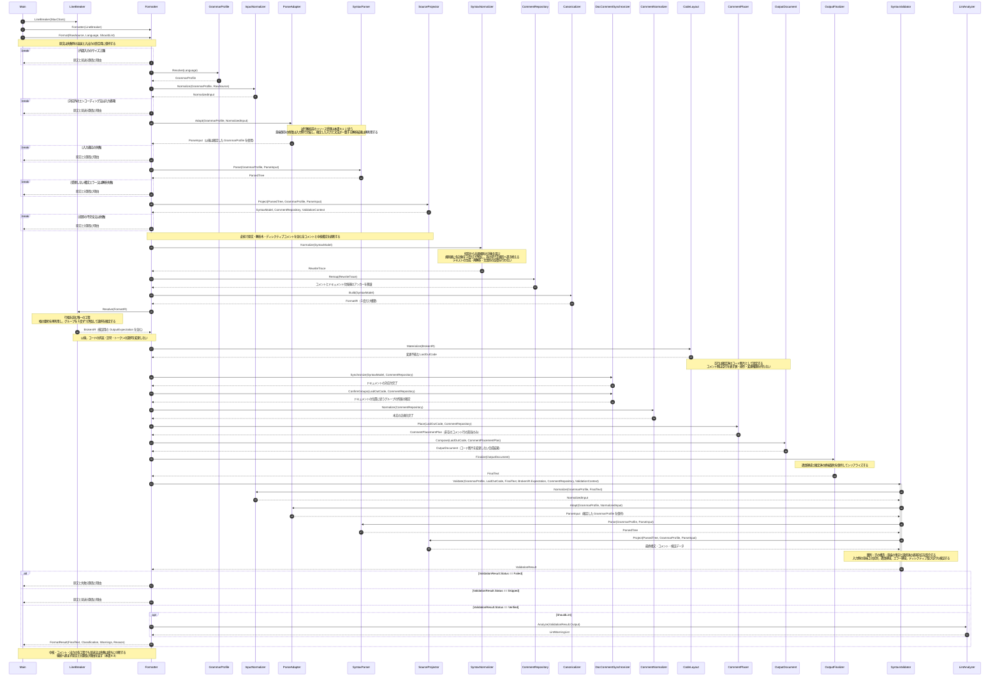

# Shave Format 整形仕様

本書は Shave Format の整形結果，責務境界，処理順序及び外部契約を規定する．構文の状態を `SyntaxModel`，コメントの状態を `CommentRepository` に分離し，宣言的な整形中間表現を経て出力する設計を採る．本書は実装の到達状況を示す物ではない．同じ構文上の役割には同じ適用条件を用い，未実装である事を言語全体の書式免除へ置き換えない．

表記及び整形規則は [コーディング規約](../CODING_STANDARDS.md) に従う．本書の節参照は「本書」，コーディング規約の節参照は「規約」と表記する．実装の補助関数名，内部ファイル構成，移行の進捗は本書の規定対象としない．

---

# 目次

- **[第１章 基本契約](#第１章-基本契約)**
	- [1.1 意味の保存と正規形](#11-意味の保存と正規形)
	- [1.2 コメントからの独立](#12-コメントからの独立)
	- [1.3 冪等性](#13-冪等性)
	- [1.4 簡潔性と構造規則](#14-簡潔性と構造規則)
	- [1.5 失敗時の契約](#15-失敗時の契約)
	- [1.6 言語横断の統合](#16-言語横断の統合)
- **[第２章 対象言語](#第２章-対象言語)**
	- [2.1 言語と方言](#21-言語と方言)
	- [2.2 言語の確定](#22-言語の確定)
- **[第３章 構成と情報境界](#第３章-構成と情報境界)**
	- [3.1 責務の分担](#31-責務の分担)
	- [3.2 中核の型](#32-中核の型)
	- [3.3 クラス図](#33-クラス図)
	- [3.4 シーケンス図](#34-シーケンス図)
	- [3.5 公開しては為らない情報](#35-公開しては為らない情報)
- **[第４章 入力受理と構文投影](#第４章-入力受理と構文投影)**
	- [4.1 入力表現と受理](#41-入力表現と受理)
	- [4.2 パーサーへの適応](#42-パーサーへの適応)
	- [4.3 投影の完全性](#43-投影の完全性)
	- [4.4 逐語領域と埋込内容](#44-逐語領域と埋込内容)
	- [4.5 ディレクティブと意味上の制約](#45-ディレクティブと意味上の制約)
	- [4.6 入力エラーと部分整形](#46-入力エラーと部分整形)
- **[第５章 構文正規化](#第５章-構文正規化)**
	- [5.1 変換の共通条件](#51-変換の共通条件)
	- [5.2 トークン・区切・式の正規化](#52-トークン区切式の正規化)
	- [5.3 不変指定と束縛](#53-不変指定と束縛)
	- [5.4 括弧の正規化](#54-括弧の正規化)
	- [5.5 本体と波括弧](#55-本体と波括弧)
	- [5.6 宣言の分離・統合と並替](#56-宣言の分離統合と並替)
	- [5.7 Ruby の構文](#57-ruby-の構文)
- **[第６章 整形中間表現とソース出力](#第６章-整形中間表現とソース出力)**
	- [6.1 `FormatIR` の契約](#61-formatir-の契約)
	- [6.2 トークン間の空白](#62-トークン間の空白)
	- [6.3 構造に依る展開](#63-構造に依る展開)
	- [6.4 行幅に依る選択](#64-行幅に依る選択)
	- [6.5 インデントと空行](#65-インデントと空行)
	- [6.6 PHP / JSX / HTML / CSS の境界](#66-php--jsx--html--css-の境界)
	- [6.7 出力の終端](#67-出力の終端)
- **[第７章 コメント処理](#第７章-コメント処理)**
	- [7.1 分離と所属の確定](#71-分離と所属の確定)
	- [7.2 アンカーの移譲と順序](#72-アンカーの移譲と順序)
	- [7.3 本文の正規化](#73-本文の正規化)
	- [7.4 ドキュメントコメントの同期](#74-ドキュメントコメントの同期)
	- [7.5 ディレクティブの保持](#75-ディレクティブの保持)
	- [7.6 記法・配置・深さ](#76-記法配置深さ)
	- [7.7 差込禁止領域と通常コメントの脱落](#77-差込禁止領域と通常コメントの脱落)
- **[第８章 出力検証と静的解析](#第８章-出力検証と静的解析)**
	- [8.1 独立した出力検証](#81-独立した出力検証)
	- [8.2 部分整形の検証](#82-部分整形の検証)
	- [8.3 結果の分類](#83-結果の分類)
	- [8.4 静的解析](#84-静的解析)
- **[第９章 リソース管理と並列実行](#第９章-リソース管理と並列実行)**
	- [9.1 入出力と解析の上限](#91-入出力と解析の上限)
	- [9.2 中核の処理予算](#92-中核の処理予算)
	- [9.3 パーサー固有の制限](#93-パーサー固有の制限)
	- [9.4 並列化と決定性](#94-並列化と決定性)
- **[第１０章 外部契約](#第１０章-外部契約)**
	- [10.1 呼出とコマンドライン](#101-呼出とコマンドライン)
	- [10.2 パスの収集と安全な書戻](#102-パスの収集と安全な書戻)
	- [10.3 エンコーディングと改行様式](#103-エンコーディングと改行様式)
	- [10.4 終了コードと通知](#104-終了コードと通知)
	- [10.5 検査用の環境変数と拡張機能](#105-検査用の環境変数と拡張機能)
- **[第１１章 受入テストと関連仕様](#第１１章-受入テストと関連仕様)**
	- [11.1 不変条件の検査](#111-不変条件の検査)
	- [11.2 境界のテストケース](#112-境界のテストケース)
	- [11.3 未対応範囲の扱い](#113-未対応範囲の扱い)
	- [11.4 関連仕様](#114-関連仕様)

---

# 第１章 基本契約

## 1.1 意味の保存と正規形

値・型・評価順序と回数・副作用・例外・寿命・束縛・外部契約の保存を最優先とする．変換規則が要求する構文・型・束縛・値域・寿命の事実の何れかを欠く構文には当該変換を適用せず，トークン列・文境界・逐語領域を保持し，意味保存を確認出来る空白・改行の規則だけを適用する．

同じ言語・方言・対象バージョン・行幅に於いて，投影後の構文構造，トークンの値，意味を持つ境界及び空行比較を含む構文事実が同じなら，コメント経路の出力を除くソース本体の出力は一意に定まる．此れは，任意の２つのプログラムの意味同値を証明して同じコードへ変換する要求ではない．

ソース本体の意味を持たない空白・改行・空行・インデントは，投影時に破棄する．コメントの配置用空白は本書 7.1 に従って分離する．Ruby の実引数の読み，Python の構文本体，文を終える改行，HTML の表示される空白等は構文事実へ変換する．リテラル・地の文・埋込データ等の内容は，必要な範囲を逐語保持する（本書 4.4）．

## 1.2 コメントからの独立

コメント経路の通常コメント・ドキュメントコメント・ディレクティブコメントの有無・内容・記法・位置は，ソース本体の構文正規化，折返，インデント及び空行を変更しない．コメントの為に波括弧を残す，行を折る，宣言統合を止める等の判断を禁止する．

空行はソースの構造だけから決め，コメントの復元後も有無・数・構文境界との対応を変えない．ファイル先頭，コメント同士の間及びコメントとコードの間にも例外を設けない．コメント専用の領域，記法又は保護断片へ空行を含めて此の制約を回避しては為らない．

ソースの構文と確定済の配置は，コメントの所属・深さ・ドキュメント化の対象を決める為に参照して良い．依存はソースからコメントへの一方向とし，コメントの配置結果をソース工程へ戻さない．

ディレクティブの対応範囲と根拠は本書 4.5 に定める．ディレクティブコメントはコメント経路で本文・記法・適用対象・有効性を保持し，其の為にソース本体の整形を変更しない．保持契約を満たさない候補は返さない（本書 7.5, 8.3）．

コメント記法でない標準のディレクティブ・属性・指示文は構文として扱う．実行時に読まれるドキュメント，ドキュメント構造の一部である HTML コメント等は，本書 4.4 のソース側に保持する．コメント内の改行が文を終える場合も，其の文境界はコメント本文ではなく構文事実である．

## 1.3 冪等性

受理した入力を整形した結果は，同じ設定で再整形しても変化しない．部分整形も対象とする．

```text
Format(Format(Source)) == Format(Source)
```

構文正規化は本書 5.1 の規則順に従う１度の適用で固定点に達する．アンカーの移譲，コメントの統合，句読点の正規化及び条件付の記号も，１回の整形で固定点に達する．全体・ローカルを問わず，収束の為の再適用・再評価・再試行を行わない．本書第１１章の再適用テストは，１度目の結果が既に固定点である事を確認する物であり，製品処理の未完了を補わない．

## 1.4 簡潔性と構造規則

規約の構造規則を満たす範囲で冗長な括弧・波括弧・空行を除き，行幅内なら不要な折返を行わない．本体の展開，閉括弧，ラベル，Python のインデント等が要求する改行を，行幅内と云う理由で除かない．

行幅は既定で１２８文字とし，インデント及びコメント経路で出力する通常コメント・ディレクティブコメントを数えない．幅の計数と選択を行うのは `LineBreaker` だけである．意味を保って分割出来ないトークン・領域は分割せず，行幅を超える事だけを理由に整形全体を見送らない（規約 3.3）．

## 1.5 失敗時の契約

正常な入力に対して「整形が難しい」事を通常の見送理由にしない．入力の構文エラー，対応外の言語・エンコーディング・明示した機能，パーサー・リソースの限界と，フォーマッターの不具合を区別する．

失敗した候補を出力・書戻しない．原文を返す場合は，BOM，改行様式及び末尾改行を含む入力のバイト列を保つ．解析不能領域に限る部分整形の候補拒否は本書 8.3 の見送条件に従い，新たな構文破壊・内部の不変条件違反は失敗として報告する（本書 10.4）．

## 1.6 言語横断の統合

整形・検証・静的解析の各工程は，構文の役割・適用条件・選択状態で分岐する全言語共通の処理とする．言語毎の差は `GrammarProfile` の文法・バージョン・トークン規則・投影対応・ドキュメント記法・検証条件の定義で表し，共通工程に言語名・文法名・綴りで分岐する処理を設けない．

言語特有の処理は，其の言語にしか無い構文・意味を扱う物に限る．同じ種類の構文（本体・宣言・式・コメント等）は全言語で同じ役割へ投影し，其の役割の制約・規則・生成形式と経路を共有する．役割の対応の漏れ，又は一部の言語だけに適用する規則に依る挙動の差を，言語特有の処理として許容しない．

---

# 第２章 対象言語

## 2.1 言語と方言

全対象言語を同じ中核アルゴリズムへ通す．文法・トークン・意味上の差は入力側で構文の役割と制約へ投影し，正規化・トークン間空白・グループの構築・行分割・配置の手順を言語毎に複製しない．未実装の構文は本書 11.3 に従う．

| 言語 | 主な拡張子 | 個別の契約 |
|---|---|---|
| C | `.c`, `.h` | 共有ヘッダは本書 2.2 に従う．プリプロセッサディレクティブは１論理行を保つ． |
| C++ | `.cpp`, `.cc`, `.cxx`, `.hpp`, `.hxx` 等 | マクロ，型の解釈，対象バージョンを保つ． |
| C# | `.cs` | 型変換・式・ラムダの読みを区別する． |
| Java | `.java` | トークン化前の Unicode エスケープと定数変数化の影響を扱う． |
| Go | `.go` | 自動セミコロン挿入，末尾カンマ及びコメントに由来するトークン境界を保持する． |
| Rust | `.rs` | マクロのトークン列，可変性を保持する． |
| Kotlin | `.kt`, `.kts` | 文境界，型位置のアノテーション，ラムダの結合を保持する． |
| Swift | `.swift` | 演算子の前置・中置・後置と末尾クロージャを区別する． |
| PHP | `.php`, `.php3`, `.php4`, `.php5`, `.phtml`, `.phps` | 地の文，ヒアドキュメント，ナウドキュメントは逐語保持する． |
| JavaScript | `.js`, `.jsx`, `.mjs`, `.cjs` 等 | JSX を含む．古典スクリプトとモジュールを区別する． |
| TypeScript | `.ts`, `.tsx`, `.cts`, `.mts` | `.tsx` と `typescriptreact` / `tsx` の指定だけを TSX として読む． |
| Ruby | `.rb` 等 | 修飾子，文境界及びヒアドキュメントの開始行を保持する． |
| Python | `.py`, `.pyi` 等 | 本体を構文から再構成し，必要な継続括弧を補う． |
| JSON | `.json`, `.jsonc` 等 | JSONC の通常コメントと許容する末尾カンマを区別する． |
| HTML | `.html`, `.htm` 等 | 属性間等の意味を保つ境界で折る． |
| CSS / SCSS | `.css`, `.scss` | 要素区切・演算等の合法な境界で折る．値・セレクタと両方言のトークン規則を保持する． |

Python の本体は規約 3.3 に従う必須展開とし，１行化の選択肢を作らない．

## 2.2 言語の確定

言語を明示した場合は其の指定を使う．既知の拡張子との不一致はコマンドラインの使用法の誤りとし，ディレクトリ配下のファイルは個別の拡張子で判定する．

言語未確定の `.h` と `--lang h` は C として解析し，C++ で破損が減る場合だけ C++ の文法を選ぶ．C からも利用し得る共有ヘッダでは，C と C++ で同じ意味を持つ変換に限る．`(void)` の除去，`while(true)` 化，整数から真偽値リテラルへの変換を一律に掛けず，C++ 専用の `constexpr` / `static_cast` / `nullptr` の勧めも出さない．`--lang c` を自動で C++ へ変更しない．

Objective-C のヘッダ，Qt Linguist の XML ドキュメントである `.ts` 等は，同じ拡張子の対応言語として整形しない．対象バージョンを指定又はプロジェクトで固定し，整形だけで新しい構文を要求しない．C++ のラムダ，Python のタプル等の省略形にも此の制約を適用する．

---

# 第３章 構成と情報境界

## 3.1 責務の分担

各工程には責務に必要な型だけを渡す．`Formatter` は行幅設定済の `LineBreaker` を受け取り，言語指定から `GrammarProfile` を選ぶ．全言語を同じ工程順へ通し，情報・権限は本書 3.5 に従って分離する．

| クラス | 責務 | 変更出来る対象 |
|---|---|---|
| `Main` | 引数の解釈，入出力，設定済の工程の構築 | 外部入出力の状態 |
| `Formatter` | 工程の順序，成功・見送・失敗の統括 | 呼出内の結果と所有物 |
| `GrammarProfile` | 文法・バージョン・トークン規則・投影対応・ドキュメント記法・検証条件の定義 | 無 |
| `InputNormalizer` | エンコーディング・入力表現の受理と正規化 | 解析前の入力表現 |
| `ParseAdapter` | パーサーの読違に対する意味保存の修復と可逆な保護 | 解析用の入力 |
| `SyntaxParser` | 指定文法に依る構文解析 | 新しい解析結果 |
| `SourceProjector` | 文法上の表現から共通の構文・コメント・検証データへの投影 | 新しい投影結果 |
| `SyntaxModel` | 独自のノード表と構文事実の整合管理 | ノード表のみ |
| `CommentRepository` | コメントとドキュメント化候補の記法・所属・アンカーの管理 | コメント記録とドキュメント化候補 |
| `SyntaxNormalizer` | 構文の役割別の共通規則を規則順に１度ずつ適用する正規化 | `SyntaxModel` |
| `Canonicalizer` | 正規化した構文から幅非依存の中間表現を生成 | 新しい `FormatIR` |
| `LineBreaker` | 行幅に依る選択を全て確定 | 新しい `BrokenIR` |
| `TextMetrics` | トークンの文字数の計数 | 無 |
| `SignatureExtractor` | 関数の名前・仮引数・戻値の構文情報の抽出 | 新しい `Signature` |
| `DocCommentSynchronizer` | 構文上のシグネチャと既存ドキュメントの対応付，確定した配置に従うドキュメントの位置とグループの所属 | `CommentRepository` |
| `CommentNormalizer` | 通常コメント本文の表記の正規化 | `CommentRepository` の本文 |
| `CodeLayout` | 確定済の中間表現へのインデント・空行の具体化 | 新しい `LaidOutCode` |
| `CommentPlacer` | 安全な配置位置へのコメントの割当 | 新しい `CommentPlacementPlan` のみ |
| `OutputDocument` | 変更不能なコードとコメント配置計画の合成 | 新しい合成結果のみ |
| `OutputFinalizer` | 確定済の合成結果と終端契約のシリアライズ | 最終テキストのみ |
| `SyntaxValidator` | 独立した再解析に依る出力・保護領域の検証 | 新しい `ValidationResult` |
| `LintAnalyzer` | 自動変更しない規約違反と要確認の候補の列挙 | 警告列のみ |

言語差の表し方と共通工程の分岐は本書 1.6 に従い，文法固有の読取結果を共通の型へ投影する．共通操作の追加には，其の意味と前提を定義する．

## 3.2 中核の型

### 構文と安定した識別子

`SyntaxModel` は独自の `NodeId`，共通のノード種別，子の順序及び `SyntaxFacts` を持つノード表である．`Lexeme` はトークンの葉と逐語領域に限り，通常の親ノードの原文全体を保存しない．

`SyntaxKind` は構文の役割と子の構造で分ける．同じ構造の意味・条件の差は `SyntaxFacts`，出力表現の差は `CanonicalFormList` で表す．種別は既存の役割・子の構造で表せない場合だけ追加し，言語名・パーサーのノード名・綴り・子の個数だけで分けない．

`NodeId` は同じ整形呼出の中で移動・並替に依って変えない．原文のバイト位置，コメントの数，作業スレッドの実行順を識別の根拠にしない．別の整形呼出で同じ数値を割り当てる事は要求しない．

`RewriteTrace` はノードの統合・除去・分割に伴う先行・末尾・内部のアンカーの移譲を記録する．`CommentRepository` が本書 7.2 に従って適用する．

ノード表は親・子・兄弟・構文順・役割別のインデックスを持ち，束縛・参照・書込・型・制御移動の事実を必要時に求める．インデックスは本書 5.1 に従って書換と共に更新し，全文文字列や解析木を再構築しない．

`SyntaxFacts` は次の情報を，該当する構文に限って持つ．固定の定義は変更不能な値として共有し，可変な事実は書換と共に更新する．

| 情報 | 内容 |
|---|---|
| トークン | 値・型・基数・精度・符号・エンコーディング・補間と，等価な綴りの成立条件 |
| 演算と束縛 | 演算の役割，結合，評価順，値の使用，名前の導入・参照・変更，捕捉と受手の束縛，構築呼出の可否及び型に関する確認済の事実 |
| 宣言 | 全体で共有する指定，宣言子毎の指定，束縛の開始，初期化の単位，分離・併記の成立条件及び空行比較の値 |
| 本体 | 文の所有者，文数，値・脱出先・寿命への影響，ラッパーと同行形の可否 |
| 境界 | 文終端，トークンの融合，必須空白，密着，改行禁止及び逐語内容の保持条件 |
| 記述条件 | 規約が構文の役割へ定める名前の形，指定子の順序及び必須項目 |
| 生成形式 | 使用出来る共通変換，部品の対応，固定トークン，必須・省略可能・条件付のラッパーと区切 |

`CanonicalFormList` の各要素は，共通操作の識別子，適用条件，子の役割の対応及び固定トークン又はトークン生成の定義値を持つ．基数・区切・接頭辞・接尾辞・エスケープの定義値は投影時に共通操作へ対応付ける．任意の処理は保持せず，トークンの生成は本書 5.2 に従う．

規約 3.4 の構造種別は，対象言語・方言・バージョンに対応する tree-sitter 文法で，宣言・ディレクティブ全体を表す公開ノード型に対応付ける．空行比較の値は其の同異だけを表し，入力側でパーサーの識別子とは独立した等値比較専用の値へ投影する．宣言子・型注釈・初期化子等の子の型では区別せず，同じ `SyntaxKind` へ投影する異なるノード型を同値にしない．生成・分離・統合した宣言には，採用する生成形式に対応する値を用い，元のノード型を機械的に引き継がない．共通工程へ型名・文法の識別子・逆引手段を渡さず，特定値との照合に依る言語別・ノード型別の処理分岐を設けない．

### 意味を持つ境界

`LexicalBoundary` は前後のトークンを別のトークンとして保つ条件，`StatementBoundary` は意味上の文境界を表す．

例えば Ruby の `f (x)` と `f(x)` は，単に空白の有無を保存するのでなく，解析した呼出形式と必要な境界を保持する．Go / Kotlin / Swift の文を終える改行は `StatementBoundary` へ変換する．

### コメント

`NotationRules` は使用可能な記法，入力のドキュメント形式，役割・種別毎の採用記法と出力ドキュメント形式を持つ変更不能な定義であり，共通の説明項目・タグの語彙を参照する．行コメントの登録定義から，記法・本文・位置の判定に必要な条件だけを投影し，`OutputForms` の成立条件として共有する（本書 3.5, 4.5）．ドキュメント形式は囲記号だけで識別しない．

`SourceProjector` は，既存コメントの `Format` に記法定義と入力のドキュメント形式，入力時のグループの所属，行末コメントの前置区切のタブ数 `LeadingTabCount`，先頭論理行の密着及び囲み内の改行条件を記録する．ドキュメント化対象の定義にはコメントの有無に依らず `DocumentationSite` を作り，定義のアンカーと記法定義を `CommentRepository` に保持する．既存記録とドキュメント化候補は同じ定義値を共有し，記録毎の書式を別表へ重複保持しない．アンカーは本書 7.2 に従って移譲する．

`CommentRecord` は `NodeId` のアンカー，原文の順，`Notation`，`Format`，役割，種別，所属及び本文 `Text` を持つ．`Text` は開始・終端記号と区切空白を含めず，値を構成する空白を保持する．定型ディレクティブ記法の開始記号は名前迄を含む１つの値とし，名前を本文へ分けない．

登録済のディレクティブ記法には `DirectiveInfo` を付ける．`Definition` は登録定義，`Conditions` は成立・保持条件と値を表す．適用対象は記録のアンカー・所属と記法が表し（外側のドキュメントは後の項目，内側のドキュメントは囲む項目），同じ事実を別のフィールドへ重ねて持たない．適用対象の検証は本書 8.1 の構文・境界対応に従う．`DirectiveState` は `Active`（成立）又は `Inactive`（不成立）であり，ビルド条件式の真偽とは異なる．無効な位置の記法も記録し，原文の所有者・任意の処理への参照を持たせず，中核へ渡さない．

| 区分 | 値 | 意味 |
|---|---|---|
| `CommentKind` | `OwnLine`, `Trailing`, `Inline` | 独立・行末・文中の３種別． |
| `CommentPlacement` | `Before`, `After`, `Inside` | アンカーとの関係． |
| `CommentRole` | `Presentation`, `Directive` | 通常の説明か，本書 4.5 の対応記法として有効性を含めて保持するディレクティブコメントか． |
| `CommentNotation` | 次表の２６値 | コメントの開始・終端を表す記法．種別・所属・役割とは独立して記録する． |

ドキュメント生成だけに用いる説明は，ドキュメントの構造を保持して正規化する `Presentation` とする．ドキュメント形式をツールが読む事だけで全説明をディレクティブに分類しない．

`CommentNotation` は次表の開始・終端記号を表す列挙型で，１記録に１値を持つ．識別した開始記号は分割しない．ドキュメント化の対象・ディレクティブの役割・有効性は別に判定する．

| 値 | 対応する記法 | 記録上の区別 |
|---|---|---|
| `SlashLine` | `//` | 一般の行コメント |
| `TripleSlashLine` | `///` | C / C++ の Doxygen，C# / Java / Rust / Swift のドキュメント，TypeScript のディレクティブ（其の他の言語では `SlashLine` とする） |
| `SlashBangLine` | `//!` | C / C++ の Doxygen 及び Rust の内側のドキュメント |
| `GoBuildLine` | `//go:build` | Go のビルド制約 |
| `GoDebugLine` | `//go:debug` | Go の `GODEBUG` の設定 |
| `GoEmbedLine` | `//go:embed` | Go のファイルの埋込 |
| `GoGenerateLine` | `//go:generate` | Go のコード生成 |
| `GoLinknameLine` | `//go:linkname` | Go のシンボル名の対応付 |
| `GoNoescapeLine` | `//go:noescape` | Go の関数へのディレクティブ |
| `GoNoinlineLine` | `//go:noinline` | Go の関数へのディレクティブ |
| `GoNoraceLine` | `//go:norace` | Go の関数へのディレクティブ |
| `GoNosplitLine` | `//go:nosplit` | Go の関数へのディレクティブ |
| `GoUintptrescapesLine` | `//go:uintptrescapes` | Go の関数へのディレクティブ |
| `GoWasmexportLine` | `//go:wasmexport` | Go の関数へのディレクティブ |
| `GoWasmimportLine` | `//go:wasmimport` | Go の関数へのディレクティブ |
| `GoLineLine` | `//line` | Go の行形式の位置ディレクティブ |
| `GoLineBlock` | `/*line` … `*/` | Go の囲形式の位置ディレクティブ |
| `CgoExportLine` | `//export` | `cgo` の公開名 |
| `GccgoExternLine` | `//extern` | `gccgo` の外部名 |
| `HashLine` | `#` | 一般の行コメント．エンコーディング・マジックコメント等の役割は別に記録する． |
| `HashBangLine` | `#!` | 対象言語・バージョンの標準記法として識別した `#!`．開始位置を保ち，`#` と `!` の間を分断しない． |
| `HashColonLine` | `#:` | 入力に在る `#:` の記法．此の値だけでディレクティブの役割又は特別な出力記法を与えない． |
| `Block` | `/* ... */` | 一般のブロックコメント．独立・行末・文中の種別を，此の値だけで決めない． |
| `DoubleStarBlock` | `/** ... */` | ドキュメントの囲みを持つ言語（Go / CSS を除く）の専用記法． |
| `StarBangBlock` | `/*! ... */` | C / C++ の Doxygen，Rust の内側のドキュメント及び SCSS の配信物へ残すコメント． |
| `RubyEmbeddedDocument` | 行頭の `=begin` から行頭の `=end` 迄 | Ruby の埋込ドキュメント．本書 4.2 のデコード後の記法と，開始・終端の行条件を保持する． |

`Notation` は入力で識別した記法を記録し，本文正規化では変更しない．識別は本書 4.3，ディレクティブの登録範囲は本書 4.5，出力記法の選択と合成は本書 7.6 に従う．

Python のドキュメンテーション文字列，HTML コメント及び逐語保護したエラー領域は本書 4.4, 4.6 のソース側に残す．JSX の `{/* ... */}` は外側の `{}` を構文，内部の通常コメントを `Block` として扱う（本書 6.6, 7.1）．

### 中間表現と出力

`FormatIR` はトークン・必須境界・選択可能な折返・インデントの範囲・アンカー・逐語領域を持つ宣言的な表現である．`Group` と `IfBroken` が平坦形と展開形の選択を表し，`LineBreaker` が全ての選択を解決した結果を `BrokenIR` とする．

`LaidOutCode` は `CodeLayout` だけが構築する変更不能なコード出力であり，断片，終端契約及び `AnchorPositionMap` を持つ．位置表はノードの前後，区切トークンの前，行毎の深さ，安全な行末及び差込禁止領域を示す．コメントを置ける零幅の位置には `CommentSlotId` を与える．空行其の物は配置枠にせず，前後の構文境界に結び付いた断片として固定する．元のバイト位置を持たない．

`CommentPlacementPlan` は `CommentInsertion` の列であり，各要素は `CommentSlotId` と `CommentBlock` だけを持つ．配置枠の所属する `LaidOutCode` も識別する．コードの置換範囲，削除命令，空行の要求，任意の出力断片又はコードの所有者への変更可能な参照を持たない．`CommentPlacer` は此の計画だけを返し，完成テキスト又は書換済のコードを返さない．

`CommentBlock` は確定した記法に従うコメント行の列とし，本書 7.6 の前置区切も含む．各物理行はコメントの本文又は記号を含み，空行を要素として持たない．ドキュメントの概要を記述する為の空の論理行（本書 7.3）は，記法が許すコメント記号・継続記号で表す．ディレクティブコメントを含め同じ型を用い，区切空行を含む任意の文字列を代用しない．種別・所属・順序・合法な記法の条件も構築時に満たす．保持契約を満たす値を構築出来ない場合の扱いは本書 7.7, 8.3 に従う．

`OutputDocument::Compose` は，変更不能な `LaidOutCode` と `CommentPlacementPlan` だけを受け取る．コードの全断片を元の順に１回ずつ参照し，指定した配置枠へコメントだけを挿入する並びを定める．本文を連結した中間文字列は作らず，テキストへのシリアライズは `OutputFinalizer` だけが行う．独立したコメント行を終える改行は含めるが，空の物理行を生む余分な改行は含めない．空行の断片を追加・削除・移動又は上書する操作，完成テキストを直接受け取るコンストラクタ及びディレクティブ別の合成経路を設けない．

`OutputDocument` は変更不能な合成結果であり，生成部分・逐語部分の区別と終端契約を引き継ぐ．シリアライズは本書 6.7 に従う．

### 検証結果

`ValidationContext::SemanticChecks` は，入力の解析木で確認した意味上の区別，構文対応及び検証条件の列である．検証に必要な区別だけを保持し，入力の解析木や構文事実全体を複写しない．照合は本書 8.1 に従う．

`ValidationResult` は次表の `ValidationStatus` を持ち，`Verified` の場合だけ `Output` に `ValidatedOutput` を保持する．其の他は出力を持たず `FailureReason` を必須とし，原文の返戻は `Formatter` が行う．理由名だけで状態を判定しない．

| 状態 | 条件 | 後続 |
|---|---|---|
| `Verified` | 完成候補の全検証に成功した． | 必要な静的解析を行い，検証済の候補を返す． |
| `Skipped` | 本書 8.3 の見送条件に該当する． | 原文と理由を返し，静的解析・書戻へ進まない． |
| `Failed` | 本書 8.3 の失敗条件に該当する． | 原文と失敗理由を返す． |

## 3.3 クラス図

図のメソッドは責務境界を示す契約である．読取専用の引数は実装でも変更不能な参照又は値として渡す．`ProjectionResult` は呼出側が所有物を受け取る為の結果であり，中核工程へ結果全体を渡さない．

```mermaid
classDiagram
	direction LR
	class Main {
		+Run(Arguments) int
	}
	class Formatter {
		-Breaker : LineBreaker
		+Format(RawSource, Language, ShouldLint) FormatResult
	}
	class GrammarProfile {
		+Resolve(Language) GrammarProfile
	}
	class InputNormalizer {
		+Normalize(GrammarProfile, RawSource) NormalizedInput
	}
	class ParseAdapter {
		+Adapt(GrammarProfile, NormalizedInput) ParseInput
		+DecodeLexeme(ParsedTree, Text, Start) string
	}
	class SyntaxParser {
		+Parse(GrammarProfile, ParseInput) ParsedTree
	}
	class SourceProjector {
		+Project(ParsedTree, GrammarProfile, ParseInput) ProjectionResult
	}
	class ProjectionResult {
		+Syntax : SyntaxModel
		+Comments : CommentRepository
		+Validation : ValidationContext
	}
	class SyntaxModel {
		-Nodes : SyntaxNodeTable
		-Root : NodeId
		+GetRoot() NodeId
		+GetNode(NodeId) SyntaxNode
		+Apply(RewritePlan) RewriteTrace
	}
	class SyntaxNode {
		+Id : NodeId
		+Kind : SyntaxKind
		+Lexeme : string
		+Facts : SyntaxFacts
		+Children : NodeIdList
	}
	class SyntaxFacts {
		+Boundaries : SemanticBoundaryList
		+Constraints : SemanticConstraintList
		+Forms : CanonicalFormList
	}
	class CommentRepository {
		-Records : CommentRecordList
		-DocumentationSites : DocumentationSiteList
		+Get(NodeId) CommentRecordList
		+GetDocumentationSites() ReadOnlyDocumentationSiteView
		+Update(CommentRecordList) void
		+Remap(RewriteTrace) void
	}
	class DocumentationSite {
		+Anchor : NodeId
		+Rules : NotationRules
	}
	class CommentFormat {
		+Rules : NotationRules
		+InputDocument : optional~DocumentFormId~
		+Group : CommentGroupId
		+LeadingTabCount : size_t
		+ShouldAttachFirstLine : bool
		+ShouldSeparateLogicalLines : bool
	}
	class NotationRules {
		<<immutable>>
		+AvailableNotations : CommentNotationList
		+DocumentForms : DocumentFormList
		+OutputForms : CommentOutputFormList
	}
	class CommentRecord {
		+Anchor : NodeId
		+Text : string
		+Kind : CommentKind
		+Placement : CommentPlacement
		+Role : CommentRole
		+OriginalOrder : size_t
		+Notation : CommentNotation
		+Format : CommentFormat
		+Directive : optional~DirectiveInfo~
	}
	class DirectiveInfo {
		+Definition : DirectiveDefinitionId
		+State : DirectiveState
		+Conditions : DirectiveConditionList
	}
	class DirectiveState {
		<<enumeration>>
		Active
		Inactive
	}
	class SyntaxNormalizer {
		+Normalize(SyntaxModel) RewriteTrace
	}
	class RewriteTrace {
		+Transfers : AnchorTransferList
	}
	class Canonicalizer {
		+Build(SyntaxModel) FormatIR
	}
	class FormatIR {
		+Root : FormatItem
		+NormalizedSyntax : SyntaxModel
	}
	class FormatItem {
		+Kind : FormatItemKind
		+Children : FormatItemList
	}
	class LineBreaker {
		-MaxChars : const size_t
		+Resolve(FormatIR) BrokenIR
		+LineBreaker(MaxChars)
	}
	class TextMetrics {
		+CountCharacters(Text) size_t
	}
	class BrokenIR {
		+Items : ResolvedFormatItemList
		+Expectation : OutputExpectation
	}
	class OutputExpectation {
		+NormalizedSyntax : SyntaxModel
		+SelectedForms : SelectedFormList
		+DeclarationPartitions : DeclarationPartitionList
	}
	class SignatureExtractor {
		+Extract(SyntaxModel, NodeId) Signature
	}
	class DocCommentSynchronizer {
		+Synchronize(SyntaxModel, CommentRepository) void
		+ConfirmGroups(LaidOutCode, CommentRepository) void
	}
	class CommentNormalizer {
		+Inspect(ReadOnlyCommentView) CommentStructure
		+Normalize(CommentRepository) void
	}
	class CodeLayout {
		+Materialize(BrokenIR) LaidOutCode
	}
	class LaidOutCode {
		-Fragments : OutputFragmentList
		-Anchors : AnchorPositionMap
		-Ending : EndingContract
		+GetFragments() ReadOnlyFragmentView
		+GetSlots() ReadOnlyCommentSlotView
	}
	class CommentPlacer {
		+Place(LaidOutCode, CommentRepository) CommentPlacementPlan
	}
	class CommentPlacementPlan {
		-Insertions : CommentInsertionList
	}
	class CommentInsertion {
		-Slot : CommentSlotId
		-Comment : CommentBlock
	}
	class CommentBlock {
		-Lines : CommentLineList
	}
	class OutputDocument {
		-Code : LaidOutCode
		-Comments : CommentPlacementPlan
		+Compose(LaidOutCode, CommentPlacementPlan) OutputDocument
	}
	class OutputFinalizer {
		+Finalize(OutputDocument) string
	}
	class ValidationContext {
		+ErrorZones : ErrorZoneSet
		+ProtectedRegions : ProtectedRegionSet
		+SemanticChecks : SemanticCheckList
		+InputDiagnostics : DiagnosticList
	}
	class SyntaxValidator {
		+Validate(GrammarProfile, LaidOutCode, Text, OutputExpectation, CommentRepository, ValidationContext) ValidationResult
	}
	class ValidationStatus {
		<<enumeration>>
		Verified
		Skipped
		Failed
	}
	class ValidatedOutput {
		+FinalSyntax : SyntaxModel
		+FinalComments : CommentRepository
		+Locations : DiagnosticLocationMap
	}
	class ValidationResult {
		+Status : ValidationStatus
		+Output : optional~ValidatedOutput~
		+Reason : FailureReason
	}
	class LintAnalyzer {
		+Analyze(ValidatedOutput) LintWarningList
	}
	class FormatResult {
		+Text : string
		+Classification : FormatClassification
		+Warnings : LintWarningList
		+Reason : FailureReason
	}
	Main --> LineBreaker : 行幅で構築
	Main --> Formatter : 設定済の工程を注入
	Formatter --> GrammarProfile : 定義の選択のみ
	InputNormalizer ..> GrammarProfile
	ParseAdapter ..> GrammarProfile
	SyntaxParser ..> GrammarProfile
	SourceProjector ..> GrammarProfile
	SyntaxValidator ..> GrammarProfile
	Formatter --> InputNormalizer
	Formatter --> ParseAdapter
	Formatter --> SyntaxParser
	Formatter --> SourceProjector
	Formatter --> SyntaxNormalizer
	Formatter --> Canonicalizer
	Formatter --> LineBreaker
	Formatter --> DocCommentSynchronizer
	Formatter --> CommentNormalizer
	Formatter --> CodeLayout
	Formatter --> CommentPlacer
	Formatter --> OutputDocument
	Formatter --> OutputFinalizer
	Formatter --> SyntaxValidator
	Formatter --> LintAnalyzer
	Formatter --> FormatResult
	ParseAdapter ..> SyntaxParser : 修復に必要な試行解析のみ
	SourceProjector --> ProjectionResult
	ProjectionResult *-- SyntaxModel
	ProjectionResult *-- CommentRepository
	ProjectionResult *-- ValidationContext
	SyntaxModel *-- SyntaxNode
	SyntaxNode *-- SyntaxFacts
	CommentRepository *-- CommentRecord
	CommentRepository *-- DocumentationSite
	CommentRecord *-- CommentFormat
	CommentFormat --> NotationRules : 変更不能な定義を共有
	DocumentationSite --> NotationRules : 変更不能な定義を共有
	CommentRecord "1" *-- "0..1" DirectiveInfo
	DirectiveInfo --> DirectiveState
	SyntaxNormalizer ..> SyntaxModel
	SyntaxNormalizer --> RewriteTrace
	CommentRepository ..> RewriteTrace
	Canonicalizer ..> SyntaxModel
	Canonicalizer ..> SignatureExtractor : 読取専用のドキュメント化対象の判定
	Canonicalizer --> FormatIR
	FormatIR *-- FormatItem
	FormatIR ..> SyntaxModel : 読取専用の期待構文
	LineBreaker ..> FormatIR
	LineBreaker ..> TextMetrics
	LineBreaker --> BrokenIR
	BrokenIR *-- OutputExpectation
	SyntaxValidator ..> OutputExpectation
	SyntaxValidator ..> LaidOutCode : 変更不能な照合基準
	DocCommentSynchronizer ..> SignatureExtractor
	SignatureExtractor ..> SyntaxModel
	DocCommentSynchronizer ..> SyntaxModel
	DocCommentSynchronizer ..> CommentRepository
	DocCommentSynchronizer ..> LaidOutCode : ドキュメントの位置の読取
	CommentNormalizer ..> CommentRepository
	SourceProjector ..> CommentNormalizer : 読取専用の本文構造判定
	DocCommentSynchronizer ..> CommentNormalizer : 読取専用の本文構造判定
	CommentPlacer ..> CommentNormalizer : 読取専用の本文構造判定
	LintAnalyzer ..> CommentNormalizer : 読取専用の本文構造判定
	LintAnalyzer ..> SignatureExtractor : 読取専用のシグネチャ
	CodeLayout ..> BrokenIR
	CodeLayout --> LaidOutCode
	CommentPlacer ..> LaidOutCode
	CommentPlacer ..> CommentRepository
	CommentPlacer --> CommentPlacementPlan
	CommentPlacementPlan *-- CommentInsertion
	CommentInsertion *-- CommentBlock
	OutputDocument ..> LaidOutCode : 変更不能な出力を共有
	OutputDocument ..> CommentPlacementPlan : コメントだけを挿入
	OutputFinalizer ..> OutputDocument
	SyntaxValidator ..> ValidationContext
	SyntaxValidator ..> InputNormalizer
	SyntaxValidator ..> ParseAdapter
	SyntaxValidator ..> SyntaxParser
	SyntaxValidator ..> SourceProjector
	SyntaxValidator ..> CommentNormalizer : 変換したドキュメントの本文の照合
	SyntaxValidator ..> CommentRepository : 読取専用の期待コメント
	SyntaxValidator --> ValidationResult
	ValidationResult --> ValidationStatus
	ValidationResult "1" *-- "0..1" ValidatedOutput
	LintAnalyzer ..> ValidatedOutput
```



`CommentNormalizer::Inspect` は，コメントグループとコード例の範囲を判定する．`ReadOnlyCommentView` は記法とドキュメント形式及び其の定義，本文，記録の順序と所属だけを公開し，`CommentStructure` は変更不能な判定結果とする．投影・同期・配置・検証・静的解析は，同じ記法・ドキュメント形式と其の定義・本文・順序・所属に対する１つの `CommentStructure` を共有し，呼出毎に `Inspect` を実行しない．本文の書換は `Normalize` に分離し，変更に影響される構造だけを更新する．完成候補の構造は本書 8.1 に従って独立に求める．ドキュメントの認識・配置，トークン境界及び構文変換の条件も，各工程に許された値だけを読む共通判定として共有し，入力適応・同期・構文正規化・中間表現生成とは分離する．

`MaxChars` は構築後不変とし，取得用・変更用の公開メソッドを設けない．クラス図で省略した `NodeId`，`Signature`，各列及び列挙型は値型であり，原文やコメントの所有者へ遡る参照を持たない．

## 3.4 シーケンス図

解析前の失敗は後続工程へ渡さない．図中の構文正規化以降では再解析せず，最終検証で初めて完成テキストを新しく解析する．パーサー対策の為の試行解析は `ParseAdapter` の内部に限る．



## 3.5 公開しては為らない情報

次表の全工程に，言語識別，`GrammarProfile` 及びパーサー固有の情報（ノード名・識別子・`TSNode` 等）を公開しない．引数・保有状態・共有定義・キャッシュを介する間接取得も禁止する．言語名を真偽値・別名・処理関数表へ置き換えず，本書 3.2 の投影済の事実と記法の定義を用いる．

| 受取側 | 公開しない物 |
|---|---|
| `SyntaxNormalizer`, `Canonicalizer`, `SignatureExtractor` | 原文，原文の位置，コメント本文・元配置，行幅 |
| `LineBreaker` | 原文，コメントの状態，元のインデント，最終コメント配置 |
| `CodeLayout` | 原文，コメントの状態，行幅，未解決の折返候補 |
| `DocCommentSynchronizer`, `CommentNormalizer` | 構文を変更する権限，行幅 |
| `CommentPlacer` | 構文・コード断片・空行を変更する権限，行幅，元のテキストから配置を推測する API，任意の出力断片を作る API |
| `OutputDocument` | コード・空行の変更権限，行幅，未確定の配置，任意の断片を追加する API |
| `OutputFinalizer` | 構文変換，折返選択，行幅，空行の増減・移動，コメントの内容に依る分岐，解析用のマーカーの復元と云う後付の処理 |
| `LintAnalyzer` | 出力又は構文を変更する権限 |

入力の診断位置と保護原文を持つ `ValidationContext` は中核へ渡さない．情報境界は型と権限で保証し，事後検証で代用しない．

---

# 第４章 入力受理と構文投影

## 4.1 入力表現と受理

`InputNormalizer` は入力を受理出来るかを判定し，言語・エンコーディング・BOM・改行様式の情報を分ける．外部入力のサイズ上限は呼出側が受理境界で検査する．パーサーのリソース上限は本書第９章に従う．

解析用に生成するコード部分の改行は LF とする．改行の置換はトークンの外側に限り，リテラル・地の文・埋込データの内部の改行は値の内容として保持する．保護範囲の確定に言語の走査が必要な場合は `ParseAdapter` が行う．BOM と元の改行様式は入力受理・診断用とし，正常出力へ戻す設定にしない．出力は本書 10.3 の共通契約に従う．

単独の CR，及び C# の U+0085 / U+2028 / U+2029 等は，其の言語が行境界として読む位置だけを正規化する．文字列・生文字列・ブロックコメントの内容と，Go / Rust / PHP / Ruby の単独の CR を一律に行境界へ読み替えない．NUL は全言語一律の禁止とせず，使用文法が受理するかで判定する．

## 4.2 パーサーへの適応

`ParseAdapter` の修復は，言語処理系の読みをパーサーへ伝える為の物に限る．書式の好みで括弧・空白・コメントを整える工程ではない．可逆な保護のマーカーは原文と衝突しない様に管理し，投影時に本来のトークンへデコードする．`DecodeLexeme` は，分離したコメントを除いた `Text` と原文上の開始位置 `Start` を受け，解析結果のマーカーとデコードデータから本来のトークンを返す．除去・結合で不連続に為った断片もマーカー又はデコードデータで対応付け，`Start` からの加算だけで元位置を推定しない．中核のトークン，幅の計数，最終出力へ解析用のマーカーを残さない．

試行解析が必要な修復は入力側で完結させる．修復前の診断と保護対象を控え，修復自身に因るトークンの喪失・構文変更を検出する．

`ParseInput` は入力側で確定した `GrammarProfile` を保持する．共有ヘッダ等で文法を選び直した場合は，其の定義を以後の解析・投影・最終検証へ引き継ぎ，最初の指定と混用しない．

確定した入力の世代と文法・バージョンが一致する試行解析の結果は再利用する．`SyntaxParser` は有効な結果が在る場合に同じ入力を解析し直さず，入力又は文法が変わった場合だけ再解析する．最終検証の解析結果は，完成出力から別に得る（本書 8.1）．

| 対象 | 入力側で確定する内容 | 保持条件 |
|---|---|---|
| C / C++ | トークン化前のバックスラッシュと改行の連結 | 行コメントへ取り込まれる後続行も同じ意味で連結する．生文字列内の取消規則とコメント本文の保持を区別する． |
| C / C++ | プリプロセッサディレクティブ，関数形式マクロ，ディレクティブ本文内の引用符・コメント | `#` は行の所定位置に在る物だけをディレクティブとする．マクロ名と `(` の密着の有無を構文事実へ変換する． |
| C / C++ | リテラル内の `/*`，ディレクティブの途中のブロックコメント | 無 |
| C / C++ | 条件コンパイルに分かれたリンケージ指定の `{` と `}` | 対を成す構造の保護に限る．リンケージと条件の対応を保持する． |
| C++ | 型引数を持つ型の宣言を比較の式文と読む誤り | 型名・テンプレート名の束縛と対象バージョンの曖昧性解消規則から，文全体が宣言と確定する場合だけ修復する．比較結果の未使用だけを根拠にせず，呼出・多重定義演算を含む式と未確定の名前を宣言へ読み替えない． |
| C# | 名前の括弧をキャストと読む誤り，実引数の積を宣言と読む誤り | `(d) - a` と型変換を区別し，ジェネリック型・エイリアス修飾等の判別不能な形を推測で変えない． |
| C# | 修飾子付の暗黙型ラムダで構文木に現れない括弧 | 省かれたトークンを復元してから中核へ投影する． |
| Java | トークン化前の `\uXXXX` の展開と，繰り返した `u` を含むエスケープの解釈 | コード・引用符・コメントの境界を変えるエスケープは展開後の構造で読む．境界を変えないリテラル内のエスケープは値を保つ．桁不足と，コード内の対を成さないサロゲートは受理しない． |
| Kotlin | コメントを呑み込む自動セミコロンの読み，型本体末尾，改行後の呼出・添字・参照 | 文境界と継続を確定し，コメント・`else` 等のトークンが解析木から消えた結果を其の儘投影しない． |
| Swift | 演算子と密着したコメント，`?` / `!` の前置・中置・後置，見出の末尾クロージャ | 空白の意味を演算子の役割へ変換する．`x!=y` 等を通常の比較と決め付けない．既知の誤読だけを修復する． |
| JavaScript / TypeScript | `let`，`await`，クラスの修飾語の前後の文境界 | 非同期関数・モジュール内の `await` と識別子を区別する．`static` / `get` / `set` と，改行で別のフィールドに為る形を区別する． |
| JSX / HTML | コメント・文字参照・本文・空の式の境界 | 本文を先に意味付し，コメントの分離に依って隣の本文を結合しない． |
| Ruby | 行頭の `=begin` から行頭の `=end` 迄の埋込ドキュメント | 本文途中の `=end` で早く閉じない．保護のマーカーはドキュメント本文からデコードする． |
| Ruby | 括弧無の実引数，符号，正規表現，修飾子と文境界 | 無 |
| CSS / SCSS | 文字列内のエスケープしたバックスラッシュ，引用符の無い `url()` | 無 |
| SCSS | 宣言の値の中の補間 `#{…}`（引用符の無い `url()` の中の物を含む） | 宣言の終端で確定した値の中の補間だけを，囲み又は前後に密着した語として可逆に保護し，補間の中身と前後の密着を保つ．セレクタ・コメントの本文の補間は対象としない． |

C / C++ のプリプロセッサディレクティブは，連結後の１論理行として扱う．マクロの仮引数は名前・カンマ・`...` の構造として扱い，本文の文字列化・トークン連結の制約を別に保持する．行末に改行の無い入力の扱いも，言語の翻訳段階の規則に従う．

## 4.3 投影の完全性

`GrammarProfile` の対応は文法・バージョン毎に検証し，ノード名・子の役割をパーサーの識別子へ１度対応付ける．`SourceProjector` は此の定義から，共通のノード種別・構文事実・コメント・検証データを同じ走査で構築する．

意味の異なる構文を，種別・子の構造・意味の事実が全て同じ表現へ投影しては為らない．必要な差を表せない場合は投影失敗とする（本書 8.3）．

`SourceProjector` は，パーサーの名前付ノードだけでなく，意味を持つ無名のトークンも対象にする．全ての入力範囲を，構文のトークン，意味を持つ境界，通常コメント，ディレクティブ，逐語領域又は捨てて良い空白へ分類する．

コメントは開始記号・区切・本文・終端記号を識別し，本書 3.2 の `Notation` と `Text` へ投影する．ディレクティブ記法は本書 4.5 の登録定義，ドキュメント記法は対象言語・バージョンのドキュメント形式の定義の開始記号・定型名と，其の直後に定義が許すトークン境界が一致する物とする．規約の採用形式と異なる行形式も，ドキュメントとして認識する．未登録名や一般の説明は通常の記号と本文へ分け，境界を定める事実が無い場合は本書 8.3 の投影失敗とする．

構文木の子の間に残るトークン，幅０のコメント，エラー回復で消えた `else`，文字列として誤読された後続コード等は入力側で検出する．既知の適応で正しい構造を取得出来なければ，誤った `SyntaxModel` を作らず投影失敗として報告する．

原文の空白を参照出来るのは此処迄である．文字列への参照を残す場合も，其の参照先は独立して所有したトークン又は逐語領域に限り，前後の原文を読める範囲や所有者への参照を公開しない．

## 4.4 逐語領域と埋込内容

逐語領域は，テキストが値・出力・トークン照合の対象と為る範囲，又は本節・本書 4.6 で保持を認めた埋込内容・エラー領域に限る．

| 領域 | 保持する物 | 周囲の処理 |
|---|---|---|
| 文字列・生文字列・正規表現・区切文字付リテラル | 内容，エスケープ，意味を持つ空白と改行 | 安全な引用符の変更は本書 5.2 に限る．補間の式と文字列本体は区別する． |
| 許容したエラー領域 | エラー本体と保持に必要な前後の境界 | 本書 4.6 に従う． |
| C / C++ の文字列化するマクロの実引数 | 実引数のトークンと，トークン間の空白の有無 | 同じファイルのマクロ定義で文字列化される仮引数に束縛される実引数と，標準の `assert` の対象を保護する．文字列化では空白の量・改行が１個の空白に為り，コメントも１個の空白に置き換わる（翻訳段階３）為，空白の量・改行は保持せず，コメントはコメント経路へ分離する． |
| Rust の未展開マクロのトークン列 | 照合に使うトークン・区切，隣接する記号同士の密着 | 末尾カンマや括弧を通常の式と同じ規則で除かない．空白の量・改行・空行・インデントは保持せず，コメントはコメント経路へ分離し，共通の境界規則と行分割仕様のグループで出力する． |
| PHP / Ruby のヒアドキュメント，PHP のナウドキュメント | 本文，終端，開始行との対応 | 開始行の折返禁止と本文の出現順を中間表現へ渡す． |
| PHP の `__halt_compiler()` の後 | データの全体と終端 | 手前のコードだけを整形し，データを除去・改変しない． |
| PHP の地の文 | 先頭の空白を含む出力本文，改行，行末空白 | PHP の開始・終了タグとの境界を保持する．末尾が地の文なら末尾改行数も保持する． |
| Ruby の `__END__` 以降 | データの全体と終端 | コードとして解析・インデントしない． |
| Python のドキュメンテーション文字列，f 文字列のデバッグ表示 | 実行時に読まれる値と表示対象のテキスト | 通常コメントの生成・句読点変換を適用しない． |
| HTML の `<pre>`，`<textarea>`，空白保持要素等 | 値又は表示に使われる本文・空白・改行 | 内容へインデントを追加・削除しない． |
| HTML コメント，文書型宣言 | ドキュメント内の位置と内容 | 通常コメントとして分離・移動しない．表記統一だけを理由に既存の値を変更しない． |
| CSS の引用符の無い `url()` | 引数全体 | 無 |

補間の式は，本文を変えずに独立して構文化出来る範囲だけを整形する．ヒアドキュメントやテンプレート文字列の親ノード全体を無条件に不透明とせず，逆に内部の生の本文へ通常の空白規則を適用しない．

言語・開始境界・終了境界が入力の文法と属性の事実で定まる埋込コードは，同じ言語・構文の単独コードと同じ規則で投影・正規化する．HTML の `<script>` / `<style>`，文字列の補間等も此の条件で扱う．文法の識別は入力・検証データへ，親子の所有関係とアンカーは構文モデルへ保持する．所有領域毎に同じ中核工程へ通し，整形した子のテキストを親の原文へ差し戻す為の全文再構築・親の再解析を挟まない．親へ内部のコメントを渡さず，埋込である事だけを理由にコメント本文だけの処理へ限定しない．

親の文法から埋込内容の本文と前後の境界を確定出来ない場合は，子の処理を始めず，親を `parser could not read the source` の見送とする．境界を確定出来る場合は次表に従う．

| 埋込内容又は子の結果 | 親の処理 |
|---|---|
| 対応外，又は言語・契約の事実が無い． | 本文を逐語保持し，`unsupported embedded content` を理由とする埋込の警告を出す． |
| 子が `Skipped` で，本書 10.4 の「子の原文保持」が可の理由に該当する． | 子が返した原文を逐語保持し，同じ理由の埋込の警告を出す． |
| 子が其の他の理由で `Skipped` と為る． | 親も同じ理由で見送り，親の原文を返す． |
| 子が `Failed` と為る． | 親も失敗とし，親の原文を返す． |

逐語保持は，本文・順序・前後の境界を保てる場合に限る．本書 8.2 の保持範囲と外側の検証に成功した親を部分整形とし，警告は本書 10.4 に従う．子が部分整形に成功した場合も，親へ部分整形の分類を引き継ぐ．其の理由と警告は親の座標へ対応付けて１度だけ引き継ぎ，分類だけを根拠に解析不能の警告を追加しない．独立した失敗理由が在る場合は失敗を優先する．

所有領域の中核結果は領域毎に１度構築し，親は子のコード断片とアンカーを共有する．幅の計数・要約の共有は `LineBreaker` 内で行い，祖先毎の本文複写・再計数・子の再整形を行わない．子のコメントはコメントの合成経路だけで扱う．完成候補の同じ範囲・文法・境界に対する解析・投影は領域毎に１度行い，検証内で共有する．整形した子の検証は，親の完成候補で当該領域の言語・開始境界・終了境界が入力の所有領域に対応し，其の範囲の独立検証が成功した事とし，中間の子のテキストの検証では代用しない．逐語保持した子は本書 8.2 で検証する．

## 4.5 ディレクティブと意味上の制約

### 対応範囲

対応するディレクティブは本節の登録定義に限る．対象言語・バージョンの言語仕様書，公式の言語参照又は公式ツールチェーンの仕様を根拠とし，記法・意味・適用条件・保持条件・テストケースを対応付ける．言語仕様本体と公式ツールチェーンの規定は区別して記録する．

| 区分 | 代表例 | 経路と契約 |
|---|---|---|
| コメントで表す言語仕様上のディレクティブ | Ruby のエンコーディング宣言・マジックコメント，Python のエンコーディング宣言 | `CommentRepository` に記法・本文・適用対象・成立条件を保持する． |
| コメントで表す公式ツールチェーンのディレクティブ | 下表の登録記法 | 同じコメント経路で保持し，登録定義に従って適用を検証する． |
| 標準が定める先頭記法 | Rust / JavaScript の `#!` | 開始位置とトークン上の区別をコメント経路で保持する． |
| コメントでない標準のディレクティブ・指示文・属性 | プリプロセッサディレクティブ，PHP の `declare`，JavaScript の `"use strict"`，構文としての属性 | `SyntaxModel` に構文と意味上の境界を保持する． |
| 値又はドキュメント構造である内容 | Python のドキュメンテーション文字列，HTML コメント，埋込内容 | 本書 4.4 のソース側で保持する． |

#### 言語仕様の登録定義

次表のエンコーディング宣言と実行時設定は `#` の行コメントから識別し，埋込ドキュメント等の他の記法を登録形としない．候補検出で複数の認識条件を併用しても，有効性・値・適用範囲は対象言語・バージョン・処理系毎の登録定義で判定する．字形・区切・前後のトークン・位置条件を，異なる定義間で混用しない．

| 規定元 | 記法・対象 | 適用・保持条件 |
|---|---|---|
| Ruby | エンコーディング宣言（`coding` の後に空白を挟み得る `:` 又は `=`） | １行目，又は `#!` の次の行のコメントだけの行． |
| Ruby | `frozen_string_literal` の組 | 最初のトークンより前の注記．行頭の組と `-*-` の囲み内の組を読む． |
| Ruby | `shareable_constant_value` の組 | コメントだけの行．後の定数へ有効範囲毎に作用する． |
| Ruby | `warn_indent` の組 | 行末を含む全てのコメント． |
| Python | エンコーディング宣言（`coding` の直後の `:` 又は `=`） | 先頭の２行．２行目の物は１行目がコメント又は空行の時だけ読み，１行目のコメントも成立条件とする． |

Ruby の処理系が１行目の `#!` 行の `-K` オプションで決める原文のエンコーディング（２行目のエンコーディング宣言が在れば其方を優先する），HTML のエンコーディングの宣言（ドキュメントの先頭の範囲の `meta` 要素）及び CSS の `@charset` 規則も，エンコーディング宣言として同じ条件で照合する．BOM と，BOM と異なるエンコーディングの宣言が併存する入力は，BOM を除くと読みが変わる為に見送る．

エンコーディング宣言の値は，0x00~0x7F のバイトが常に ASCII の同じ文字だけを表し，多バイト文字の一部や状態の切替に使われないエンコーディングだけを受理する．其れ以外は文字列・コメントの境界を誤読し得る為，`unsupported encoding` で見送る．値の名前は各処理系が受け付ける綴り・別名・正規化で照合する．

#### 公式ツールチェーンの登録定義

定型の開始記号は本書 3.2 の値へ対応付ける．名前直後の区切と位置条件は別に検査し，記法の識別だけで有効と判定しない．

| 規定元 | 記法・対象 | 適用・保持条件 |
|---|---|---|
| `go` コマンド | `//go:build` | `package` より前の頭部で，１ファイルに１行迄．条件式と対象環境毎のファイル選択を保持する．Go 以外のソースでも定義上の位置条件に従う． |
| `go` コマンド | `//go:debug` | `main` パッケージ又はテストの対象ファイルの `package` より前．対象バージョンの設定名・値と重複の可否を確認し，対象プログラムへの適用を保持する． |
| `go` コマンド | `//go:embed` | 直後の変数宣言と，パターン・型・初期化・インポートの成立条件を対応付ける． |
| `go` コマンド | `//go:generate` | 行頭（桁０）．命令と引数の内容を保持する． |
| コンパイラ | `//go:linkname` | 独立行．名前の対応を保持する． |
| コンパイラ | `//go:noescape`, `//go:noinline`, `//go:norace`, `//go:nosplit`, `//go:uintptrescapes`, `//go:wasmexport`, `//go:wasmimport` | 直後の関数宣言．個々の定義が要求する本体・シグネチャ・引数の条件を保持する． |
| コンパイラ | `//line` | 行頭（桁０）．次行先頭の位置を表す． |
| コンパイラ | `/*line` … `*/` | 閉記号の直後のトークンの位置を表す． |
| `cgo` | `//export` | 直後の関数宣言と公開名の対応を保持する． |
| `gccgo` | `//extern` | 直後の関数宣言と外部名の対応を保持する． |
| `cgo` | `import "C"` の前文 | インポートの直前のコメントグループとして，本文・所属・適用を保持する． |
| `go test` | `Example` 関数の出力注記 | 標準出力との照合対象である最後のコメントグループの本文・空白・行と所属を保持する． |
| TypeScript コンパイラ | 三重スラッシュディレクティブ（`/// <reference … />` 等） | コメントだけが先行するファイル頭部．ディレクティブの内容・適用対象・有効性を保持する． |

定型名の直後は，登録定義が認める行末・スペース・タブで区切る．`go` コマンドの行形式はスペース・タブの区切を識別し，コンパイラ等の定義がスペースだけを認める境界へ広げない．位置ディレクティブでは，記号後の必須スペース１つを区切り，其れ以降をファイル名・行・列を含む本文とする．本文先頭・末尾の空白も値として保持し，位置を示す `:` と数値の成立条件を検査する．

前文・出力注記は通常の `SlashLine` / `Block` 等の記法と `DirectiveInfo` の役割で表す．此等を含む全登録形の配置は，本書 1.2 の空行不変性と本書 7.5 の保持条件を満たす範囲に限る．

登録済の記法は無効な位置・区切も有効性の検証対象とする．未登録名には通常コメントの規則を適用し，似た接頭部や未確認の仕様からディレクティブを推定しない．標準が内容の意味を定めない領域は不透明な内容として保持し，内容固有の変換・生成を行わない．

### 情報境界と保持

ディレクティブコメントの保持契約は，コメント側の記録と検証側の保護データに保持する．対象言語・バージョン・規定の識別，本文・記法，適用対象，有効性及び必要な位置条件を対応付け，中核工程へは渡さない．ディレクティブの成立に必要な前行又は境界も，コメント側と検証側で保持条件として記録する．

配置・合成の権限は本書 1.2, 3.2, 3.5 に従う．

本節で作る配置計画と其の合成結果は検証前の候補である．コード側へ戻って修復せず，候補を拒否して原文を返す．ディレクティブコメントの保持契約に違反した候補は，本書 8.3 の意味保存の検証失敗として扱う．

## 4.6 入力エラーと部分整形

入力エラーの扱いは，外側の構文単位と保護境界が次表の条件を満たすかで決める．パーサーの診断が対象の文法では正当な構文に対応する場合は本書 4.2 の登録済の適応を適用し，入力の文法違反に分類しない．

| 確認結果 | 処理 |
|---|---|
| 正しい構造と全トークンを投影出来る． | 通常の工程へ進む．方言が許す区切等をエラー扱いしない． |
| エラーを局所化し，外側の完全な構文単位と保護境界を確定出来る． | エラー領域を保持し，外側へ同じ整形規則を適用する． |
| 閉じないリテラル，欠落した本体，境界又はトークンの喪失に依って外側も確定出来ない． | 部分整形を開始せず原文を返す．本書 8.3 で分類する． |

保護するのは最外のエラー領域と，保持に必要な前後の境界である．同じテキストの領域は識別と順序を別に記録する．内部のコメントは不透明な入力の一部とし，通常のアンカーへ移動しない．

エラーを越える束縛・型・評価関係を証明に使わない．解析不能領域を含まない独立した構文の領域には本書 5.1 の前提を満たす変換を適用し，他の領域の解析エラーを変換の除外条件にしない．中核にエラー周辺の原文を読む経路を設けない．

---

# 第５章 構文正規化

## 5.1 変換の共通条件

`SyntaxNormalizer` は投影済の構文を共通規則で変更する．本章の言語別記述は適用条件の対応データであり，言語別の走査・処理順を定めない．

各規則は，対象の役割，必要な事実，意味保存の前提，生成する構造，変更が影響する事実，アンカーの移譲及び優先順位を持つ．変換に必要な型・束縛・演算子の多重定義・値域・寿命等の何れかの事実が無い場合は自動変換せず，本書 8.4 の対象の構文は同節の候補として検査する．未対応の判定を末尾の構文検査だけに委ねない．

規則は固定の規則順位と構文順の全順序で１度ずつ適用し，ハッシュ表の列挙順又は並列実行の先着順に依存させない．役割別の対象列を構築時に作り，対象が無い規則を実行せず，各対象を１度だけ評価して正規形へ書き換える．後の規則が前の規則の正規形を崩さず，未処理の適用対象を生まない順を，規則の読取・書換条件から定める．互いに対象を生む規則は，定義時に１つの共通規則へ統合し，最終形を直接生成する．適用順と統合条件は共通規則の定義に固定し，入力毎に評価履歴から組み立てない．独立した規則の対象列と事実抽出は共有して良いが，此の論理上の適用順と結果を変えない．

前の規則が生む後の規則の対象は，書換と共に役割別のインデックスへ反映する．同じ規則のネスト・連鎖・連続する宣言は，内側の確定済の結果を共有し，各ノードを重複走査せず１度で正規形にする．生成したノードも当該規則の正規形とし，処理済の対象を再登録しない．再評価の為の読取履歴・判定結果・収束状態を保持せず，無関係な全ノードを規則毎に走査しない．意味保存の前提確認と，共有する構文事実・インデックスの更新は省かない．

全規則の適用を終えた時点で正規化を完了し，１度だけ `FormatIR` を構築する．

編集は `SyntaxModel::Apply` に集約し，ノードの変更，インデックス・事実の有効性及び `RewriteTrace` を一体で管理する．独立した編集は纏め，同じ範囲を読み書きする編集は規則順に適用する．次の読取が無い中間状態の要約は作らず，読取時には必要な変更が全て反映された事実だけを渡す．更新と予算の条件は本書 9.2 に従い，再解析，全文比較又は整形済文字列への再編集を行わない．

## 5.2 トークン・区切・式の正規化

トークンの変更は本書 3.2 の値・型・成立条件と生成形式に従い，規約に必要な候補だけを生成する．等価な綴りを全列挙せず，数値の近似値だけを同値の根拠にしない．型・精度・符号，文字列の値・補間及び観測するテキストを保持し，変更時は隣接境界と生成形式の依存事実を更新する．

| 対象 | 正規化 | 保持条件 |
|---|---|---|
| 数値リテラル | 有効な接頭辞・接尾辞・指数記号・１６進桁を規約の字形へ揃える．対象言語で小数点前後の `0` を補う． | 型・値を保持し，対象バージョンで有効な綴りだけを用いる．エラー領域のテキストを数値と決め付けない． |
| 通常の文字列 | 値を保って二重引用符へ揃える． | 二重引用符の形式が対象の文法に在り，デコード値・補間の式と其の評価順序・型が等しく，テキストの観測に差が無い場合に限る．専用リテラルの区切は変えない（規約 7.6）． |
| 引数無の宣言 | C++ と対象が C23 以降の C では `()` へ揃える． | C17 以前及び共有ヘッダでは `(void)` の契約を保持する． |
| 真偽値の初期化 | 規約 7.7 に従い，言語が持つ真偽値リテラルで表す． | 契約上も真偽値である対象に限り，型・値を保持する．整数のフラグ，名前の束縛又は外部契約の型を変えない． |
| 文脈上値を使わない後置増減 | 前置形を持つ言語・構文で，規約 9.7 に従って揃える． | 前後の形式で代入先，更新値，評価順序・回数及び多重定義・アクセサの呼出が一致する場合に限る．其の事実が無い候補は本書 8.4 の静的解析の対象とする． |
| 通常関数の末尾 | 規約 5.4 の返戻を，言語に依らず同じ適用条件で明示する． | 値・評価回数・寿命・脱出先を保持する．式本体・内部の値ブロック・ジェネレータの終了を通常関数へ読み替えない． |
| 無条件の反復 | 条件反復の構文と真偽値リテラルを持つ場合は，規約 8.4, 7.7 に従う形へ揃える． | C のバージョンと宣言済の真偽値名を確認し，不明な名前を生成しない．Go の `for {}` 等，専用の無条件反復も同じ意味として扱う． |
| C / C++ の `sizeof` | `sizeof(X)` の形へ揃える． | 無 |
| C / C++ の `const` | 基底の型への修飾は型の前，ポインタ自体への修飾は対応する `*` の後へ置く（規約 3.11, 6.4）． | 無 |
| Go / Kotlin / Swift / Ruby の文末 | 不要な行末セミコロンを除く． | 同行の文区切，継続との衝突回避，ヒアドキュメント開始行等で必要な物は残す． |
| PHP の閉タグが終える文 | `<?= $x; ?>` 等の終端を明示する． | 宣言本体の `}`，見出の `:`，地の文との境界を保持する． |
| JavaScript / TypeScript の `typeof` 比較 | 文字列リテラル又は双方の `typeof` との比較を厳密比較へ揃える． | 一般の数値・型不明の比較へ機械的に広げない． |
| JavaScript / TypeScript の文末 | 文の終端を明示する． | 式で終わる宣言・代入・export と，関数・クラスの宣言本体を区別し，二重に補わない． |
| TypeScript の型本体 | セミコロンとカンマの何方も使える境界はカンマへ揃え，冗長な末尾区切を除く． | 文法上必要な区切を保持し，クラスのメンバのセミコロンとは区別する（規約 3.12）． |
| Python の単純文 | 文毎の行へ展開し，区切と末尾の `;` を除く． | 投影済の本体への所属と実行順を保つ．リテラル内の記号は変更しない． |
| HTML の空要素 | 通常の HTML の空要素の不要な `/` を除く． | SVG / MathML 等の外来内容，XML としての契約，文字として読む本文は対象外． |
| CSS / SCSS の色 | １６進色の桁を大文字へ揃える． | `url(#fade)`，セレクタの ID，エラー領域は色として変更しない． |
| CSS / SCSS の宣言末尾 | 各宣言の末尾に `;` を付ける． | 空のカスタムプロパティの空白の値を消さない． |

末尾カンマは，単なる区切である場合だけ除く．Rust / Python の単一要素タプル，Rust のマクロトークン列，JavaScript / TypeScript の配列の空要素，TSX の `<T,>`，Ruby の `|a,|` の分解，Python の括弧の無い単一要素タプルと添字，CSS の `var(--x,)` を表すカンマは保持する（規約 3.12）．Go の折返に必要なカンマは本書 6.4 で確定する．

Ruby / Python の行継続や文区切の違いは，投影済の文・式の構造として正規化する．括弧の内側に原文の改行が残ったかを調べて冗長括弧の要否を決めない．

通常関数は，名前を持つ関数・メソッドの定義，コンストラクタ，デストラクタ及びアクセサで，本体が文の並びである物とする．ラムダ・無名関数・クロージャ，初期化のブロック，式本体，ジェネレータ・コルーチン，戻らない型を宣言した関数，値を返さない関数の空の本体及び Python の中身の無い本体（説明文字列・`pass`・`...` だけの本体）は対象としない．値を返さない通常関数の末尾へ到達する場合は規約 5.4 の返戻文を補い，C / C++ のエントリーポイントには空の本体を含め `return 0;` を補う．Ruby は本書 5.7 に従う．

戻値の区分と到達可能性は `ControlFlow` が確認済の構文・束縛・制御移動の事実から判定し，本節の補完，本書 7.4 の戻値の説明の同期及び本書 8.4 の静的解析で共有する．終端は，返戻，関数外へ伝播する送出，脱出経路の無い繰返及び通常復帰しない呼出とする．呼出の非復帰の事実は，解決先の宣言・型の契約，又は次表の標準登録から得る．

標準登録は，対象の同一性，導入条件，対象バージョン，通常復帰の有無及び送出・異常終了等の効果を入力側に持つ．既定の単一ファイル入力では次表を使い，未提供の外部の同名定義は仮定しない．入力で確認した別対象への束縛・再代入・マクロ置換を先に適用し，条件分岐等で解決が未確定の場合は名前の一致で標準登録へ戻さない．同じ標準対象の再宣言と追跡済の別名は記録を引き継ぐ．

| 言語 | 既定の標準登録と導入条件 |
|---|---|
| C / C++ | 標準の `abort` / `exit`，C++ の `std::abort` / `std::exit`．標準ヘッダの `#include` で導入した宣言へ解決した呼出に適用する． |
| C# / Java | 標準型の `System.Environment.Exit` / `System.Environment.FailFast`，`java.lang.System.exit`．完全修飾名，標準の暗黙の導入又は入力の `using` / `import` から当該型へ解決した呼出に適用する．同じ短縮名の変数・型は別対象とする． |
| Go | 言語の暗黙の組込宣言 `panic`．仮引数・ローカル名・入力中のパッケージ宣言等に依る遮蔽を反映する．`go` / `defer` の呼出は，当該文列の終端にしない． |
| Rust | 標準の `panic!`．通常復帰し得る標準マクロ `print!` / `println!` / `eprint!` / `eprintln!` と，制御移動・型・束縛・借用・破棄順を変えない属性 `allow` / `cold` / `deny` / `deprecated` / `doc` / `forbid` / `inline` / `must_use` / `warn` も登録し，其の他のマクロ・属性は効果の記録を持たない．標準の暗黙の導入又は解決済の標準パスから得る記録を使い，同名のマクロ定義に依る遮蔽を反映する． |
| Kotlin / Swift | 標準の `kotlin.TODO` / `kotlin.error`，`Swift.fatalError` / `Swift.preconditionFailure`．標準の暗黙の導入又は解決済の標準パスから得る記録を使う． |
| PHP | 対象バージョンの言語・標準の `exit` / `die`．当該対象へ解決した呼出に適用する． |
| Python | 標準モジュール `sys` の `exit`．入力の `import` と追跡済の別名から当該対象へ解決し，`SystemExit` の送出として扱う．`site` が追加する裸の `exit` / `quit` は既定の登録に含めず，本文に現れた名前だけで非復帰としない． |

通常の関数型へ解決し，非復帰の契約が無い呼出と，入力に宣言が無く標準登録にも無い通常の名前の呼出は，後続へ復帰し得る経路を残す．入力の条件分岐・再束縛・マクロ置換等に依って呼出先が一意に定まらない場合，及び未展開マクロ呼出には此の既定を適用せず，其の事実を必要とする補完を行わない．

分岐・切替・例外処理は，全ての実行経路が終端する場合だけ終端とする．切替では不一致時の経路を含め，既定節の省略だけを網羅性の根拠にしない（規約 5.4）．送出を同じ関数内で捕捉する経路と `finally` 等を合成し，呼出が通常復帰しない事だけで関数の終端としない．実行上と対象言語のコンパイル時の到達可能性を区別し，意味と構文の成立を保てる場合だけ返戻文を補う．挿入に必要な到達可能性・型・束縛・借用・破棄順・リザルトビルダーの事実の何れかが無い候補は補完しない．

Rust の値を与える末尾式は，対象バージョンの場所・値の区分，一時値とローカル変数の破棄順及び借用を保持出来る場合だけ返戻文にする．関数のシグネチャ又は本体に，効果の記録が無い未展開マクロ呼出が１つでも在る場合は補完しない．本体には入子の通常ブロック・クロージャ・非同期ブロックを含め，独立した名前付関数の本文とマクロの定義本文は含めない．関数，シグネチャ・本体内又は包含項目に付く属性の役割・効果が未登録の場合も補完しない．有効な枝が未確定の `cfg` / `cfg_attr` がシグネチャ・本体・属性を変える場合も同じとする．

マクロの定義が見える事を効果の記録の代りにしない．登録は解決済の対象とバージョンに結び付け，生成する制御移動・型・束縛・借用・破棄順の内，補完に必要な事実を持つ場合だけ使用する．登録済のマクロも実引数の評価に伴う制御移動・効果を合成し，実引数内には前段の未展開マクロ・属性の条件を適用する．Swift の暗黙の返戻は，リザルトビルダーの明示・推論適用を含む構文・型・束縛を確認し，同じ値と動作を保てる場合に明示する．前提が未確定の候補は補完しない（本書 5.1）．

## 5.3 不変指定と束縛

| 言語 | 対象 | 変換の成立条件 |
|---|---|---|
| Java | ローカル変数への `final` | 再代入だけでなく，定数変数化に因る型・評価・到達可能性等への影響が無い事． |
| Rust | `let mut` から `mut` を除去 | 可変借用・呼出・捕捉等に可変性を必要としない事．未展開マクロや名前の正規化を追えない範囲を除く． |
| Kotlin | 関数内の `var` から `val` | 再代入が無い事． |
| JavaScript / TypeScript | `let` から `const` | 全ての束縛名に再代入が無く，初期化子が存在する事．直接の `eval`，解釈を追えないエスケープ識別子，古典スクリプトの最上位を除く．TypeScript では加えて，各束縛の型（初期化子からの推論型，export した束縛を他のモジュールから見た型を含む）への影響が無い事を確認出来る事．確認出来ない場合は変換しない． |

分割代入・残余・反復変数は其の全ての束縛名を解析する．同じ宣言内で不変指定の可否が異なる場合は，意味を保って分離出来る宣言を宣言子毎に正規化する．初期化順序，スコープ，export，属性及び宣言子毎の型の違いを保持する．

C / C++ のローカル `const`，`constexpr`，浮動小数の接尾辞，型推論の置換等，本書で自動変換の前提を規定して居ない物は自動変換しない．静的解析は本書 8.4 の警告一覧に挙げた物に限る．構文解析だけで型・値域・外部契約を証明出来ると仮定しない．

## 5.4 括弧の正規化

括弧を「構文の区切」「意味を持つグループ」「省略可能なラッパー」に分類する．本節の自動除去の対象とする通常のラッパーは，最内の中身と外側の文脈に対して次表の何れかに該当する物だけを残し，其れ以外の重なりを除く．型エイリアスの誤読，逐語領域，エラー領域又はテキストを表示する構文を，同じ規則で剥がさない．

次の何れかに該当する括弧を保持する．

| 観点 | 保持する代表例・条件 |
|---|---|
| 文法上の必須記法 | 制御構文・型変換の区切，Java の `synchronized`，Rust のタプル，PHP の必要な三項のネスト，JavaScript の `??` と論理演算の混在，Python の単独の代入式． |
| 演算子の結合 | 内側と外側の優先順位・結合性が変わる場合．`a - (b - c)`，非結合の比較・範囲・Swift のシフト等． |
| 文頭の解釈 | JavaScript / TypeScript の関数式・クラス式・オブジェクト式，アロー関数が返すオブジェクト，指示文へ変わる文字列だけの式． |
| 呼出と参照の区別 | `(a.f)()` がフィールドの関数からメソッド呼出へ変わる言語，C / C++ の関数形式マクロの展開を抑える `(f)(x)`，PHP のプロパティのクロージャ． |
| 後置連鎖と短絡 | `(a?.b).c`，引数無の `new` の受手，生成式と後続の呼出・タグ付テンプレートの結合． |
| 型と式の曖昧さ | C / C++ の名前と型を判別出来ないキャスト，型引数に読まれる比較，C++ のテンプレート内の `<` / `>`． |
| グループ内の値の構造 | カンマ式，タプル，展開要素，複数の名前付要素を持つ型アサーション等．括弧の除去で要素を外の並びへ分けない． |
| 語又は式の後続取込 | Swift の `try` / `await`，Ruby の括弧無呼出・終端の無い範囲・`not` / `defined?`，末尾へ伸びるラムダ等． |
| トークンの融合 | `--` / `++` / `&&` / `!~` / `!!` 等へ変わる前置記号の隣接，数値の後の `.`，Swift の密着した記号． |
| スコープ・型・値の差 | C++ の `decltype((x))` と `decltype(auto)` の返戻，PHP の参照返戻，Python のアノテーション対象 `(x): T`，マクロの実引数の端． |
| バージョンの制約 | 省略形が対象バージョンで受理されない場合．C++ の修飾付ラムダ，Python の星付タプル等． |

### 演算子の比較

優先順位は言語毎に定める．Go のシフト・ビット演算を C 形式の表で扱わず，Kotlin の中置関数を記号のビット演算と同じ結合にしない．累乗の左右と単項演算，Swift の非結合のシフト，PHP の比較・三項，Ruby / Python の比較・範囲を個別に扱う．

`yield` / `throw` / `return` / `break` / `include` / `require` / `print`，Python の `:=`，ラムダ等の後続を取る式を，演算子の記号が無いと云う理由で最も強い式としない．前置の `await` / `co_await` / `delete` 等と，識別子としての同じ語も区別する．

型の後で閉じる `as` / `satisfies` と，後続の `<` / `<<` / `&` / `|` / `?` 等を型へ取り込む文脈を区別する．反復見出の `in` / `of` / C# の問合せ式の `in` / PHP の `as` は，通常の二項演算子として比較しない．Python の内包の反復対象は，通常の `for` と同じ式を全て受理する物として扱わない．

### 文頭・値位置・後置位置

後置の受手の括弧は，括弧内の左側の構造が当該後置演算の受手として文法上成立し，除去の前後で演算の結合が等しい場合だけ外す（`(a + g()).h` は外さない）．

JavaScript / TypeScript では，文頭の `let [`，for-of の `let` / `async`，for-in の左辺，`export default` の後，アロー関数の本体の括弧は，外すと宣言・指示文・別のループ構文として読まれる場合は外さない．`for` の初期化子内の `in` の括弧は，括弧・トークンの区切又は内側の関数本体に依って当該初期化子の演算子と為らない範囲だけで外す．

ラムダ，アロー関数，`if` / `match` / `when` 式等は，値全体を占め，後に区切しか続かない位置なら不要なラッパーを外す．後続の演算子を本体又は型へ取り込む位置では保持する．C++ のリフレクション式・スプライス構文も，対象バージョンと後続トークンの読取範囲を保持する．

### C / C++ とマクロ

マクロの状態と，値名・型名の束縛を分ける．既定の単一ファイル入力では，対象言語・バージョンが翻訳開始時の事前定義を必須とするマクロを定義済，定義の有無が処理系に依存する標準マクロを未確定，其の他の名を未定義として始める．ヘッダが定義する `assert` 等は事前定義に含めない．入力中の定義・取消は使用位置の順と条件分岐毎に記録し，全ての到達する枝で一致する状態だけを確定とする．外部ファイルは読み込まず，未読の `#include` をマクロ定義が未確定に為る境界とする．有効な `#undef` は当該名の定義を取り消す．後続の定義・インクルード・未確定の条件分岐が無ければ，此の取消済の状態は継続する．通常の宣言だけでマクロの定義又は未確定の状態を取り消さない．

本節の「非マクロの事実」は，入力中の宣言又は登録済の標準契約から通常の値・型・関数へ解決し，使用位置で同名のマクロ置換が無いと確定した記録とする．宣言・契約の無い外部名，又は未読のインクルード・条件分岐の影響が残る名前へ，此の記録を推定しない．

単独名のラッパーの自動除去は，使用位置の前処理の状態から当該名が非マクロと確定する場合に限る．前処理の状態は使用位置より前の `#define` / `#undef` と条件ディレクティブから求め，条件の真偽が未確定の分岐又は未読のインクルードに依って確定しない名前は除去しない．此れは自動変更の対応範囲であり，除去しなかった名前がマクロである事を意味しない（本書 11.3）．

| 除去する括弧 | 適用条件 |
|---|---|
| 通常の値式の単独名を直接包む１対 | 当該名に使用位置で非マクロの事実が在る場合だけ除く．重なるラッパーの外層は，本節の其の他の保持条件に触れなければ除く．型・宣言及び呼出等の必須の区切は此の１対に数えない． |
| `(f)(x)` の呼出先のラッパー | 前行に加え，除去に依って関数形式マクロの呼出へ変わらない事を確認する． |
| 呼出の実引数の左端・右端のラッパー | 関数形式又は別名のマクロへ解決する呼出先と，マクロの状態が未確定の呼出先では保持する．文字列化する実引数は本書 4.4 に従う． |
| 演算子を持つ式全体のラッパー | 単独名の条件を式中の各名へ広げない．演算子の結合，マクロの実引数・展開，型・値等の保持条件で判定する．展開に因るトークン・結合・実引数の数の変化を判定する事実が無い場合は，本書 5.1 に従う． |

`return` / `co_return` の値全体と，カンマへの展開が投げる値を変える `throw` を区別する．C / C++ の `(T)++*p` 等のキャストとも読める形を，通常の後置増減として一律に外さない．

### Python のタプルとアノテーション

タプルの括弧は，戻値・代入・反復対象・`del`・添字等，括弧無のタプルを置ける文脈だけで外す．単一要素を示すカンマは残す．`d[(a, b), c]` 等で内側のタプルを複数の添字へ分解しない．

`yield from`，代入式又は `yield` を要素に持つタプル，ラムダや条件式の内部，星付要素のバージョン制約，添字対象側のタプルを個別に扱う．アノテーションを記録するかを変える `(x): T` は保持する．`as` パターンの結合，型エイリアスの誤読，f 文字列のデバッグ表示も保持する．

１要素でカンマの無いパターンのラッパーはタプルと区別して外す．

### 型の括弧

原子の型，又は型全体を置く位置の冗長なラッパーは外す．合併・交差・関数・条件・`keyof`・参照・チャネル等の被演算子の括弧は，型演算の優先順位と結合方向及び後続トークンの所属が除去の前後で一致する場合だけ外す．

Go のポインタ・関数型への変換，Rust の `dyn` と参照，Swift の省略可能型と関数の仮引数，TypeScript の関数型の戻値，条件型の `infer ... extends`，関数の型の後の `=>` を区別する．Go の `chan (<-chan int)` は `<-` の掛かる先を保持する．

### 省略可能な仮引数・実引数

名前だけの単一仮引数を持つ C# / Java / JavaScript / TypeScript のラムダ，Kotlin の空のプライマリコンストラクタ，Swift / Ruby の許容される仮引数，空の Ruby の定義・ラムダ，Python の空の基底等は，構文とバージョンが許す範囲で省略する．型・既定値・修飾・残余・分割代入・セカンダリコンストラクタへの委譲等を失う場合は省略しない．

末尾ラムダ・クロージャだけを渡す空の実引数，アノテーション・属性・列挙子の空の引数，生成式等も同じ条件で省略する．外すと結合・型の読みが変わる括弧は保持する．

Ruby の受手の無い通常の名前はローカル変数と読まれ得る為，空の実引数を一律に外さない．`::` の後の定数名，後続の添字・符号，`yield` の値を区別する．SCSS の mixin / include と，括弧を必要とする `@function` も区別する．

## 5.5 本体と波括弧

本体の文数は構文から数え，コメントと見出の部品を数えない．単一文のラッパーは，波括弧を省略出来る言語・構文でのみ除く．空の本体，宣言，言語仕様で必須の本体，スコープ・リソースの寿命を持つ本体は保持する．

波括弧は，除去の前後で各 `else` の所属する `if` が同じ場合だけ除く．本体末尾のループ・ラベルを辿った先の閉じて居ない `if` にも此の対応を適用する．内側と外側の何方を包むかが除去順で揺れる形は，外側の所属を保持する一意の構造へ正規化する．`else` の本体が単一の `if` で同じ結合を保つ場合は `else if` の連鎖へ揃える．

Kotlin の値位置の代入・繰返，Kotlin のネストの繰返を本体に持つ do-while，PHP の地の文を持つ本体，TypeScript の `using` / `await using` 宣言は，通常の単一式と区別する．パーサーと処理系で枝の所属が異なる形は，入力側で正しい所属を確定してから扱う．

本体自身の必須展開や do-while 等に必要なラッパーは，構造規則として保持する．幅超過だけで必要に為る波括弧は此処で付けず，本書 6.4 の条件付表現として確定する．

## 5.6 宣言の分離・統合と並替

対象は規約 6.2 の関数内の宣言とする．宣言子単位で本書 5.3 の不変指定を確定し，同じ所属範囲でカンマに依る一括宣言として表せる最長の連続範囲を必ず１つのグループへ統合する．

各宣言を，共有する指定と順序を持つ宣言子列へ分解する．共有する宣言種別・型指定・修飾・属性等と所属範囲を比較キーとし，文の列を左から１度走査して，併記の成立条件を満たす間だけ同じグループへ追加する．異なるキー又は越えれない境界でグループを確定する．宣言全体で型を共有しない形式では宣言子の型をキーへ含めず，全言語で同じグループ構築を用いる．

型注釈の削除，共通型への変換又は推測した型の付与で統合条件を作らない．識別子の綴り，用途，使用箇所及び元の一括・個別記法も判定に用いない．キーと成立条件に必要な構文事実はインデックスから得て，候補毎に宣言本文を連結・再解析しない．

宣言以外の文・本体・プリプロセッサディレクティブの境界を跨がず，初期化の評価順序と回数，束縛開始，各宣言子の型・修飾，属性及びリンケージを保持する．Go の多値初期化，定数仕様の省略及び `iota` の値も保持する．変換の前提は本書 5.1 に従い，初期化子同士の依存の有無だけで統合を禁じない．

C / C++ のポインタ・参照等は宣言子側に保持する．宣言種別に依らず，異なる型を併記出来る範囲を分離しない．クラス・列挙のメンバと最上位の宣言は統合せず，分離出来る複数宣言子は１宣言毎にする．仮引数列は対象に含めない．

グループの境界は行幅・コメント・原文の空白から決めない．幅超過時の宣言分割は `FormatIR` の選択肢として表し，共有する指定と各宣言子の型注釈を保持した儘 `LineBreaker` が選ぶ．コメントの移譲は `RewriteTrace` と本書 7.2 に従う．

JavaScript / TypeScript の名前付インポート指定子は，大文字・小文字を区別しない規約の順に並べる．同順位では決定的な順序を用い，別名・型指定を保つ．指定子の `NodeId` を維持する為，添付の移動は本文を見ずに行える．モジュールの評価順や読込の副作用を変える import 文全体の並替を，此の規則から導出しない．

## 5.7 Ruby の構文

明示的な `return` はメソッド本体及び rescue 節の末尾の値を対象とし，ensure，通常のブロック，ネストの別関数へ越境しない．`end` を用いない式本体の定義は，幅に依る合法な折返の有無に関わらず其の形式を保つ（規約 5.3）．現在の呼出元が戻値を使うかで定義の書式を変えず，値・脱出先・寿命を保持出来るかで判断する．

`not` で始まる式，改行又は空白で始まる正規表現，符号で始まる式，括弧内の曖昧な受手へ `return` を加える場合は，元の演算の結合とトークンの隣接を保つ括弧で包む．符号と数値が独立した演算の場合は，符号付の数値リテラルとして読まれないラッパーにする (`- 1.abs`)．必要なラッパーは構文として表す．

単一文で `else` を持たない `if` / `unless` / `while` / `until` は，修飾子形でも本体・条件中の名前の束縛，代入，正規表現の捕捉，結果の値，評価順序・回数が同じ場合に修飾子へ正規化する．本体が `begin ... end` の場合は，修飾子形が後判定の `begin ... end while/until` に為る為，正規化しない．

通常形式の分岐は，単一文本体と複数文本体を区別する．`case ... in` の対象式と最初の `in`，終端の無い範囲，ヒアドキュメントを開始する見出は，其の構文上必要な区切を保持する．文区切の `;` を除く場合も，ブロック仮引数内，括弧で包む複文，補間及びヒアドキュメント開始行の `;` を同一視しない．

---

# 第６章 整形中間表現とソース出力

## 6.1 `FormatIR` の契約

`Canonicalizer` は構文の役割と生成形式へ共通の組立規則を適用し，次の要素を１つの構築走査で生成する．子は識別子又は変更不能な範囲で共有する．選択・アンカー・意味上の境界を持たない単なるネストの並びと空の要素は生成時に省く．隣接するテキストも，アンカー・トークンの役割・逐語条件の境界を失わない場合だけ参照範囲として纏め，本文を再連結しない．完成テキストを作らず，任意の文字列に埋めたマーカーを後から探して処理しない．

| 要素 | 意味 |
|---|---|
| `Token` | デコード済のトークン又は規則から生成する固定トークン |
| `Space` | トークンの区切又は規約が要求する空白 |
| `LexicalSeparator` | トークン列を再現する固定の区切記法．境界規則の識別だけを持ち，原文・コメント本文又は任意の文字列を持たない． |
| `SoftBreak` | 平坦時と折返時の表現が定義された選択可能な境界 |
| `HardBreak` | 構文・意味又は構造規則に依る必須の改行 |
| `Group` | 共通の選択単位を持つ平坦形・展開形の組 |
| `IfBroken` | 指定したグループの展開時だけ出す記号又は断片 |
| `IndentScope` | 構文上の本体又は継続範囲の深さ |
| `BlankLine` | 本書 3.2 の空行比較の値と構文単位の範囲を持つ規則．確定した行数と合わせて `CodeLayout` が具体化する． |
| `AnchorMark` | ノード・トークン・所属文へ戻れる出力上のアンカー |
| `Verbatim` | 本書 4.4, 4.6 に限定する変更不能な領域と出力制約．通常コメントを包まない． |
| `Sequence` | 選択・深さ・アンカーを持たない子の並び．子を順に出す． |
| `OwnedRegion` | 本書 4.4 の所有領域の出力を置く位置．親へ本文を複写せず，領域の幅とアンカーを保持する．`CodeLayout` は生成コードの行だけを所属深さへ置き，逐語内容を変更しない． |
| `DeclarationSplit` | 行幅に依り複数の宣言へ分ける統合宣言．本書 5.6 の共有指定と宣言子列，区切及び宣言間の改行を持ち，行分割仕様 4.1 の区分を `LineBreaker` が選ぶ． |

`LexicalSeparator` の綴りは前後のトークン種別・値と意味上の境界から固定規則で生成する．CSS の空の区切記法 `/**/` 等が該当する．コード側の必須表現として幅に数え，説明コメントの置換先又は任意のテキストの退避先にしない．再投影時も同じ境界へ戻す．

`IfBroken` は何処かに改行が在るかで判定せず，対応するグループの決定を参照する．`Group` の各選択肢は同じ意味を持ち，必須の構文と逐語内容を保持しなければならない．

波括弧の省略を許す単一文の制御本体は，平坦時の `if(Condition) Statement;` と，必要時の波括弧付本体を持つグループとして表す．Go の末尾カンマ，Python の継続括弧も同じ選択機構へ載せる．分割可能な宣言は平坦と展開の二択でなく宣言子の連続範囲の区分を選ぶ為，`DeclarationSplit` として表す．各要素は `NodeId` に対応する．

正規化後の `SyntaxModel` は，中間表現を構築した時点から変更しない．`Canonicalizer` は此の読取専用の期待構文を `FormatIR` に対応付け，`LineBreaker` は選択した表現の記録と共に `BrokenIR::Expectation` へ引き継ぐ．原文・解析木を復元する情報は含めず，期待構文を共有する．

`BrokenIR` には未解決の `SoftBreak` / `IfBroken` / 選択肢を残さない．`OutputExpectation` の `SelectedForms` は末尾カンマを含むラッパー・区切等の採用形式を，`DeclarationPartitions` は宣言子グループの出力区分を保持し，同じ選択を重複保持しない．`LineBreaker` は中間表現に宣言された対応を選ぶだけとし，新しい意味上の変換を考案しない．`Formatter` は此の期待結果を検証へ渡すだけとし，テキストを読み直して期待する構文を作らない．

## 6.2 トークン間の空白

`Canonicalizer` は正規化後の構文種別・トークン・`SyntaxFacts` に，[トークン間空白仕様](token_spacing_spec.md) の役割別規則を適用する．境界毎に意味保存条件を先に満たし，共通の優先順位で１度決定する．解析木との対応データも同仕様に集約する．

平坦時の境界は `Space` 又は `SoftBreak` の平坦表現とし，合法な改行位置だけをグループに所属させる．折返時は区切空白を残さず，逐語内容の空白は保持する．

## 6.3 構造に依る展開

本体の役割・文数と子の必須展開から，幅非依存の改行を決める．規約 3.2 の非空の宣言本体と規約 8.1・8.4・8.7 の波括弧付の非空の制御本体は，開始記号の後，文・宣言間及び閉記号の前を `HardBreak` とする．単一文本体は規約が同行形を認める場合だけ平坦形を持たせ，２文以上の本体は文毎に展開する．空の本体は合法な空の形へ揃え，コメントだけの本体もソース側では空として扱う．

Ruby の空の `if` / `while` 等は必要な `then` / `do` を使う．`def m end`，継承付の `class`，空の rescue 等，禁止した同行のセミコロン無では書けない形を無理に畳まない．例外の種別を限定する `begin` / `rescue` を，単一式の修飾子 rescue と同一視しない．

配列・オブジェクト・実引数の並びは，要素の数だけで不要に展開しない．子に本体等の必須展開が在るコンテナは，開き，内容及び閉じの境界を構造化する．規約 11.4 が直前のドキュメントを要求する名前付定義は，コメントの有無に依らず前置属性を含む定義の開始を独立したコード行へ置き，必要なコンテナを展開する．空の本体の `{}` は展開しない．Java の列挙本体の宣言部はメンバとして展開し，列挙子を終える `;` は最後の列挙子へ付ける．

複数行の行頭へ置いた閉括弧の後に更に閉括弧が続く場合は次行へ置き，其れ以外の接尾トークンは同じ行へ続ける（規約 3.2）．`,`，`;`，`else`，`catch`，do-while の `while`，宣言名，`from`，代入，型アサーション，メンバ参照，呼出等が該当する．Go 等で此の改行が文を終える場合は，構文を保つ分割だけを表す．

`else` / `catch` / do-while の `while` の結合は構文の所属から決め，テキストが同じ別の `while` を結合しない．初期化文を持つ見出の区切は見出のグループへ所属させ，内側の単独文の区切として扱わない．

Ruby の分岐は複数文本体の節だけを展開し，単一文本体は次の節境界迄を平坦形とする．全節が単一文なら１行の候補を作る．`case ... in` は対象式の後を必須改行とし，終端の無い範囲には必要な区切を残す．

Python は投影した文の並びから本体を再構成する．`if x: a = 1` と同行の `;` で並ぶ単純文も，構文上の本体と文毎の行へ揃える．文として意味を持つ無名のトークンを，名前付ノードでないと云う理由で省かない．

## 6.4 行幅に依る選択

`LineBreaker` は幅の選択に必要な `FormatIR` のトークンだけを `TextMetrics` で計数し，宣言区分・折返・条件付記号を確定して `BrokenIR` を返す．グループの構成，測定区間，評価順及び構文別の選択条件は [行分割仕様](line_breaking_spec.md) の第２章〜第４章に従う．

完了後はコードトークンと折返を変更せず，後段は配置・出力契約の具体化だけを行う．

## 6.5 インデントと空行

`CodeLayout` は `BrokenIR` の範囲と確定済の改行を順に辿り，インデント・空行・出力断片・アンカーと配置枠の表を同時に構築する．深さと文の所有者は範囲の開始・終了で更新し，行毎の構文木走査又は原文の先頭空白の換算を行わない．

本体と行を跨ぐ括弧対は内容を１段深くし，閉じの行は開始側の深さへ戻す．同じ起点の行で開く複数の括弧を，見掛の個数だけ重ねて深くしない．行の途中の引数だけを任意に２段深くする配置は禁止する．

アクセス修飾子，`case` / `default`，goto・ループのラベル及び対応する Ruby の節見出は，規約の対象に従って内容より１段浅くする．Rust / Kotlin の同じ行に付くラベル，Python の `case` 等の構文本体は独立した行のラベルと区別する．

生成するインデントはタブとする．本文・リテラル・データの内部へインデントを挿入しない．独立コメントは後続の行の深さに置く為（本書 7.6），行毎の深さを位置表へ記録する．

空行は本書 3.2 の空行比較の値，確定したコードの行数及びアクセスセクションから規約 3.4 に従って決め，変更不能な断片として出力する．プリプロセッサディレクティブにも同じ比較を用い，`SyntaxKind`，ディレクティブ名又は用途に依る独自の分類へ置き換えない．

## 6.6 PHP / JSX / HTML / CSS の境界

### PHP

地の文から始まる行と PHP だけの行を区別し，開始・終了タグの移動で出力本文を増減させない．先頭の `<?php` の後，同行に収まる単一文の領域，複数文の領域を構文に従って配置する．`<?=` と閉タグの終端も保持する．

代替構文の `:` から `endif` / `endforeach` 等迄は本体の範囲として扱う．空の本体は合法な同行形を使い，地の文の直後へ不要な改行を追加しない．見出直後の `?>` が空の本体を意味する場合は，後続の地の文を条件付の本体に取り込まない．

### JSX

隣接する本文と文字参照を内容の並びとして読み，式・要素の境界毎に空白の意味を確定する．空白だけの本文と空の式を，展開する内容の子の個数へ機械的に加えない．コメントだけの式は，本文の境界を保つ式として残す．

改行に接すると本文の空白が失われる境界は，折返候補にしない．

JSX の行端に在る全角空白，NBSP，制御文字，文字参照，U+2028 / U+2029 等は，対象方言・バージョンで同じ内容を保てる事を確認出来ない限り境界を変更しない．此の領域を後処理で改行し直しては為らない．

属性の分割は属性の前と閉じの前を候補にする．属性の無いタグの内部は折らない．単一の行内本文を持つ属性付要素では，属性だけを折って `>本文</Tag>` を保つ形と，子を展開する形を区別する．

### HTML

子の境界は，行を区切る要素，行内の要素，描画されない要素，文字参照及び本文を区別して決める．空白が表示へ現れる境界は有無を保持し，元の空白の量を整形判断へ持ち込まない．本文内部及び空白保持要素は本書 4.4 に従う．外部の表示規則への参照が有り，其の表示・空白処理の事実が無いドキュメントでは，既定の表示に基付く本文の空白の除去を行わない．

描画されない子やコメントを越えて隣接関係を調べる場合も，ドキュメントのノードや文字参照の境界自体は消さない．`&cop<!-- c -->y` を `&copy` へ繋げない．暗黙に閉じる要素，空要素，SVG の文字と図形，MathML のトークンと式の並びを区別する．

`<textarea>` / `<title>` / `<xmp>` / `<plaintext>` / `<iframe>` / `<noembed>` / `<noframes>` 等，内容を文字として読む範囲の `<!--` を通常コメントと扱わない．通常の HTML と外来内容・XML の閉方も区別する．

### CSS / SCSS

コメントの除去に伴うトークンの意味は投影時に確定する．CSS の `.a/**/.b` と SCSS の同じテキストを，同じ子孫結合子として扱わない．数値と単位，百分率の `%`，符号付数，減算，関数名の一部である記号を区別する．

`10/* c */%` や `1px/* c */-2px` 等，コメントの境界がトークンの分離・演算の解釈に関わる物は，其の必要な境界を構文事実として保持する．単に説明本文を取り除いて数値や演算を繋ぎ直さない．空白では同じトークン列を表せない場合は，前後のトークンと `LexicalBoundary` から本書 6.1 の `LexicalSeparator` を生成する．説明本文は必ずコメント経路へ分離し，コメントを含む原文を逐語領域へ封入しない．同じトークン列と境界の下で本文だけを変えた入力は，コメント非依存の検査対象とする．

値の中の `//` をパーサーがコメントと読まない形は，通常コメントの処理へ渡さず内容を保持する．数値に密着した単位・関数，`calc()`，空のカスタムプロパティの値，引用符の無い URL は固有の境界規則に従う．

## 6.7 出力の終端

`OutputFinalizer` は `OutputDocument` の断片を，確定済の終端契約に従ってシリアライズする．断片の長さの総和と終端契約が要求する改行の長さを出力バイト数とし，其の分のメモリを確保した後，各出現のテキストを１度ずつ書く．連結後の全文を走査して配置・行末空白・終端を修正する経路を設けない．

生成コードの行末空白は `CodeLayout`，コメントの行末空白はコメント経路で予め処理する．通常の非空のコード出力は末尾改行を正確に１つとし，コードが空でもコメントの行が在る場合は其の行を終える改行を出す．コードもコメントも無い結果は空の儘返す．コメントの後へ別の空行を追加しない．

末尾の地の文・データは終端を保持し，逐語領域の CR・LF・タブ・行末空白を変更しない．

---

# 第７章 コメント処理

## 7.1 分離と所属の確定

`SourceProjector` は原文中の通常コメントを独立・行末・文中の３種別に分類し，構文のアンカーと所属を確定する．後に同じ行のコードが続く物は文中，コードの後で行を終える物は行末，コメントだけの行は独立とする．PHP の同じ行の `?>` はコードの行の終端として扱う．

分類の際に読み飛ばすのは解析・トークン確認済のコメントだけである．

| 原文での関係 | アンカーと所属 |
|---|---|
| 後続の構文を説明する独立コメント | 後続の構文又はトークンの直前の境界へ結び付ける． |
| 本体の最後の独立コメント | 本体の末尾の境界へ結び付け，閉記号・後続節又はインデントで表す閉じとの対応を記録する． |
| 閉じと次の節の間のコメント | 原文のインデントに依らず次の節へ所属させる． |
| トークンの間の文中コメント | 前後のトークン，区切・閉じの内外及び所属する構文を記録する． |
| 見出直後の行末コメント | 本体の最初の文だけでなく，見出の境界へ置ける所属を記録する． |
| 構文の閉じの後の行末コメント | 本体の中の最後の文へ降ろさず，其の構文の末尾へ結び付ける． |
| コメントだけの本体・空の括弧 | 其の本体・括弧の終端境界へ結び付ける． |
| 所有領域の末尾の独立コメント | 所属領域の終端へ結び付ける． |
| コメントだけのファイル | 根に結び付け，独立した出力位置を用いる． |
| JSX のコメントだけの式 | 空の式の内部へ結び付け，本文の境界を維持する． |

行末コメントでは，開始記号直前の区切空白に含まれる水平タブ (U+0009) の個数を，半角・全角スペースの混在に依らず `CommentFormat::LeadingTabCount` に記録する．其れ以外及び新規記録は０とする．対象は同じ行の先行コード又はコメントとの区切とし，行頭のインデントと，記号と本文の区切を含めない．元の空白列・表示桁は保持せず，アンカーの移譲と本文正規化でも此の値を変えない．

原文の行頭インデントは，コメントの所属にも出力深さにも用いない．コメント本文中の `end` / `{` / `}` 等も所属判定に用いない．

## 7.2 アンカーの移譲と順序

構文の並替ではアンカーの `NodeId` を維持する．ラッパーの除去・追加，宣言の統合・分割，返戻又は後置条件への変換では，`RewriteTrace` と中間表現のアンカー対応に従う．移譲は先行・末尾・内部の関係を区別して変更点だけを記録し，構文正規化の完了時に移譲先から逆順に最終対応を求める．共通の連鎖は１度解決して共有し，編集の度に全ての旧アンカーを更新しない．コメント側は確定した対応を１度参照して適用する．独立コメントの境界トークンが除かれる場合も，対応する後続境界又は所有領域の終端を記録する．パーサーのノードの寿命，原文のバイト位置又は再解析時の経路の推測へ依存しない．

先行・末尾・内部のアンカーを同じ移譲先へ一律に寄せない．括弧の内側に在るコメント，括弧の前に在るコメント及び括弧を閉じた後のコメントの関係を保持する．型の頭のコメントを複製して全宣言へ増殖させず，分割された宣言子自身のコメントは当該宣言子へ運ぶ．

同じ種別のコメントは原文の順を保つ．構文の並替又は修飾子化でアンカーの順が変わる場合は，アンカーに従って移動して良い．異なる種別の前後関係は，種別を保つ為に変わって良い．同じ配置先では，行の前・行内・行末・後の独立行を区別した上で，元の順を安定して適用する．

## 7.3 本文の正規化

`CommentNormalizer` は本文の論理行と表記を正規化し，配置は決めない．説明文には，使用言語・記法・種別に依らず規約 11.1 の１文１論理行と句点禁止を適用し，括弧・クォート内の行分割は同節の例外に従う．説明内容の生成・翻訳・要約は行わない．

下表のコード・値・記法の保持範囲と，括弧・クォートの対応を先に確定し，文区切と句点除去を行う．点列は後ろから１度処理し，右側の句点除去・文区切を反映した直後の文字又は行末で半角の `.` を判定する．句点除去でクォートの開閉又はアポストロフィの判定が変わる場合は，除いた位置に半角スペース１つを置き，後段の空白整理でも保持する．残した半角の `.` と其の直後の密着を保ち，規約第１２章に従って読点・空白を整える．

括弧・クォートの対応には入子を反映する．英数字の間に在る単引用符はアポストロフィとする．其れ以外の単引用符は，開いて居る単引用の閉じを先に照合し，英数字の直後から新しい囲みを開かない．直前に奇数個の連続する `\` が在るクォートも開閉に使わない．「閉じ」は括弧・クォートの閉記号を指し，ブロックコメントの終端とは区別する．

| 対象 | 処理 |
|---|---|
| 日本語・英文の説明文 | １文を１論理行とし，行幅だけで１文を折り返さない．括弧・クォート内の例外を除き，行末・文中でも複数文を１論理行へ結合しない．配置は本書 7.6, 7.7 に従う． |
| 句点 | `.`／`．`／`。` の何れも出力へ残さない．括弧・クォートの外側では，句点を除くだけで文を同行へ結合しない． |
| 句点としない点 | 後ろに空白・行末又は閉じが続かない半角の `.` と，本文の頭の列挙番号の点は句点としない．略語の点も語に依らず此の条件で判断する． |
| 疑問・感嘆の文末記号 | 括弧・クォートの外側では，半角の `?` / `!` は後ろに空白・行末又は閉じが続く場合に，全角の `？` / `！` は其の位置で文境界とする．記号自体を保持し，連続する文末記号は１つの境界として扱う．記号だけの論理行を生成しない． |
| 括弧・クォート内の例外 | 規約 11.1 の例外として内部では行を分けず，説明文の句点は本表の判定で除く．括弧・クォート自体は保持する．外側は１文１論理行の原則に従い，閉記号だけを理由に新たな文境界を作らない． |
| ブロックコメントの終端 | 本文と閉記号を区別する． |
| ドキュメントの構造・コード例・数式・外部の値 | 本書 7.4, 7.6 で扱う入力・出力のドキュメント構造と，コード例・トークン・値の内容及び保持境界を保つ．説明文には同じ文区切規則を適用する．其れ以外の見出・箇条書・表・引用等の軽量記法は構造化せず，通常の説明文として扱う． |
| コメントの記号と標準のディレクティブの構文 | 本書 3.2 の `CommentNotation` で記号と本文を識別し，本書 4.5 のディレクティブの構文と引数は其の保持契約で扱う．本文の正規化で `Notation` / `Kind` / `Placement` / `Role` を変更しない． |

漢字化・翻訳・説明の補完を空白正規化の副作用として行わない．数字と数量を表す英字の全角・半角は，日付・範囲を含めて変換しない．

内容の無いコメント行は，ドキュメント内の空の論理行を含めて出力しない．例外は，説明の無いドキュメントへ概要を記述する為に置く空の論理行だけとし，採用記法のコメント記号又は継続記号を伴う行で表す．記号の無い空行は追加せず，ディレクティブの構文の本文へ飾りの `*` や空行を補わない．全ての出力を本書 3.2 の `CommentBlock` の条件へ揃える．

## 7.4 ドキュメントコメントの同期

`SignatureExtractor` は名前付関数のインデックスと確認済の構文事実から，名前，仮引数，明示された型，戻値の区分を抽出する．宣言と定義が分かれる場合は定義側を対象とする（規約 11.4）．

Python のドキュメンテーション文字列は，本書 4.4 の値として保持する．Python の定義は，ドキュメントの有無に依らず，本節のドキュメントの生成・同期と本書 8.4 のドキュメントの規則の対象にしない．

`DocCommentSynchronizer` は，規約 11.4 のドキュメント形式と実際のシグネチャを対応付けれる `Presentation` の記録を統合・同期する．対象はアンカー・所属と `NotationRules` の採用記法・ドキュメント形式から下表に従って決め，記法変換後に対象と為る説明も出力・再解析を挟まず同じ同期で取り込む．タグを持たない形式は構造化した説明項目として扱う．`Directive` 又はソース側に保持したドキュメントは内容を改変せず，本書 8.4 の対象に限って不足を読取専用の静的解析へ渡す．

ドキュメントはアンカーに対応するドキュメント形式から，概要・仮引数・戻値・失敗条件等の共通の説明項目へ対応付ける．

既存の説明とタグの対応を保ち，シグネチャの仮引数の束縛・順序と戻値の有無に対応する項目を同期する．不存在の項目や推測した説明を追加せず，説明の無いタグ骨格だけをドキュメント化済と判定しない．不足の判定は本書 8.4 に従う．

新しいドキュメント記録は，定義の `DocumentationSite::Rules` を共有し，採用するドキュメント形式に対応する `Notation` と `Format` を設定する．既存記録の入力記法は変えず，出力記法は本書 7.6 で選ぶ．

| 判定 | 契約 |
|---|---|
| 既存ドキュメントの認識 | `Presentation` のドキュメントは，投影済の記法・ドキュメント形式と，型・メンバ（値として作る物のメンバを含む）・最上位の宣言（インポートとプリプロセッサディレクティブを含む）又はドキュメント化対象の定義への所属で認識する．宣言子・仮引数等の宣言の部分は其の宣言を説明対象とし，同期する定義の見出内では本表の統合条件を適用する．ローカルの型と値として作る物のメンバもドキュメントの認識対象とし，囲む関数の説明とは区別する．入力ドキュメントの認識には本書 7.2 の移譲済のアンカーと構文上の所属を用い，出力時の記法と配置は本書 7.6 に従う．其れ以外の通常の文（最上位の文を含む）に付いたドキュメント記法は通常コメントとして扱う．本文にタグらしい語が在る事だけでドキュメントとしない． |
| 定義直前の通常コメント | ドキュメントを同期する定義へ，ディレクティブコメントを挟まずに続く独立した通常コメントは，ドキュメントの説明へ統合する．ドキュメントより前の物は説明の先頭へ，其れ以外は説明の末尾へ原文の順で置き，概要を要素で表す形式では概要の要素の内容とする．統合した説明が在れば空の概要行を補わない． |
| 見出の中の独立コメント | 本体より前の独立したドキュメントと通常コメントは，見出内の型・値のメンバに付く物も含め，行幅に依らず原文の順で説明の後へ統合する．ディレクティブコメントは元のアンカーに残す． |
| ドキュメントの構造 | 説明・タグ・参照・コード例をドキュメント形式に従って読み，同じ対象へ別のドキュメント骨格を重ねない． |
| 仮引数のタグ | 対象名・型との対応を取る．ネストの `@overload` 等の内部タグを外側の仮引数と比較して消さない． |
| 戻値のタグ | 本書 5.2 の確認済の戻値区分を用いる．明示型の `void` / `Unit` / `never` 等，暗黙の返戻及び非同期・ジェネレータの呼出結果を区別し，値付の `return` の不在だけで説明を除かない．未確定なら既存の説明を保持する． |
| 失敗条件 | 送出例外・エラー値等と発生条件の既存記述を保持する．シグネチャ又は本体の送出構文だけで全ての失敗を推定せず，構文に現れない事だけを理由に説明を削除しない． |
| ネストの関数 | 別の関数・ラムダ・ジェネレータの `return` を外側の戻値へ数えない． |
| エラーを持つ定義 | シグネチャを信用出来ない為，自動同期を行わない． |
| 仮引数等の独立したドキュメント | 定義へ所属を統合する場合は，コードの元の行番号や行幅でなく構文上の対応で決める． |

ドキュメントへ統合しない先行コメントとドキュメントの順序を保持する．新しいドキュメントを置く場合も，標準のディレクティブコメントの適用位置を妨げない．行末・文中の通常コメントを独立したドキュメントへ取り込まない．ドキュメント内の型・仮引数・戻値の説明は，対象と為る宣言子又は関数との対応を保持する．此れは説明対象の対応であり，本文を構文上の型・束縛として解釈する処理ではない．

文法上ドキュメントを付けれる定義かを構文から決める．

## 7.5 ディレクティブの保持

`Directive` は本書 4.5 の登録定義に従い，記法・本文・適用対象・有効性を保持する．説明文の正規化，ドキュメントへの取込，コメント同士の結合又は通常コメントの脱落を適用しない．記号と区切空白は本書 7.6 の共通規則で出力する．

| 保持対象 | 配置・検証 |
|---|---|
| 位置・所属 | 登録定義の先頭位置，前行又は対象宣言との関係を，確定済の配置枠とアンカーから再現する． |
| 適用内容 | ビルド条件，設定，埋込先，公開名，位置情報等を保持し，別の構文へ移したり複製したりしない．ビルド条件を現在の環境だけで削除・簡約しない． |
| 有効性 | `DirectiveInfo` の入力時の状態を保持する．無効な位置・区切の有効化も拒否する．状態の保持の判定には，他のコメントの追加・削除・移動に因る影響も含める． |
| 配置可能性 | 記法・本文・有効性を保持する計画だけを構成する．コード・折返・インデント・空行を変更して配置を確保せず，構成不能な候補は本書 8.3 に従って拒否する． |

## 7.6 記法・配置・深さ

`CommentPlacer` は `LaidOutCode` の配置枠とアンカーの所属から，本書 3.2 の `CommentPlacementPlan` を構築する．

### 記法と本文の合成

出力記法は用途と `NotationRules` から選び，入力の `Notation` と区別する．

| 用途 | 出力記法と条件 |
|---|---|
| 通常の独立・行末・文中コメント | 規約 11.2 の種別毎の記法を用いる． |
| `Presentation` のドキュメント | 規約 11.4 の採用形式へ揃える．同じドキュメントの論理行を１つのドキュメントへ纏め，説明・タグ・参照・コード例の意味と対象を保つ． |
| `Directive` | 入力の `Notation` と本書 7.5 の保持契約に従う． |

通常コメントの行形式は，本書 7.3 で正規化した各論理行へ開始記号を付けて本文と後続コードの境界を保つ．トークン化前の行連結・エスケープ展開，又は別の記法・登録形への読替等で保持出来ない場合は，同じ種別で合法な囲形式を選ぶ．本文の改行の有無だけで入力の囲みを保持せず，全形式に本書 3.2 の `CommentBlock` の条件を適用する．成立する形式が無い場合は本書 7.7, 8.3 に従う．

記法の変更では，記号だけでなく本文のドキュメント形式も照合する．Java の Markdown 形式と従来の Javadoc 等，本文の解釈が異なる形式を，開始・終端記号の置換だけで変換しない．`@returns` 等の同義タグは，対象のドキュメント形式の同義タグ表に在る物だけを規約の綴りへ揃える．ドキュメント項目・説明対象・参照・コード例の対応が得れない記法の変更は行わず，未修正の記法・項目は本書 8.4 の検査の対象とする．

選択した記法の開始記号を１つの固定綴りとして出力し，非空の本文との区切は，入力の半角スペース・全角スペース・タブの有無・個数・混在に依らず半角スペース１つへ正規化する．引数を伴わないディレクティブ記法及びドキュメントの記号だけの行には，区切空白を出さない．開始・終端記号と本文は別に合成し，値に属する空白を含むディレクティブの `Text` は変更しない．入力時の区切条件の識別は本書 4.5，有効性の保持は本書 7.5 に従う．

ドキュメントの囲みは，規約 11.4 の開始・継続・終端の行形式で合成する．一般の囲みの複数論理行は継続行を `*` で始め，文毎に分けた物と行末の一般の囲みは論理行毎に閉じる．文中の囲みでは，投影済の意味上の改行条件を保つ．ディレクティブ記法と値の保持は本書 7.5 に従う．

| 記号 | 本文 | 合成結果 |
|---|---|---|
| `//` | `説明` | `// 説明` |
| `//go:build` | `linux` | `//go:build linux` |
| `//go:debug` | `panicnil=1` | `//go:debug panicnil=1` |
| `//go:noinline` | 無 | `//go:noinline` |

### 配置

記法と配置の選択はコメント経路で完結させる．本書 7.4 と本節で定める対応の下で種別・所属・順序及びコードの意味を保ち，本書 7.7 の通常コメントの脱落と，保持契約の不成立に依る候補拒否を区別する．

| 種別 | 配置 |
|---|---|
| 独立 | 所属する構文の前又は末尾の独立行へ置く．アンカーが行内へ移った場合も行内コメントにしない． |
| 行末 | アンカーに対応するコードが在る行の行末へ置く．リテラル・JSX 本文の内部へ入る場合は，其の領域の終わる安全な行末を使う． |
| 文中 | 同じ構文内のトークンの境界へ置く．後続コードが次行へ移った場合は，アンカーを終える区切・閉トークンの前，又はアンカーの直前の安全な行内を使う． |

同じ行のコード又はコメントに続ける行末コメントの前置区切は，`CommentFormat::LeadingTabCount` が正なら同数の水平タブだけを出し，混在して居た半角・全角スペースを除く．０なら半角スペース１つとする．表示桁を再現する為のタブ数の増減やスペースの追加は行わず，独立コメントのインデントと開始記号後の空白には用いない．前置区切はコメントの配置計画だけに含め，コードの断片は変更しない．

### 深さと所属

独立コメントは，本書 7.1, 7.2 で確定した後続境界のトークンが在るコード行の直前へ，其の行の深さで置く．境界トークンが他のトークンと同行に為った場合は其の行の前，境界トークンが消えた場合は対応する後続のコード行の前へ置く．後続のコード行が無い場合は所属領域の末尾へ，其の最上位の深さで置く．原文の位置又はテキストを配置工程で読み直さない．

配置先が複数行リテラル・地の文の内部に為る場合は本書 7.7 に従う．出力する記法が行頭（桁０）を必須とする行だけインデントせず，ディレクティブには本書 7.5 の有効性保持を適用する．

独立した `Presentation` のドキュメントは，説明対象（前置の属性を含む）が確定済のコード行の途中から始まる場合，直前の独立行へ置けない．本書 7.4 の統合後も此の条件に該当する物は，説明対象の在る行の前へ，規約 11.2 の通常の独立コメントとして置き，脱落させない．`ConfirmGroups` は此の出力配置に従うグループの所属を本文正規化前に確定する（本書 3.4）．

Go の最上位の通常コメントが移動先の別の宣言のドキュメントへ取り込まれる場合は，確定済の空行の手前へ後続コード行の深さで置く．空行は追加せず，安全な位置が無ければ本書 7.7 に従う．

### 複数の論理行

行末コメントの複数の論理行（文毎に分けた物を含む）と，宣言の統合等で同じ行へ集まる行末コメントは，其々の記号と記録毎の前置区切を付けて原文の順に行末へ積む（`/* a. b. */` → `// a // b`）．１つの記録から分けた追加の論理行の前置区切は半角スペース１つとする．記号を持たない文を１つの本文へ連結せず，積んだ記号は次の整形でも論理行の区切として読み，其々の前置区切を本書 7.1 に従って記録する．行形式を持たない言語は閉じた囲みを並べる．処理系が読むコメントの後へは積まず，積めない複数行の本文と共に本書 7.7 に従い，コードの折返や空行を変更して配置を確保しない．

## 7.7 差込禁止領域と通常コメントの脱落

通常コメントは，種別を保ち，コードの意味と他の基本契約を守って置ける位置に限って残す．条件を満たす位置が無ければ除く．本書 7.4 で認識したドキュメントを含むドキュメント構造，ディレクティブ及び実行時データには此の脱落許可を適用しない．保持契約の不成立は本書 8.3 に従う．

内容の無いコメント行は，本書 7.3 に従って置かない．

| 状況 | 処理 |
|---|---|
| 行コメントの後の複数行コメント | 行コメントに続けて置くと本文の後続行がコードとして読まれるコメントは除く．PHP の行コメントを `?>` が終える事も此の判定に含める． |
| 文中コメント内の改行 | 自動セミコロン挿入・演算・プリプロセッサディレクティブを変える位置には置かない． |
| 文の終わりの無い行末コメント | 同じ行にコードが無ければ行末種別を作れない為，除く． |
| 消滅した内部のアンカー | 構文上対応する行内位置が無い文中コメントは除く．根へ寄せて別の文の説明にしない． |
| パーサーが特定の挿入形を読めない場合 | パーサーが当該コメントの挿入を別の構文として読む位置には挿入しない．通常コメントは本書 7.6 の候補の内，同じ種別・順序・本文を保つ位置へ置き，其の位置が無ければ脱落とする． |
| C / C++ の連結したプリプロセッサディレクティブ | 独立行の種別を保てないコメントや，ディレクティブを途中で終える複数行の文中コメントは除く． |
| PHP の地の文 | 本文へ差し込まない．同じ行に閉タグが在る行末コメントだけを `?>` の前へ置ける．独立・文中等で安全な場所が無ければ除く． |
| JSX の本文・複数行リテラル | 内容に混入させない．独立コメントは外側の構文の前，行末コメントは外側の終端等の安全な位置へ移す． |

同じ種別の順序を維持出来ない場合も，別種別へ変更して解決しない．脱落は通常の警告を必須とせず，本書 10.5 の診断用設定を指定した場合は理由と位置を診断へ出す．構文変換で新しく作ったアンカーの不整合は，通常の「置けないコメント」として隠さず実装上の不具合として検査する．

---

# 第８章 出力検証と静的解析

## 8.1 独立した出力検証

`SyntaxValidator` は `OutputFinalizer` の完成候補を，入力時に確定した `GrammarProfile` と埋込境界で新しく解析・投影する．入力の解析木・中間位置は再利用せず，文法を選び直さない．コメントの比較元には同期・本文正規化済の `CommentRepository` を読取専用で渡し，空行の照合には変更不能な `LaidOutCode` を用いる．

完成候補から独立に得た構文事実・本文構造・位置表は検証内で共有し，成功時に `ValidatedOutput` へ引き継ぐ．静的解析の為の再解析・再投影を行わず，シグネチャ・ドキュメント構造・行頭位置も同じ完成候補から求めた結果を用いる．入力側の期待値を完成候補側の事実へ流用しては為らない．

次表の全項目が成立した候補だけを `Verified` とし，其の他は本書 8.3 に従って `Skipped` 又は `Failed` とする．成功以外の候補を静的解析又は書戻へ渡さない．

| 項目 | 検証内容 |
|---|---|
| 構文 | 入力に無かった許容対象外の `ERROR` / `MISSING` が無い． |
| 構造と意味の対応 | 期待構文と再投影した構文の種別，子の役割・順序及び意味を左右する事実が，選択済の表現対応の下で一致する． |
| トークンと値 | 再表現したトークンの値・型・補間等の意味と，逐語保持すべきトークン・データ・ドキュメントの内容が一致する． |
| ドキュメントの構造と説明対象 | 本書 7.4 の統合・同期と本書 7.6 の記法・配置の変換に従う対応を照合する．直接付くドキュメントは，説明・タグ・参照・コード例の構造と対象を保持する．通常の独立コメントへ変換した物も検証から除かず，本書 7.6 の変換条件と `LaidOutCode` の配置枠から得た移動先に在る事と，正規化後の本文の論理行の列が順序・内容・出現数で一致する事を照合する．此の変換では元の対象へのドキュメントとしての直付を要求せず，同名だけで対象又は所有構文を同一視しない． |
| 行末コメントの前置区切 | 残した行末コメントの前置区切が，記録したタブ数が正なら同数の水平タブだけ，０なら半角スペース１つである（本書 7.6）． |
| 部分整形の保護領域 | エラー領域と本書 4.4 で逐語保持した埋込内容の本文，順序及び隣接する境界を維持して居る． |
| 本体と式の結合 | Go の自動セミコロン挿入，Ruby の呼出・演算の接続変更，Python の空の本体の発生等を起こして居ない． |
| 標準のディレクティブ | 同じ登録定義で本文・記法・適用対象・入力時の有効性を比較する．適用対象は構文・所有範囲・境界の対応で照合し，同名又はノード番号の一致だけで同一視しない．定義上同値な区切空白だけを許し，無効だった形の有効化と，記法・本文・配置の変更で新たに現れた登録形（無効な位置の物を含む）も拒否する．Go のファイル選択条件・対象宣言も保持する．検証側だけで未登録記法を追加しない． |
| 空行の不変性 | `LaidOutCode` の空行の有無・数・構文境界との対応を，コメント復元と終端処理の後も保持して居る．ディレクティブコメントの前後を含め，空行を追加・削除・移動又は上書して居ない． |
| 出力の完結 | 解析用のマーカー，未解決の選択肢，無効なアンカー又は未出力の必須断片が残って居ない． |

照合する事実は完成候補から求め直し，期待構文から補完しない．未確定値同士の一致を同値の根拠にせず，ノード番号・メモリ・キャッシュ世代・未選択の生成候補の一致は要求しない．ラッパー・区切・宣言分割等の表現差は，選択済の対応に限って許容する．

選択済の対応は対象ノードと出力範囲でインデックス化し，宣言子の初期化子・内部の関数・型を含む全ての深さで同じ照合手順へ渡す．外側の宣言分割だけを対応表で照合し，内側を対応表の無い比較へ切り替える事はしない．期待構文と選択済の差分を読取専用で参照し，ラッパー又は分割の度に全体を複写しない．出力の対応範囲を順に消費し，トークン・役割・順序・意味上の境界の欠落・重複・変更を検出する．同じ構文対と選択対応を別の照合経路で重ねて走査しない．分割宣言の共通接頭部等，出力上の異なる出現は各々確認し，共有する期待値だけで未確認の出現を検証済としない．

投影の欠落を検出する為，`ValidationContext::SemanticChecks` を完成候補の解析木とも照合する．本書 5.1 の変換条件は読取専用で照合し，完成候補を再正規化して差を消さない．

## 8.2 部分整形の検証

部分整形は保護領域の外だけを変更する．エラー領域が出力で増えず，入力の最外の各領域の本文・順序・前後のトークン境界が出力へ同じ対応で残る事を検証条件とする．

本書 4.4 で逐語保持した埋込内容は，本文・順序・親の文法で確定した前後の境界の保存を検証する．逐語保持した子は子の文法で再解析せず，親の再解析で得た外側の構文・保持境界と本文を照合する．完成候補で此の本文・順序・境界を損なった場合は，本書 8.3 の失敗とする．

入力側で領域の識別と順序を控え，出力の対応表と再解析結果で照合する．入力の解析不能領域と前後に接するトークン・文境界の対応が出力の対応表と再解析結果に無い場合は，本書 8.3 の見送とし，原文を返す．

パーサーの適応の前後で診断が変わる場合も，修復自身が落としたトークンや変更した意味を検証対象から外さない．

## 8.3 結果の分類

| 分類 | 意味 | 返すテキスト |
|---|---|---|
| 完全整形・無変更 | 対象を全て処理して検証に成功し，入力と同じ結果． | 検証済のテキスト |
| 完全整形・変更有 | 対象を全て処理して検証に成功した． | 検証済のテキスト |
| 部分整形 | 許容したエラー領域又は本書 4.4 の埋込内容を保持し，外側の整形と検証に成功した．子の部分整形も含む． | 検証済のテキストと保持理由に対応する警告 |
| 見送 | 対応外の対象，入力のエラー，本書第９章で見送と定めたパーサー・リソースの上限，又は下記の部分整形の候補拒否に該当する． | 原文と見送理由 |
| 失敗 | パーサーの初期化失敗，見積作業域の超過，リソース不足，内部のエラー，構文・意味・アンカーの不具合，又は見送に該当しない検証失敗． | 原文と失敗理由 |

対応外の入力に因る見送は原文で確認した条件に基付け，完成候補の検証時に判明した事だけを根拠にしない．入力側で安全な保護境界を確定出来ない場合は，部分整形を開始せず入力理由の見送とする．既に記録した解析不能領域に就いて，候補の本文・順序・隣接境界の保持を検証出来ず，出力前に原文へ戻す場合も，`partial formatting would change code the parser could not read` の見送とする．此れは安全の為の候補拒否であり，検証済の部分整形とは分類しない．

此の見送を，正常領域に生じた新しい構文破壊，無効なアンカー，必須断片の喪失又は内部の不変条件違反へ広げない．見送理由と独立した失敗理由を同時に検出した場合は失敗を優先する．保護違反を見逃して出力した事が後から判明した場合は検証ツールの不具合として記録し，当該出力を成功のテストケースにしない．検出出来なかった違反を，同じ呼出で既に失敗分類に出来て居たかの様には扱わない．

正常な入力の構文破壊は `Error: formatting would break syntax` 等で失敗を通知する．標準のディレクティブコメント又はドキュメントが本書 8.1 の保持条件を満たさない候補も，意味保存の検証失敗として `Failed` にし，原文を返す．許可した記法・配置の変換を失敗とせず，本文の欠落・複製，順序違反又は許可しない説明対象の変更を通常コメントの脱落や部分整形の見送へ読み替えない．内部の不変条件の破壊及び上記の見送に該当しない検証失敗も，リソース上限に依る見送へ読み替えない．規定した探索量を使い切った場合の見送とは区別する（本書 9.2）．

`FormatResult` は分類，テキスト，警告及び理由を返す．呼出側は文字列の一致だけで成功と判定せず，分類を確認する．個別の規約の自動修正を行わなかった事は，ファイル全体の整形の見送とは区別する．

## 8.4 静的解析

`LintAnalyzer` は `ValidatedOutput` の最終構文，コメント及び位置情報を読むだけで，テキストを変更しない．`--no-lint` では省略する．入力形式，リソース，書戻等の通知は静的解析と別に行う．

対象の列挙・事実の再利用は本書 9.2 に従う．静的解析を無効にした呼出では，静的解析だけが必要とする解析を実行しない．対象言語の記述は規約との対応であり，本書 3.5 の言語識別の禁止を解除しない．

### 警告の判定と文面

静的解析の警告は，後述の「警告一覧」の表に挙げる物とする．識別子は警告の条件と文面の対応を表し，内部の検査関数名ではない．一覧に無い静的解析の警告を追加する場合は，適用条件・文面・位置・件数及び受入条件を同時に規定する．此の一覧は規約全体の機械的な証明を意味せず，未実装の検査を検査済として数えない．ドキュメントの規則（`MissingDocumentation` と `Documentation` で始まる規則）は Python を対象にしない（本書 7.4）．命名（規約第４章）は本節の検査対象に含めない．検査対象の限定に依って規約の義務を変更しない．

| 区分 | 成立条件 | `<内容>` の文面 |
|---|---|---|
| 違反 | 警告一覧の発報条件を全て確定した対象を報告する．必要な事実が未確定の対象は報告しない． | `Violation: {message}` |
| 要確認 | 警告一覧の候補の形を構文から検出した対象を報告する． | `Review: {message}` |

区分は規則毎に１つとし，警告一覧の通りに出す．候補の形は構文から検出する．要確認は規約違反の確定を要さず，偽陽性を許容し，個々の候補を違反へ格上げしない．構文から候補の形を検出出来ない事項は対象にしない．自動修正後に差異が残らない項目は報告しない．警告だけで終了コードを変更せず，見送・失敗した候補には静的解析を行わない．

`{message}` は下表の警告本文を置換した文字列とする．固定部分の綴り・大小・記号は表の通りに出し，区分の表示を省略しない．此の区分と文面は本節の静的解析に限り，部分整形・入力形式・書戻の通知へ付加しない．

### 警告一覧

表の規約番号は根拠の参照であり，発報条件は本節の共通条件と各行で定める．表に無い用途又は言語へ拡大しない．「位置」は最終テキストの対象の先頭を表す．

| 識別子・検査 | 規約 | 対象・発報条件 | 区分・警告本文 | 位置・件数 |
|---|---|---|---|---|
| `NestingDepth`<br>ネストの深さ | 3.1 | 規約 3.1 の全対象．生成済の構文上の深さが対象の上限を超える連続範囲の最初のコード行を報告する． | 違反<br>`Nesting depth {depth} exceeds the limit of {limit}` | 超え始めた行の最初のコードトークン．連続範囲毎に１件． |
| `AccessOrder`<br>アクセス修飾子の順序 | 5.2 | 規約 5.2 のクラス・列挙のメンバ又はアクセスセクションの順位が後退する場合．暗黙の可視性と複合修飾子を含め，対象別の全順位を使う． | 要確認<br>`Reorder access specifiers as {order}` | 順位が最初に後退する修飾子．暗黙ならメンバの開始．本体毎に１件． |
| `ExplicitAccess`<br>アクセス修飾子の順序 | 5.2 | C++ の私有メンバを持つ領域の `private:`，Swift の既定の `internal` が明記されて居ない場合．明示義務を他の言語へ広げない． | 違反<br>`Make {access} explicit` | 当該領域の最初の私有メンバ，又は当該メンバの開始．明示箇所毎に１件． |
| `MemberOrder`<br>クラスメンバの宣言順 | 5.2 | 同じ可視性内で，構文から確定した規約 5.2 のメンバの役割・分類内の順位が後退する場合． | 要確認<br>`Reorder this member according to its role` | 順序に違反するメンバの開始．同じメンバの複数の順位違反は１件． |
| `JumpUsage`<br>goto・ラベル付脱出 | 8.6 | 規約 8.6 の `goto`・ラベル付脱出・段数付脱出．同じ関数内の多重ループから外側のループの後又は継続先へ移る物は除く．実際の制御移動を持たないラベルは対象にしない． | 要確認<br>`Replace this jump with structured control flow` | 脱出を行う語．脱出文毎に１件． |
| `ImmediateReturnVariable`<br>即時返戻のローカル変数 | 6.1 | 初期化したローカル束縛を直後の返戻の値とし，構文上の参照が其の返戻だけである形．同じ宣言への参照と構文から確定出来る物に限る． | 要確認<br>`Inline immediately returned variable {name}` | ローカル変数の宣言名．束縛毎に１件． |
| `InferredType`<br>型推論の使用 | 7.1 | 型位置の推論専用の指定を検出する．同じ綴りの名前と，Go / JavaScript / TypeScript / Kotlin 等の宣言・可変指定の `var` は含めない． | 要確認<br>`Use an explicit type instead of {keyword}` | 推論を指定するトークン．トークン毎に１件． |
| `AnyType`<br>型推論の使用 | 7.1 | TypeScript の型として明記された `any`． | 違反<br>`` Replace `any` with `unknown` or a specific type `` | 型の `any`．出現毎に１件． |
| `MissingReturn`<br>関数の明示終端 | 5.4 | 本書 5.2 の通常関数で，到達可能性と返戻の必要性が確定し，自動補完後も必要な明示終端が無い場合．空本体・式本体・ジェネレータ等の適用除外を維持する． | 違反<br>`Function is missing an explicit trailing return` | 関数名．名前を持たない対象は定義の開始．定義毎に１件． |
| `UnreachableReturn`<br>関数の明示終端 | 5.4 | 実行経路が終端した後の到達不能な末尾 `return`．到達不能は本書 5.2 の到達可能性で判定し，除去後も関数本体と戻値型が対象言語の文法を満たす場合に限る． | 違反<br>`` Remove the unreachable trailing `return` `` | 到達不能な `return`．返戻文毎に１件． |
| `DeclarationType`<br>宣言・仮引数・戻値の型 | 7.1 | 規約 7.1 の対象で，文法上型を明示する宣言形が在り，共有の型指定を含め型の明示が無い宣言． | 要確認<br>`Add an explicit type to this declaration` | 宣言子名．分解等で単一の名前が無ければ束縛の構文の開始．独立して型を記述する箇所毎に１件． |
| `ParameterType`<br>宣言・仮引数・戻値の型 | 7.1 | 規約 7.1 の対象で，文法上型を明示出来る仮引数に，共有の型指定を含め型の明示が無い場合． | 要確認<br>`Add an explicit type to {parameter}` | 仮引数名．分解等で名前が無ければ仮引数の開始．仮引数毎に１件． |
| `ReturnType`<br>宣言・仮引数・戻値の型 | 7.1 | 規約 7.1 の対象で，文法上戻値型を明示する関数形に型の明示が無い場合．Kotlin の `Unit` も含める． | 要確認<br>`Add an explicit return type to this function` | 関数名．無名なら関数構文の開始．定義毎に１件． |
| `MissingDocumentation`<br>ドキュメントの不在 | 11.4 | 規約 11.4 の名前付定義にドキュメントが無い場合．宣言と定義が分かれる時は定義側だけを検査する．同期の実行有無では免除せず，囲み・項目が存在して説明が空の場合は下記の不足として扱う． | 違反<br>`Function is missing a documentation comment` | 定義名．定義毎に１件． |
| `DocumentationSummary`<br>ドキュメントの不足 | 11.4 | 存在する対象ドキュメントに目的・概要の説明が無いか空の場合．タグや囲みだけでは充足としない． | 違反<br>`Documentation is missing a summary` | ドキュメントの開始．対象ドキュメント毎に１件． |
| `DocumentationParameter`<br>ドキュメントの不足 | 11.4 | 存在する仮引数の説明が対象ドキュメントに無いか空の場合．シグネチャの仮引数の束縛・順序・残余指定・分解構造に対応する項目を照合し，型名・属性名・外部名・分解のフィールド名は，仮引数の束縛でない限り対象名にしない． | 違反<br>`Documentation is missing a description for {parameter}` | 対象仮引数名．名前が無ければ仮引数の開始．仮引数毎に１件． |
| `DocumentationReturn`<br>ドキュメントの不足 | 11.4 | 本書 5.2 の戻値区分で値を返すと確定した関数のドキュメントに，戻値の説明が無いか空の場合．返戻文の補完対象でない関数も検査し，区分が未確定の関数は検査しない． | 違反<br>`Documentation is missing a return-value description` | 明示された戻値型．無ければ定義名．対象ドキュメント毎に１件． |
| `DocumentationNotation`<br>ドキュメントの形式 | 11.4 | ドキュメントの役割・説明対象・対象バージョンに対応する採用形式の記法・配置・本文形式と最終候補のドキュメントが異なり，未修正の場合．本書 7.6 の許可した変換の結果は違反とせず，ディレクティブ・値として保持したドキュメントも検査する． | 違反<br>`Use {form} for this documentation` | ドキュメントの開始．対象ドキュメント毎に１件． |
| `DocumentationItemForm`<br>ドキュメントの形式 | 11.4 | 説明項目のタグ・見出・属性の形式が採用形式と異なり，未修正の場合．同義タグも採用形と比べ，囲みだけでドキュメント形式を判定しない． | 違反<br>`Use {form} for this documentation item` | 対象タグ・見出・属性の開始．項目毎に１件． |
| `DocumentationName`<br>ドキュメントの形式 | 11.4 | Go のドキュメントのアンカーと所属から得た宣言名で，ドキュメントの概要が始まって居ない場合． | 違反<br>`Start the documentation with {name}` | ドキュメントの概要の開始．対象ドキュメント毎に１件． |
| `ConstantMacro`<br>定数マクロ | 2.3 | C / C++ のオブジェクト形式マクロで，置換列が単一の数値リテラルと，其れを包む括弧・単項の正負符号だけで構成される物．入力の前処理条件に識別子として直接現れる名前は除く． | 要確認<br>`Replace this constant macro with a language constant` | マクロ名．定義毎に１件． |
| `UsingNamespace`<br>`using namespace` | 2.2 | C++ の using ディレクティブ． | 要確認<br>`` Avoid `using namespace`; qualify names explicitly `` | `using` の開始．ディレクティブ毎に１件． |
| `MissingReturnComment`<br>返戻コメント | 11.7 | 規約 11.7 の `return` の直前に必要な説明が無い場合．case 内及びコメント・幅折返を除く本体の必須コード行が１〜２行の関数は除く． | 違反<br>`` Add the required comment before this `return` `` | `return` の開始．返戻文毎に１件． |
| `ZeroComparison`<br>０比較 | 9.5 | 数値リテラルの０との比較の内，C / C++ / JavaScript / TypeScript / Python の `==` / `!=` と `x > 0` / `0 < x`，JavaScript / TypeScript の `===` / `!==`，PHP の `==` / `!=`，Ruby の `==` を候補とする．等値・不等値比較は左右反転も含める．JSX の非０判定は次行に従う． | 要確認<br>`Use the zero-test form required for this numeric type` | 比較又は判定の演算子．判定毎に１件． |
| `JsxNonzeroCondition`<br>JSX の非０判定 | 9.5 | JSX / TSX の描画式を成す `&&` の左辺に在る `x != 0` / `x !== 0` / `x > 0` と左右反転．比較から其の左辺迄の構文上の経路には，括弧又は `&&` だけを許す． | 要確認<br>`` Use `!!x` for nonzero in JSX condition `` | 比較演算子．比較毎に１件． |
| `BooleanNegation`<br>真偽値の反転 | 9.6 | 同じ単純名への論理否定，又は真を表す真偽値リテラルとの排他的論理和に依る自己代入・複合代入で，規約 9.6 の指定形と異なる形． | 要確認<br>`Use the boolean-negation assignment required for this target` | 代入演算子．再代入毎に１件． |
| `NullishComparison`<br>`null` / `undefined` の比較の縮約 | 9.4 | JavaScript / TypeScript で，同じ単純名と `null` / `undefined` との等値比較を論理和で結ぶグループ，又は不等値比較を論理積で結ぶグループ．両種の比較を含む物を対象とし，比較の左右及び並びの順は問わない． | 要確認<br>`` Combine the `null` and `undefined` checks `` | グループの最初の論理演算子．同じ論理演算子で連なる同じ単純名の対象比較の最長連続範囲毎に１件． |
| `MergeIf`<br>同一本体の if の統合 | 8.2 | 規約 8.2 の連続又は連鎖する条件分岐で，本体のトークンと構造が一致するグループ． | 要確認<br>`Merge the conditions of these identical branch bodies` | 対象グループの最初の `if`．最長の統合候補グループ毎に１件． |
| `ComparisonBoundary`<br>比較境界の調整 | 9.4 | 規約 9.4 の `>=` / `<=` で，境界が整数リテラルである形，又は `E >= B + 1` / `E <= B - 1` と其の左右反転． | 要確認<br>`Use a strict inequality with an equivalent adjusted boundary` | 比較演算子．比較毎に１件． |
| `UnitAssignment`<br>`+= 1` / `-= 1` | 9.7 | 規約 9.7 の増減構文を持つ対象で，値が１の数値リテラルを用いた `+=` / `-=`．Go には後置形を用いる． | 要確認<br>`Use the increment or decrement form required for this target` | 複合代入演算子．演算毎に１件． |
| `UnusedPostfix`<br>後置増減の未使用結果 | 9.7 | 規約 9.7 の前置形を持つ対象で，式文又は `for` の更新部に単独の式として置かれた後置の `++` / `--`． | 要確認<br>`Use prefix increment or decrement when the old value is unused` | 後置の `++` / `--`．演算毎に１件． |
| `CStyleCast`<br>C 形式のキャスト | 7.4 | C++ の C 形式のキャストの内，変換先の型が組込型のトークンと cv 修飾・ポインタ・参照だけで書かれた物．C として解析する構文は対象外とし，共有ヘッダは本書 2.2 に従う． | 違反<br>`Replace the C-style cast with the appropriate C++ cast` | 型を囲む開括弧．キャスト毎に１件． |

### 置換値・位置・件数

`{depth}` と `{limit}` は実測の段数と対象の上限を１０進整数で表す．`{name}` と `{keyword}` は対応する最終構文の名前又はトークンとし，周囲の本文を取り込まない．`{access}` は明示すべき `private:` 又は `internal` とする．`{parameter}` は `parameter '名前'` とする．名前の無い仮引数は１始まりのシグネチャ順で `parameter #N` と表す．未確定の型・名前・説明を生成しない．

候補形の `x`, `E`, `B` は式を表すパターン名とする．`JsxNonzeroCondition` の文面の `x` も同じとし，固定文面へ原文の式を展開しない．

`{order}` は規約 5.2 の対象別の全順位を ` → ` で繋ぐ．Java の修飾子無は `package-private`，C# の複合修飾子は `private protected` / `protected internal` と表し，Swift の `fileprivate` / `package` / `open` 等を落とさない．`{form}` は次表の固定値から選ぶ．具体的な記法・名前の条件は引用した規約に従い，説明文を置換値として生成しない．採用形を確定出来ない場合は，此の値を必要とする警告を出さず，確認済の他の指摘だけを返す．

| 警告 | `{form}` の値と対応 |
|---|---|
| `DocumentationNotation` | 規約 11.4 の言語順で `Doxygen block-comment syntax` (C / C++), `XML block-comment syntax` (C#), `Javadoc block-comment syntax` (Java), `Go declaration documentation`, `outer Rust block documentation` / `inner Rust block documentation`, `KDoc block-comment syntax`, `Swift block documentation`, `PHPDoc block-comment syntax`, `JSDoc block-comment syntax` (JavaScript / TypeScript), `YARD line documentation`． |
| `DocumentationItemForm` | 規約 11.4 の採用形式に対応する `@param`，`@return`，`@throws`，`@property`，`@raise`，`<summary>`，`<param>`，`<returns>`，`<exception>`，`# Arguments`，`# Returns`，`# Errors`，`# Panics`，`- Parameter 名前:`，`- Returns:`，`- Throws:`．`名前` は当該仮引数名とする．Go の本文は `prose` とする． |

置換値の制御文字等は本書 10.4 に従って安全に表示し，警告本文を１物理行にする．診断用の表示変換を，最終出力・検査位置又はドキュメント本文へ反映しない．

警告座標は整形後のテキストを基準とする．表示する行・列は１始まりとし，列は行頭からの UTF-8 のバイト数に１を加える．タブの表示幅や UTF-16 の符号単位数を列として混用しない．埋込コードの位置は親の最終テキストへ対応付ける．書戻しない `--check` では原文の位置と食い違い得る．拡張機能は整形結果を適用し，其の本文から診断位置をエディターの座標へ換算する．

ネスト検査は行幅其の物を参照しない．行分割で生じた継続行の深さは最終配置として数え，１行に畳んだ本体には存在しない行の深さを加えない．複数行リテラルやコメントの本文を構文上のインデントとして数えない．

同じファイルの警告は，最終テキストの行，列，警告一覧の行順，同じ位置・識別子内の対象の最終構文順と置換値の順に並べる．置換値は表記前の値をフィールドの記載順で比較し，文字列は Unicode のコードポイント順，整数は数値順とする．ファイル間は本書 9.4 の収集順に従い，並列実行順を用いない．同じ識別子・区分・対象・置換値の重複だけを１件にし，同じ文面でも別の対象は残す．

ドキュメント自体が無い定義では `MissingDocumentation` だけを報告し，其のドキュメントの概要・項目不足・形式の警告を重ねない．採用形式との差異が在るドキュメントも，本文構造として取得した項目を不足検査の対象とし，項目の構造の事実が無い候補は報告しない．

同じ対象では，`InferredType` / `AnyType` と型の不在を重ねない．同じ０比較では，`JsxNonzeroCondition`, `ZeroComparison` の順に条件を評価し，最初に条件が成立した警告だけを返す．JSX 用の文面を一般の０比較の文面で置き換えない．独立した不足又は別の演算の指摘は省かない．

---

# 第９章 リソース管理と並列実行

## 9.1 入出力と解析の上限

上限は実行環境の制約として扱い，通常のスタイル選択の代用にしない．原文の空白を増減させただけで中核の処理予算が変わる様な計数を行わない．入力サイズ・解析用入力のサイズに対する上限は，受理前のリソース制限として別に扱う．

| 項目 | 上限・契約 | 主な通知 |
|---|---|---|
| １件の入力 | 16 MiB 以下．超過は見送． | `input exceeds size limit` |
| 並列処理中に保持する入力 | 合計 16 MiB 以内．上限に近い１件は単独で処理する． | 入力の破棄でなく同時実行数を調整する． |
| １件の見積作業域 | 512 MiB 以下．超過時は原文を保持して失敗． | `estimated working memory exceeds resource limit` |
| 並列処理中の見積作業域 | 合計 512 MiB 以内．枠が空く迄実行を待つ． | 同時実行数を調整する． |
| １件の出力 | 16 MiB 以下．超過は見送．再入力も同じ上限で受理する． | `output exceeds size limit` |
| 解析１回の期限 | ５秒に入力１バイト毎の１マイクロ秒を加える．超過は見送． | `parsing exceeds the time limit` |
| パーサーの初期化 | 文法と実行時ライブラリの不整合等で木を取得出来ない場合は失敗． | `parser initialization failed` |
| メモリ・実行リソースの不足 | 候補を返さず原文を保持する． | `Error: formatting could not be completed (out of memory or execution resources)` |
| 内部のエラー | 候補を返さず原文を保持する． | `Error: formatter defect, left unchanged: <path>: <reason>` |

試行解析を含む最初の解析前に，原文から見積作業域 `E` を１度求める．解析に依る文法確定を前提にせず，入口で候補に為る文法全てで境界と区分が一致するまとまりだけを下表の `C` とし，他は `T` へ数える．単位はバイトとし，次の式を用いる．

```text
E = 16 * 1024 * 1024 + 16 * B + 1280 * T + 2048 * C + 48 * L
```

| 記号 | 計数する物 |
|---|---|
| `B` | BOM と元の改行を含む原文の UTF-8 バイト数． |
| `T` | `C` の領域外の語の最長連続列の個数と，語・空白以外のバイト数の和．語の構成バイトは ASCII の英数字・`_`・`$`・`0X80~0XFF`，空白は `0X09~0X0D` / `0X20` とする． |
| `C` | 境界と終端を確定したコメント又は補間無のリテラルの，重ならない最外領域の数．行コメントは行末又は入力末尾迄を１つとする．内部の記号を別領域へ重複計上しない． |
| `L` | まとまりの内外を含む原文の LF の数． |

`B` は既知の入力長を使い，`T`, `C`, `L` は同じ受理走査で求める．未閉・補間・トークン化前の Unicode 展開・正規表現又は埋込との区別が未確定の範囲は，内部の語・記号も数える．領域候補の内部計数は確定済の計数と分けて保留し，境界と区分を確定した時に `C` と内部計数の何方かを採用する．本文を走査し直さず，未確定の保留値だけで超過を判定しない．乗算・加算はオーバーフロー前に `512 MiB + 1` へ飽和させる．同じ入力と入口条件の計数は共有し，中核の構文判定には用いない．

此の見積は受理・並列実行の枠であり，実常駐量の上限を保証しない．入力から求めた `E` は最終検証を含む１件の予約量とし，埋込領域へ別枠を重ねない．本書 9.2 の `W`・作業単位又は 9.3 の実読取量へ用いない．

受理前の入力サイズ・見積作業域と実時間の解析期限はリソース上の外部契約であり，原文の空白量又は環境負荷で成否が変わり得る．出力上限は固定とし，入力の空白量から拡大率を計算しない．元レイアウト非依存は，此等の上限内で正常に完了する対象の中核表現と出力に就いて保証する．中核の予算自体は本書 9.2 に従って原文の空白量から独立させる．

完成候補は本書 8.1 の解析前に，元の入口条件で再入力する際のサイズ・見積作業域を候補側の受理走査で１度求め，上表の超過理由と分類に従って判定する．サイズは出力上限を用い，受理出来ない候補を成功にしない．受理確認専用の整形・構文解析又はリソースの再予約は行わず，元の予約量を保つ．検証時の解析期限は候補の実際のバイト数から求める．

出力上限は配置を実体化する前にも見積もり，コメント・インデントの追加後にも確認する．解析期限は１回の解析毎に適用し，整形全体の経過時間には適用しない．実時間の期限は環境負荷の影響を受ける為，其の超過に因る見送は内容の恒久的な非対応判定ではない．

## 9.2 中核の処理予算

中核の予算は，ノード・トークン・中間表現の走査と探索に対して定める．原文の空白量，コメントの個数又は再解析回数を計数の根拠にしない．

### 走査・メモリ・再利用

重複処理は，同じ対象と判断条件に就いて，必要な事実・構造・本文・測定境界が同じ状態で，同じ判定・抽出・計数を再実行する事を指し，禁止する．工程名又は呼出元の違いは再実行の理由にしない．未読の対象の列挙，結果が必要な変更後の事実の生成及び完成候補からの独立検証は重複処理と区別する．

共有する事実と要約は最初の必要時迄に１度作り，使用側は変更不能な結果を参照する．固定定義・既存のフィールド・ローカル値で足りる物に，別のキャッシュ・履歴・依存表を作らない．結果を使わない対象・劣後候補・中間状態を計算せず，生成・照合・インデックス管理の為に同じ本文を走査し直さない．有効性は更新時に管理し，参照の度に依存先の列を照合し直さない．並列の生成も１つの所有者へ集約する．

| 処理 | 共通の実装条件 |
|---|---|
| 構文の走査 | 同じ所有範囲を使う事実は共通の走査で収集し，役割・親子・宣言・参照のインデックスを共有する．深い構文は明示した作業列で辿り，対象毎の全子孫・全祖先の再探索を行わない． |
| インデックスと要約の更新 | 同じ親への独立した編集は纏め，子列とインデックスを１度更新する．事実の定義が示す影響範囲だけを無効にし，更新済の子を次の読取迄に１度合成する．編集毎の全ノードの再採番・全祖先への再集計・未使用の中間要約の構築を行わない．未反映の変更を持つ値は読取へ渡さない． |
| 構文事実 | 型・束縛・書込・戻値・到達可能性・シグネチャは，定義した依存範囲毎に共有する．子の確定した要約を親へ渡し，親毎に同じ子孫の情報を抽出し直さない． |
| 宣言の統合 | 共有指定の比較値と宣言子毎の条件を１度求め，文順の走査で最長グループを作る．元の要素の範囲を蓄積してグループの確定時に子列を１度組み立て，候補毎の本文連結・全宣言の再比較・成長する子列の複写を行わない． |
| トークンと中間表現 | トークン・固定定義・子の範囲を共有し，平坦形・展開形・期待構文の為に本文又は部分木を複写しない．構文正規化中に完成テキストを作らない． |
| 幅の測定と選択 | 不変のトークンの計数と区間の幅要約を共有し，候補を試す為に確定済のインデックスを変更して復元しない．行分割仕様 3.2, 3.4 に従う． |
| コメント | アンカーの最終対応，本文構造及び配置枠を共有する．変更された本文・記法・グループの所属に影響される構造だけを更新し，記録毎に構文木・全行・全配置枠を探し直さない． |
| 位置と静的解析 | 完成候補の構文事実・シグネチャ・本文構造・行頭表を共有する．共通の候補抽出と除外判定を１度行い，成立した警告だけ位置・置換値・文面を作る．警告毎の本文先頭からの位置計算，整列の比較毎の文字列生成を行わず，本書 8.4 の競合条件と順序を保つ．独立した警告の検査は省かない． |
| 出力とメモリ | 合成は断片の参照，シリアライズは最終テキストの１度の構築とする．所有権の受渡又は変更不能な参照で全体複写を避ける．件数・長さが既知なら必要量を確保し，未知なら追加毎の全体複写を生じない連続又は分割したメモリを用いる．容量を知る為だけの再走査と要素毎の不要な個別確保を行わず，使用を終えた作業領域を解放又は再使用する． |
| キャッシュ | 所有するモデル・領域，対象，事実の種別及び必要な依存範囲の世代を識別する．無関係な変更に依る一括無効化，評価履歴からの依存推測及び処理済の判断の再登録を行わない． |

インデックスには既存の識別子と確定済の範囲を使い，直接参照で足りる対象へ再識別用のハッシュを作らない．ハッシュ値を使う場合も衝突時の内容照合を省かない．必要な集合・列は下流が使う範囲だけを持ち，各親へ全子孫の一覧を複写しない．予約・積算にはオーバーフロー検査を行う．共有に依って本書 3.5 の禁止情報へ到達する参照を作らず，独立した最終検証と意味保存の前提確認は削減対象にしない．

### 計数単位

投影直後のノード数を `N`，トークンの葉及び逐語領域の UTF-8 バイト数の総和を `B` とし，基準量を `W = max(1, N + B)` とする．通常コメント・コメント経路のディレクティブ本文，原文の非意味的空白，診断位置は含めない．逐語内容の空白は `B` に含む．`W` は呼出中に変更しない．

ノード・中間表現要素・選択候補の１回の検査又は生成を１作業単位，トークン本文の１バイトの検査又は複写を１作業単位とする．再利用した集計値の参照は１作業単位とし，再利用して居ない走査を省略して数えない．単位は実時間又は実際のメモリの大きさではない．

| 対象 | 上限 | 理由のテキスト |
|---|---|---|
| 構文正規化と中間表現の構築 | 合計 `max(524288, 32 * W)` 作業単位 | `structured text exceeds formatting limit` |
| `LineBreaker` の評価 | 合計 `max(524288, 32 * W)` 作業単位 | `line wrapping exceeds formatting limit` |
| 構文及び中間表現のネスト | ６５５３６段 | `nesting exceeds formatting limit` |

通知のテキストは互換契約として保ち，特定のスレッド数へ依存しない．深さは使用する走査基盤の数ではなく，構造の段数で測る．

### 終了と分類

| 検出した状態 | 結果 |
|---|---|
| 必須条件を満たし，全規則の適用又は全てのグループの評価を１度ずつ終えた． | 次工程へ進む． |
| 不変条件を破る． | 不具合として失敗． |
| 処理予算又は深さの上限を超える． | 規定したリソース上限として見送． |

適用順と決定単位は本書 5.1 と行分割仕様 3.4 に従う．未確定の依存又は必須条件違反は実装上の不具合であり，追加の巡・安全検証の省略・通常の見送で隠さない．失敗条件と予算超過を同時に確認した場合は失敗を優先する．

## 9.3 パーサー固有の制限

パーサーの制限は，文法・実行時ライブラリのバージョン，失われる情報又は超過するリソース，検出条件及び再現テストケースを対応付ける．言語名又は根拠の無いしきい値だけで見送らない．次表の「部分整形候補」は本書 4.6, 8.2, 8.3 の条件を満たして検証に成功した場合だけ部分整形とし，固定警告と認識不一致の付加診断を本書 10.4 に従って出す．エラー領域の存在だけで部分整形の成功を保証しない．

| 文法・バージョン | 失われる情報又は超過するリソース | 検出条件 | 再現テストケース | 通知 |
|---|---|---|---|---|
| tree-sitter-html 0.23.2 | スキャナーが開いた要素の並びを書く１０２４バイトのシリアライズ領域に収まらない要素の名前と，其の要素を閉じる閉タグの対応． | 囲む要素のシリアライズの大きさが領域に達する要素と，誤った閉タグ又はエラー領域の双方を解析結果が含む． | `test_data/golden/html/deep_nesting` | `nesting exceeds parser limit` |
| tree-sitter-swift 0.7.4 | 演算子に密着したコメントの修復後の差分解析へ渡す実バイト数（累計 1 MiB）． | 予算を使い切り，更に読出を必要とする． | `tools/verify_runtime.py` の密着コメント・長い本文・読取予算の境界のテストケース | `comments glued to operators exceed parser limit` |
| tree-sitter-c 0.24.2 | 条件付前処理の境界を跨ぐ `if` と `else` の対応． | `#if` / `#endif` を挟んだ `else` を対応する `if` へ繋げず，許容対象外のエラー領域を持つ． | `test_data/golden/c/else_directive` | 部分整形候補 |
| tree-sitter-cpp 0.23.4 | 前処理式中の `__has_include` の山括弧で囲むヘッダ名． | `#if __has_include(<vector>)` 等のヘッダ名を含む領域が，許容対象外のエラー領域と為る． | `test_data/golden/cpp/preprocessor_has_include` | 部分整形候補 |
| tree-sitter-cpp 0.23.4 | 条件付前処理の境界を跨ぐ `if` と `else` の対応． | `#if` / `#endif` を挟んだ `else` を含むテストケースが，許容対象外のエラー領域を持つ．同じテストケースの `else h(1, 1)` は宣言と誤読するが，エラー領域を持たない． | `test_data/golden/cpp/else_directive` | 部分整形候補 |
| tree-sitter-go 0.25.0 | Go 1.26 以降の `new` の式引数と，複合リテラルの閉じの対応． | `new([]int{1, 2})` の `}` を本体の閉じと誤読し，許容対象外のエラー領域を持つ． | `test_data/golden/go/new_composite_partial` | 部分整形候補 |
| tree-sitter-kotlin 0.4.0 | 非 ASCII の文字を用いる関数名・仮引数名と，其の参照の対応． | `関数名`・`引数` を含む宣言又は参照が，許容対象外のエラー領域と為る． | `test_data/golden/kotlin/unicode_identifier` | 部分整形候補 |
| tree-sitter-swift 0.7.4 | 宣言した独自後置演算子 `^^` の適用． | `z^^` 等の適用を読み切れず，許容対象外のエラー領域を持つ． | `test_data/golden/swift/custom_postfix_operator` | 部分整形候補 |
| tree-sitter-typescript 0.23.2 | 型位置の `typeof import("x")` と，型引数付の呼出の区切． | `f<typeof import("x"), B>(y)` を比較と宣言子の並びへ誤読し，許容対象外のエラー領域を持つ． | `test_data/golden/typescript/misread_generic_declaration` | 部分整形候補 |

Swift の密着コメントの開きは修復前の木とテキストから１度収集し，纏めた編集を１度の差分解析へ渡す．文字列・正規表現・コメント本文・ネストした囲みの内部を独立した候補として再探索しない．パーサーへの１回の読出は最大６４バイト且つ残余予算以内とし，既存の連続範囲を参照して不要な複写を行わない．予算を使い切って更に読出が必要に為った時点で中断し，打切を入力の構文エラー又は成功した部分整形へ読み替えない．

実読取量は初回解析を除く受渡バイト数で計数し，同じ範囲の再読も数え，未読の再利用領域は加算しない．コメント件数・文字数・再解析回数から推定せず，読出単位を変えた場合も実際の受渡量と上限適用を検証する．解析期限は本書 9.1 に従う．

本書 9.1 の外部リソース上限と 9.2 の中核予算は別に適用する．依存バージョンに対応する根拠又はテストケースが無い制限を，通常の見送条件へ追加しない．パーサーの更新時は条件とテストケースを再確認する．

文法の誤読・不足は，言語の公式の文法が受理する形を元の文法の既存の構文木を変えずに読める様に出来る場合，制限として見送らず，構築時に文法を拡張して直す．拡張は `tools/prepare<文法名>.mjs` が元の文法定義（外部スキャナーを含む）を編集し，其の結果から `parser.c` を生成する．元の文法が正しく読む入力の構文木を変えない事を，拡張の前後の構文木の比較で確かめる．現在の拡張を次に示す．

| 文法・バージョン | 拡張して読む形 | 再現テストケース |
|---|---|---|
| tree-sitter-cpp 0.23.4 | 宣言子を持たないクラス・構造体・共用体の明示的実体化（`template class B<C>;`，名前空間・テンプレートのスコープで修飾した物，`extern template` に依る実体化宣言を含む）．関数・変数の実体化の宣言子は必須の儘とする． | `test_data/golden/cpp/template_argument_paren` |
| tree-sitter-html 0.23.2 | 文字参照に為らない本文の生の `&` と，本文の `>`． | `test_data/golden/html/inline_boundary` |
| tree-sitter-scss 1.0.0 | キーフレームの小数とカンマで並べる位置，擬似クラスの引数の属性セレクタの引用符内の空白，変数の `!default`, `!global`，`@use`, `@forward` の `as`, `show`, `hide`, `with` の節，名前空間付の `@include`，未知のアット規則の関数の条件，ネストしたセレクタと `:has()` の先頭の結合子，括弧の並びの末尾カンマ・空の並び． | `test_data/golden/css/combinator_pseudo`, `test_data/golden/css/has_relative_selector`, `test_data/golden/css/string_values`, `test_data/golden/scss/comment_module_rule`, `test_data/golden/scss/nesting_mixin`, `test_data/golden/scss/numeric_operator` |
| tree-sitter-swift 0.7.4 | 型引数を持つ型を受手とする式（`Box<Int>.self` 等）を，非結合の比較の連鎖より先に型引数として読む．要素数０のタプルの値，型・プロトコルの本体のメンバの位置のコンパイラの診断（`#error`, `#warning`），属性の実引数の `where` の型制約．外部スキャナーでは，行コメントの後のブロックコメントと閉括弧の前の改行を文境界として読む． | `test_data/golden/swift/operator_forms`, `test_data/golden/swift/directive`, `test_data/golden/swift/lambda_argument`, `test_data/golden/swift/custom_operator_and_macro_spacing`, `test_data/golden/swift/documentation_notation_anchors` |

## 9.4 並列化と決定性

本書 10.2 で重複を除いた正規化済のパスを，表示用の変換前の UTF-8 バイト列の辞書順に並べる．此の順を収集順とし，同じ入力サイズの割当及びファイル毎の差分・診断の出力に用いる．

ファイル単位で，大きな入力から実行可能な物を割り当てる．１件で受理上限を超える入力は，本書 9.1 の分類で終了し，待機列へ入れない．同一プロセスの保持入力量と見積作業域の両枠を一体で予約し，片方を保持して他方を待たない．枠不足では通知を待ち，空きの反復照会又は見積の再計算を行わない．完了・見送・失敗・取消の全経路で予約を解放する．同じ１件の埋込・部分木は予約を共有し，別枠を待たず，作業スレッドを無制限に増やさない．

同じファイルの内部を並列化する場合は，読取専用の部分木，又は互いに独立した変換計画を単位にする．共有する事実は分岐前に用意するか生成を１つの所有者へ集約し，ノード毎の課題生成・ロック・重複計算を避ける．共有するノード表・コメントの列を無同期に変更しない．宣言の統合，前後の文への依存，アンカーの移譲及び最終警告順は，決定的な順で合成する．

文法定義と変更不能な規則表だけを呼出間で共有し，読取専用の結果を得る為の遅延初期化にも競合を作らない．並列化の有無は同じ入力・設定の出力，警告順及びリソース上限の検査で照合する．

---

# 第１０章 外部契約

## 10.1 呼出とコマンドライン

埋込の呼出側は，行幅を `LineBreaker` の構築時に渡し，設定済の工程を `Formatter` へ注入する．`Format` の入力は原文，言語及び静的解析の要否とする．行幅やコメントの状態を引数へ追加して他工程へ転送しない．

```text
shavefmt [OPTIONS] <FILE|DIR>...
shavefmt --stdin --lang ID [OPTIONS]
```

| 指定 | 契約 |
|---|---|
| `-w`, `--write` | 検証済の変更をファイルへ書き戻す．既定では書戻しない． |
| `-c`, `--check` | 検査だけを行い，要修正のファイルが有る場合は終了コード `1` を返す． |
| `--diff` | 差分を統一差分の形式で表示する．見出しは `--- a/<path>` と `+++ b/<path>` とし，各領域は `@@ -l,n +l,n @@` の行で始めて前後３行の文脈を含める．末尾に改行の無い側は `\ No newline at end of file` の行で示す． |
| `-l`, `--lang ID` | 標準入力又は明示したファイルの言語を指定する．名前の大小を問わず，対応する拡張子の別名も受ける． |
| `-m`, `--chars N` | 非負整数の行幅を指定する．既定は `128`，`0` は幅無制限． |
| `--stdin` | 標準入力を読み，結果を標準出力へ書く．`--lang` を必須とする． |
| `--no-lint` | 規約違反と改善候補の静的解析を省略する． |
| `--fail-on-skip` | 見送と，リンクを経る為に辿らない明示パスを失敗として数える． |
| `-h`, `--help` | 使用法を表示する． |
| `-v`, `--version` | バージョンを表示する． |
| `--` | 以後を全てパスとして扱う． |

`--check` と `--write` の併用，及び `--stdin` と `--check` / `--write` / `--diff` 又はパスの併用は，終了コード `2` の使用法の誤りとする．ディレクトリに指定した `--lang` は無視し，其の旨を通知する．配下のファイルは個別の拡張子で判定する．

`--chars` / `--lang` は引数を空白で区切る形式とする．`--chars=128` の形式，負値，非数値，欠落した引数は使用法の誤りとする．既知の拡張子との食違は拒否する．`.h`，明示した C，TSX 等の扱いは本書 2.2 に従う．

標準入力が入力上限を超えた場合は整形せず，既に読んだ分と残りを其の儘標準出力へコピーする．エディターからの連携で本文を空にしない為である．此の見送の終了コードは，`--fail-on-skip` が指定された場合だけ `1` とする．

## 10.2 パスの収集と安全な書戻

ディレクトリは再帰走査する．走査中に出会った次の名前は除外する．利用者が直接指定したパスの名前には此の除外を適用しない．

| 区分 | 除外する名前 |
|---|---|
| 全階層のディレクトリ | 点で始まる全ての名前，`Carthage`，`Pods`，`bower_components`，`node_modules`，`vendor`，`venv` |
| 起点の直下のディレクトリ | `build`，`dist`，`obj`，`out`，`target` |
| ファイル | `*.lock`, `package-lock.json`, `*.min.js`, `*.min.css` |

ディレクトリ名は大小を問わず照合する．全階層のディレクトリの名前は走査中の全ての深さで除外する．起点の直下のディレクトリの名前は，指定したディレクトリの直下に在る物だけを除外し，より深い階層の同じ名前はソースのディレクトリとして走査する．指定したディレクトリ自体は照合しない．除外件数はディレクトリ又は対応言語のファイルを数え，`N path(s) excluded by name` と通知する．

パスの何れかの成分がシンボリックリンクである対象は辿らない．ファイルを開く時にも全成分でリンクを辿らず，収集から読込・書戻迄の差替を検出する．辿らなかった対応対象は `N symbolic link(s) not followed` と通知する．

元の各パスでリンクの非追跡を確認した後，同じ正規化済の絶対パスは，整形・書戻・通知・集計の対象として１件に纏める．`.` / `..`，相対・絶対パス及びディレクトリ走査との重複を除き，大小文字等の同一視は対象のファイルシステムに従う．正規化でリンクを経る成分を隠さず，ハードリンクの別名は別のパスとして扱う．重複除去に依って本書 2.2, 10.1 の明示ファイルへの言語指定を失わせない．纏めたパスの表示には，明示引数の順で最初に得た元のパスの綴りを用いる．

書戻には対応する読込成功を必須とする．同じ親ディレクトリの一時ファイルを同期し，所有者・権限・拡張属性を保持する．POSIX では両名のアトミックな交換と交換後の実体の照合を行い，Windows では付帯ストリームを保持して置換する．

外部の変更と競合した場合は，対象名と退避名が交換直後の実体を指す場合だけ元へ戻す．再競合した場合は別の編集を上書きせず，退避を残して警告する．所有者・権限・ACL・付帯情報を保持して置換出来ない対象は，環境名に依らず書き戻さない．ハードリンクの実体共有が切れる場合は，其の他の名前が古い内容を保持する事を通知する．

## 10.3 エンコーディングと改行様式

成功した出力は，ファイル指定・標準入力・埋込 API の何れでも BOM 無の UTF-8 とする．生成するコード・コメントの改行は LF とし，元の BOM 又は CRLF を出力後に戻さない．同じ入力と設定へ入口別の変換を加えない．

本書 4.4 の逐語内容は，値を構成する CR・LF・行末空白・終端を保持する．入力の改行を解析用に正規化する場合も，値の復元に必要な対応を残す．

BOM の除去及び非意味的な改行様式の変更も整形差分に含める．見送又は失敗で原文を返す場合だけは，本書 1.5 に従い入力の全バイトを返す．

## 10.4 終了コードと通知

| 終了コード | 条件 |
|---|---|
| 0 | 整形成功，既定で許容する見送，書込又は通常実行で対応対象が無い場合 |
| 1 | `--check` の要修正又は対応対象無，パス不在，明示した対応外のファイル，読書き失敗，フォーマッターの不具合・リソース不足・内部のエラー，`--fail-on-skip` の対象 |
| 2 | 未知の指定，値の欠落・不正，排他指定の衝突，`--lang` と拡張子の食違等の使用法の誤り |

通常の見送の主な理由は次のテキストを用いる．入力のエラーとパーサーの未対応は，付加する診断で識別出来る様にする．

| 理由 | 主な対象 | 子の原文保持 |
|---|---|---|
| `unsupported encoding` | UTF-16 / UTF-32 等，及び本書 4.5 のエンコーディング宣言で受理しない値． | 不可 |
| `leading U+FEFF text cannot be preserved without a BOM` | 先頭の BOM の直後に，内容としての U+FEFF が続く入力．BOM 無の成功出力（本書 10.3）では其の U+FEFF が BOM と読まれ，内容を保てない． | 不可 |
| `Objective-C header` | Objective-C のヘッダ． | 可 |
| `XML document` | TypeScript として扱えない XML ドキュメント． | 可 |
| `parser could not read the source` | 本書 4.6 の入力エラー，回復出来ない解析の不一致，又は本書 4.4 の親側で埋込の保持境界を確定出来ない場合． | 可 |
| `a stray backslash would end a line` | 整形すると行末に来て原文に無い行継続に為るバックスラッシュを含む C / C++． | 可 |
| `a line comment absorbed a brace` | CSS / SCSS の入力で，値中の `//` の解釈に依って後続の波括弧との境界を確定出来ない場合（本書 4.6）． | 可 |
| `HTML-like comments are not supported` | 古典スクリプトの対象文法が認める HTML 風コメント（ECMAScript 付属書 B）．モジュール等で文法が認めない形は入力エラーとして扱う（本書 4.6）． | 可 |
| `non-associative Swift operators need parentheses` | 結合性の無い Swift の演算子を括弧無で連ね，本書 4.3 の構文の結合を確定出来ない入力． | 可 |
| `unknown Swift operator precedence in an unparenthesized chain` | 優先順位の定義が見えない Swift の演算子を括弧無で連ね，本書 4.3 の構文の結合を確定出来ない入力． | 可 |
| `partial formatting would change code the parser could not read` | 本書 8.2 の解析不能領域のテキスト・識別・順序・前後の境界の対応が完成候補に無く，出力前に原文へ戻した候補拒否（本書 8.3）． | 可 |

「子の原文保持」は，本書 4.4 の境界・保持条件を満たす子が `Skipped` と為った場合だけに適用する．本表以外の見送理由は不可とし，本書第９章のリソース上限も親へ伝える．子が `Failed` の場合は理由に依らず親も失敗とする．

コマンドラインでは未対応の言語を整形工程へ渡さず，入口で未知の `--lang` を終了コード `2`，明示した対応外の拡張子を終了コード `1` とする．`unsupported language` と `--lang does not match the file content` は見送理由として用いない．内容に依る Objective-C・XML の判定と，既知の拡張子との食違の拒否は維持する．

サイズ・時間・中核の処理予算・パーサーのリソース上限は本書第９章の理由を用いる．

無効なアンカー，標準ディレクティブ・ドキュメントの保持契約違反及び見送条件に該当しない最終検証失敗は，`--fail-on-skip` の有無に関わらず終了コード `1` とする．解析不能領域に限る部分整形の候補拒否は本書 8.3 に従い見送とし，`--fail-on-skip` 指定時だけ終了コード `1` とする．独立した失敗理由も在る場合は失敗を優先する．

診断は標準エラーへ出す．静的解析と部分整形・埋込の固定警告は `[warn] file:line:col: <内容>`，見送は `[skip] file: <理由>` とする．入力形式・中核診断・対処は別行の `[notice] file: <内容>` とし，位置が有れば `file:line:col`，対象パスが無ければパス部を省く．対処を警告・失敗理由の末尾へ付けない．静的解析の区分・本文・置換値は本書 8.4 に従う．

検査の要約は `Formatting check: N unchanged, N would change, N partial, N skipped (not checked), N failed, N warning(s)` とする．警告件数は表示した `[warn]` の件数とし，`[notice]` を含めない．見送を検査済と数えず，静的解析を規約全体の適合証明と表示しない．

解析の付加診断は次の２つのテキストとする．対象言語・方言・バージョンの文法への違反が入力の診断に在る場合は前者，其れ以外の識別出来ない構文は後者を使う．

```text
[notice] file:line:col: input syntax error; correct the input syntax before retrying
[notice] file:line:col: parser recognition failed; verify the source syntax and target language version
```

見送・失敗の診断は返す原文，成功した出力の診断は最終テキストを基準とする．付加診断も対応する主診断と同じ基準を用いる．埋込コードの静的解析は対象トークンへ，領域全体の未整形・部分整形の通知は所有要素へ対応付ける．行・列の計数は本書 8.4 に従い，原文へ対応付けれない候補位置又は取得して居ない位置を表示しない．

次の入力・出力上の通知も維持する．

```text
Input has a UTF-8 BOM; successful output omits it
Input uses CRLF line endings; generated output uses LF
File uses CR-only line endings; they become LF
File mixes CRLF and LF line endings; they become LF outside literals
Unicode line separators outside literals become LF
--lang is ignored for directories; each file uses its extension
hard link was broken; the other names keep the old content
Parser could not read part of the source; formatting is partial
Error reading: <path>: <reason>
Error writing: <path>: <reason>
the file changed on disk or could not be verified
```

| 通知のテキスト | 対象・区分 |
|---|---|
| `[warn] file:line:col: Embedded code was left as is: <reason>` | 本書 4.4 で逐語保持した埋込内容．`<reason>` は未対応時の固定理由，又は保持を許した子の見送理由とする． |
| `[warn] file:line:col: Embedded code: Parser could not read part of the source; formatting is partial` | 子自身の解析不能領域に依る部分整形．孫以下の保持理由は，元の警告を座標変換して引き継ぐ． |
| `[notice] file: comment dropped (<reason>): <N> bytes` | `SHAVEFMT_WARNINGS` 指定時の通常コメントの脱落． |
| `Error: formatter defect, left unchanged: <path>: <reason>` | フォーマッターの不変条件違反． |
| `Error: formatting would <reason>, left unchanged: <path>` | 本書 8.1 の検証失敗．理由は `break syntax`, `change the meaning of the code`, `change a directive comment`, `change a documentation comment`, `change blank lines`, `change code structure`, `remove a required block body`．入力の規約違反を表す物ではない． |
| `Error: formatting could not be completed (estimated working memory exceeds resource limit), left unchanged: <path>` | 見積作業域の超過．原文を保持した失敗． |
| `Error: formatting could not be completed (out of memory or execution resources), left unchanged: <path>` | メモリ・実行リソースの不足．原文を保持した失敗． |
| `Error: --lang unsupported language ID '<ID>'` | 未知の言語指定． |
| `Error: unsupported file type: <path>` | 明示した対応外のファイル． |

`<reason>`, `<ID>`, `<N>` は実際の理由・指定値・バイト数とし，`<path>` は対象パスとする．取得済の座標を付ける場合も上記の基準を守る．次の対処は対応する失敗に限り，`[notice]` として１度表示する．

| 失敗 | 対処の固定本文 |
|---|---|
| 読込 | `verify read access and retry after concurrent changes stop` |
| 書込 | `verify write access, free space, and concurrent changes before retrying` |
| 未知の言語指定 | `run --help for the list` |
| 対応外のファイル形式 | `use --lang ID to format it anyway` |

BOM と改行様式の通知は標準入力でも行う．実体共有の切離は書戻時だけの事実として通知する．

表示用のパス・診断文では，制御文字，不可視の制御符号及び不正な UTF-8 を安全な表示へ置換し，テキストの取違を防ぐ．日本語を含む通常の文字は保持する．差分本文では水平タブと異体字セレクタを残し，双方向の制御文字・零幅空白・TAG 文字等は安全に表示する．此の表示用の変換を，保存する本文や標準入力の整形結果へ適用しない．

## 10.5 検査用の環境変数と拡張機能

検査用の指定は，診断の追加又は読取専用の観測だけを変更する．整形結果，規則，保持条件又は失敗分類を切り替える出力経路を設けない．

| 変数 | 有効条件 | 契約 |
|---|---|---|
| `SHAVEFMT_VERIFY_COMMENT_SEPARATION` | 値が空でない時 | 中核の読取専用な情報境界の診断を追加する．違反は指定の有無に依らず失敗とする． |
| `SHAVEFMT_WARNINGS` | 変数が存在する時 | 配置候補・脱落等の補助診断を追加する．無効なアンカー等の不具合を通常の脱落へ読み替えない． |
| `SHAVEFMT_STRUCT_DIAG` | 変数が存在する時 | 期待構文と再投影した構文の差を，入力のテキストを含めずに報告する． |

コメント非依存は，本書 11.1 の中核モデル・出力計画の比較で検査する．コメントを変えた入力はテスト側で用意し，製品の同じ入口・保持契約・検証を通す．ディレクティブの条件の異なる入力の実行結果が同じであるとは要求しない．

VS Code 拡張機能は，子プロセスへ `HOME`, `LANG`, `LC_ALL`, `LC_CTYPE`, `SYSTEMROOT`, `TEMP`, `TMP`, `TMPDIR`, `USERPROFILE`, `WINDIR` だけを渡す．検査用変数は転送しない．`.h` には `--lang h` を渡し，検証済の整形結果を適用してから診断を配置する．

---

# 第１１章 受入テストと関連仕様

## 11.1 不変条件の検査

意味保存の比較では，言語・方言・バージョン・意味上の境界・保護領域・ディレクティブの適用を揃える．コメント非依存では投影後のソース構文と設定を揃え，ディレクティブコメントを含むコメントを変異させる．異なるディレクティブの条件での実行結果の一致は要求せず，意味を変えるトークン境界を非意味的空白の変異へ含めない．

| 性質 | 合格条件 | 検査資産の参照 |
|---|---|---|
| 期待結果 | 規定した出力と一致する． | `tools/golden_test.sh` |
| 冪等性 | 完全・部分整形の何方も再適用で変わらない． | `tools/golden_test.sh`, `tools/verify_generated_idempotence.py` |
| 行幅に依らない冪等性 | 何れの行幅でも再適用で変わらない． | `tools/verify_case_variants.py` |
| 元レイアウト非依存 | 意味を持たない空白・改行・空行の変異後もコードの出力が一致する． | `tools/verify_space_random_ast.py` |
| 宣言統合 | 本書 5.6 の条件を満たす最長の連続宣言が１つのグループと為る．併記可能な型の違い，変数の用途・使用箇所又は原文の区切方だけで分離されない． | `tools/golden_test.sh`, `tools/verify_generated_idempotence.py` |
| コメント非依存 | ディレクティブコメントを含むコメントの有無・内容・記法・位置を変えても中核のモデルと出力計画が一致する． | `tools/verify_comment_separation.py` |
| 空行の不変性 | コメント復元後も空行の有無・数・構文境界との対応が一致する． | `tools/verify_comment_separation.py` |
| コメントの深さ | 各行幅で本書 7.6 の後続コード行又は所有領域の終端に対応する深さを持ち，記法の行頭条件も満たす． | `tools/verify_case_variants.py` |
| ドキュメントの形式 | ドキュメントの認識・出力記法・未修正の差異の報告が本書 7.4~7.6, 8.4 と一致し，再適用でも変わらない． | `tools/golden_test.sh`, `tools/verify_generated_idempotence.py` |
| 静的解析の警告 | 本書 8.4 の全識別子で，発報・除外・区分・固定文面・置換値・位置・件数・順序が仕様と一致する．自動修正済・見送・失敗・無効化の対象を誤って報告しない． | `tools/VerifySyntaxModel.cpp` の警告位置・固定名・競合順のテストケース，`tools/golden_test.sh` と `.warn` の期待警告の照合． |
| コメントの文区切 | 規約 11.1 の１文１論理行の原則と，括弧・クォート内の非分割の例外を満たす．句点・コード・値・記法は本書 7.3 に従って処理し，再適用しても結果が変わらない． | `tools/golden_test.sh`, `tools/verify_generated_idempotence.py` |
| 期待結果と条文 | 期待結果自体が規約と本書に適う． | `tools/verify_golden_spec.py`（本書 6.3 の空本体と，行頭の閉括弧に続く閉括弧の２規則に限る．`.skip`, `.partial` は除外）． |
| 依存境界 | 本書 3.5 の禁止情報を直接・間接に取得出来ず，コメント配置計画と合成経路が本書 3.2 の変更制限を満たす． | `tools/verify_design_invariants.py` |
| 共通アルゴリズム | 本書 3.2 の分類基準を満たし，同じ役割・制約・生成形式では規則と選択の結果が一致する． | `tools/VerifySyntaxModel.cpp` の個別規則・投影のテストケース，`tools/VerifyLineBreakingReuse.cpp` の共通の行分割・完全な選択状態の比較． |
| 再利用の正しさ | 両手順が予算内で完了するテストケースで，構文・出力・完全な選択状態が一致する．実作業量は別に記録する． | `tools/verify_reference_comparison.py`（下記の基準手順との比較テスト） |
| 処理量 | 本書 9.2 の同一対象・同一判断条件・同一状態毎に生成・抽出・計数・照合・インデックス更新・複写・メモリの確保を計測する．入力規模・ネスト・宣言数・埋込深さ・コメント数を増やし，作業量・最大メモリ・実行時間を比較する．無関係な定義の追加で処理量を増やさず，失敗・見送・検査省略を高速化の達成に数えない． | `tools/VerifySyntaxModel.cpp` の構造・正規化・静的解析の規模拡大テストケース，`tools/VerifyLineBreakingReuse.cpp` の作業計数，`tools/verify_reference_comparison.py` の作業量・時間記録． |
| 意味の保存 | 本書 8.1 の許可した変換・選択表現と，値・演算・副作用・保護対象の保存を照合する． | `tools/verify_semantic_preservation.py` |

検査資産の実装範囲を，本節の合格条件の免除に用いない．実行手順は [README](../README.md#tests) に従う．

比較テストは規則関数・適用順・更新操作・終了条件を共有し，両側とも各対象の判断を１度だけ行う．基準側だけ可変事実のキャッシュと幅要約の再利用を無効にし，各判断に必要な事実と測定区間を現在の構造から直接求める．構文正規化とグループの選択も，入力とする事実・幅要約が結果を左右する為，比較対象に含める．正規化した構文，選択状態，アンカーの対応，最終出力・警告・分類を照合し，実作業量は別に記録する．基準側は再利用用のインデックス・無効化結果に依存せず，不変の定義と基本操作を共有する．

基準側はテスト内に限り，製品に切替入口を設けない．共有規則のエラーも検出する為，独立した期待結果・意味の異なる反例・投影及び検証ツールの欠落テストケースを併用する．テストの成功を全入力の証明としない．詳細な作業履歴の収集もテスト用の観測に限り，通常実行へ履歴保存・全文ハッシュ・反復確認を追加しない．

コメント非依存は，出力文字列から `//` 等を単純に削る方法で検査しない．中核の `SyntaxModel` / `FormatIR` / `BrokenIR` / `LaidOutCode`，及び合成・終端処理後の出力断片を比較する．空行は元の行番号でなく前後の構文境界との対応で照合し，比較の為に空行を削除・再正規化しない．リテラル，ドキュメントのノード，コメントの改行に由来する文境界を消さない．

行幅だけを変えた比較では，`SyntaxNormalizer` の結果と `FormatIR` が一致し，`LineBreaker` 以降だけが異なる事を合格条件とする．`NodeId` の数値自体が異なる比較では，構文上の対応を取ってから比べる．

## 11.2 境界のテストケース

| 分類 | 必須のテストケース |
|---|---|
| 行幅 | 上限の直前・一致・直後，`0` の無制限，非 ASCII のトークン，分割不能な値 |
| 本体の配置 | 規約 3.2 の宣言本体と規約 8.1・8.4・8.7 の波括弧付制御本体（非空なら単一文でも展開），CSS / SCSS の全宣言の `;`，幅内・幅超過・`0` での必須改行，式本体・列挙子・値の並びとの区別，名前付定義と前置属性の行頭配置，空本体の保持，コメントの有無に依らないコンテナの展開 |
| 条件付の記号 | 単一文本体の波括弧，Go の末尾カンマ，宣言の分割，Python の継続括弧 |
| 構文の結合 | 所属が曖昧な `else`，前置・後置の記号，`new` と呼出，型と比較，マクロ，Ruby のローカル変数認識 |
| 通常コメント | 空の本体，先行・末尾・内部のアンカー，畳んだ枝，宣言統合，import 並替，複数コメントの順序，定義直前・見出内の独立コメントの概要への統合と幅非依存 |
| 空行の判定 | 同じ公開ノード型と異なる公開ノード型，同じ `SyntaxKind` に投影する異なるノード型，子の型だけが異なる宣言，プリプロセッサディレクティブ，属性付の構文単位，一方又は両方が複数行の隣接宣言，構文変換・宣言分割後の比較値，同じ設定での再整形の一致 |
| 独立コメントの後続境界 | 原文のインデントだけが異なる入力，閉記号・後続節・インデントに依る閉じ，境界の同行化・除去，空本体，末尾・コメントだけの領域，埋込領域の深さ，トークンとノードの移譲，移動で成立するドキュメント統合の同一回での完了，別の宣言のドキュメントへの誤取込防止，ドキュメント・ディレクティブの非脱落，同じ設定での再整形の一致 |
| コメントの文区切 | １文１論理行の原則と括弧・クォート内の例外，日本語・英文・混在文，独立・行末・文中・ドキュメント化の各形式，`Read. Return.` / `Read (once). Return.` / `Dr. Smith reads.` の２文への分割，`処理する.結果を返す.` の中間の点の保持と末尾の句点だけの除去，本文頭の `1.` / `A.` の保持，`(Read. Return.)` の内部の非分割と `(Read. Return.). Next.` の外側の句点での分割，クォート・括弧の入子と内部の句点・疑問符・感嘆符，`don't` / `users'` とクォートの区別，エスケープされたクォート，`('a.'b.'x.'c)` 等の句点除去でクォートの判定が変わる位置の空白保持，半角・全角の文末記号とコード・数式・値内部の記号の区別，`処理.. 続行.` / `処理.。` の点列，非句点の点に続く密着の保持，再適用時の一致，コード・空行の不変性 |
| 行末コメントの前置区切 | タブ無の区切（空白無を含む）の半角スペース１つへの統一，タブ１個・複数個の個数保持，タブの前・間・後に混在する半角・全角スペースの除去，文中コメント・独立コメント・開始記号後の区切への非適用，アンカーの移譲・宣言統合・折返後の保持，同行へ積む複数記録と１記録の文分割，再入力時の記録，脱落後の区切空白の不出力，コード・空行・幅計数の不変性，再整形の一致 |
| コメント記法 | 本書 3.2 の全値と対象言語・用途，採用記法に従う行頭条件と行形式への変換後の深さ，Ruby の埋込ドキュメントを含む概要の空の論理行の記号付出力，定型名全体を持つ `Notation` と本文だけの `Text`，記号内部の密着，記号と本文の区切に在る単一・連続・混在する半角スペース・全角スペース・タブの半角スペース１個への統一，記号と本文が密着する場合の半角スペース１個の補完，本文の記号・値の空白との区別，本文無の末尾空白禁止，未登録名・似た接頭部との区別，本文正規化時の入力分類の保持，通常の改行とトークン化前の行連結・エスケープ展開の区別，正規化後の登録形・途中終端・次行連結の回避と安全な記法選択，再投影時の選択済記法との一致 |
| ドキュメントの形式 | 規約 11.4 の全採用形式，ローカル型・値メンバ・宣言の部分への所属，見出内の型・値メンバの説明の概要統合，平坦・展開と配置移動に依らないドキュメント認識，コメントの無い定義からの記法取得，宣言・ローカル定義のドキュメントと通常の文の説明の区別，ディレクティブの役割の保持，同じ囲みで異なるドキュメント形式，C# の XML の概要・引数・戻値，Java の Markdown と従来形式の区別，Rust の内側・外側のドキュメント，Swift の引数・戻値，タグの同義関係，コード例中の囲終端，ドキュメントの重複防止，出力記法・再投影・再整形の一致，ディレクティブの入力記法保持と未修正の差異の報告 |
| ドキュメントの戻値 | 明示・推論された型，暗黙の返戻，値付の `return` が無い非同期・ジェネレータ，返戻文補完の対象外の定義，値を返さない事の確定と未確定の区別，未確定時の既存説明の保持 |
| ドキュメントの対象と保持 | Python のドキュメントの有無に依らない生成・同期・ドキュメント警告の非適用とドキュメンテーション文字列の値・位置の保持，Swift の説明項目と一般の箇条書の区別，Java の Markdown のコード囲み内のタグ状文字列・句点の保持，既存の失敗条件の説明の保持 |
| ドキュメントの配置変換 | 説明対象と前置属性が行頭・行途中に在る場合，畳んだ列挙・型・値のメンバ，説明対象の在る行の前への通常の独立コメントとしての配置，通常記法への変更後の本文・論理行・順序・移動先の照合，欠落・複製の検出，グループの所属の同一回での確定，コード・空行の不変性，同じ設定での再整形の一致 |
| 本文構造の共通判定 | 同じ記法・ドキュメント形式・定義・本文・順序・所属に対する工程間の判定一致，判定時の入力不変性，本文・記法・グループ構成の変更後の再評価，完成候補からの独立した判定，同期・本文正規化済の比較元の不変性 |
| 記法変換とドキュメント同期 | 同じ本文の行・囲形式（Ruby の埋込ドキュメントを含む），空の論理行の有無，定義直前・見出内・既存ドキュメントの前後・定義以外の配置，区切・ディレクティブコメントとの境界，初回での統合・同期完了と幅非依存，同じ設定での再整形の一致 |
| 標準のディレクティブ | 言語仕様又は公式ツールチェーンの根拠と対象バージョン，異なる所有範囲の同名宣言・名前を持たない適用境界の照合，エンコーディング宣言，対象言語・バージョン・処理系毎の字形・区切・位置条件，記法・本文・配置の変更に依る有効化及び新規登録形（無効な位置を含む）の拒否，標準の先頭記法，TypeScript の三重スラッシュディレクティブの頭部と通常文後の区別，有効・無効の保持，前行・所属・適用位置，配置不能時の候補拒否，構文としてのディレクティブとの分離 |
| コメントの配置権限 | 非空のコメント行だけの計画，内容の無いコメント行の除去，概要を記述する為の空の論理行の記号付出力，配置枠の所属，空行を上書出来ない事，コードの全断片が１回ずつ同順で出力される事，空行要求・置換・削除・任意断片の構築経路が無い事 |
| 不変指定と型 | JavaScript / TypeScript の再代入・初期化子・除外条件，TypeScript の型注記無の `let` と `const` の推論型の違い，型の絞込及び export した束縛の型への影響，型を確認出来ない場合の非変換，変換後の冪等性 |
| 宣言の統合 | 同型・異型の併記可能な連続宣言の必須統合，共有指定と宣言子毎の型注釈の区別，Swift の束縛列，PHP のローカル `static`，JavaScript / TypeScript の異型・型未確定の宣言列，不変指定後のグループ，初期化・束縛・定数値の保持，元の一括・個別記法・コメント・空白・行幅に依らないグループの一致 |
| 逐語領域 | CR / LF / CRLF，行末空白，引用符，ヒアドキュメント，PHP の地の文，HTML の本文，末尾データ，文字列化するマクロと標準の `assert` が観測する空白 |
| トークンの分離 | 同じトークン列で異なる説明本文，CSS の固定区切記法，本文の中核漏洩が無い事，再投影後の同じ境界，トークン・意味の境界が既知で追加の役割が無い場合の通常の語の分離，Swift の `import Foundation` と Rust の `use std::fmt;` の非融合 |
| 言語・構文間の一貫性 | `f(name=value)`, `declare(strict_types=1);`, `declare(ticks=1);`, `A\|B`, `A&B` の密着，仮引数の既定値・代入・初期化・値のビット演算との区別，型注釈の有無に依らない同じ役割での空白の統一，Go の一括・個別宣言，TypeScript のカンマを許す型本体と許さない型構文，単独・埋込コード，Python の単一文本体の必須展開 |
| 到達可能性 | 不一致経路を持つ切替，網羅する切替，全選択節の終端，後続へ達する `break`，既定節の有無だけに依存しない終端判定，定数条件の反復と脱出先，捕捉後の継続，実行上とコンパイル時の到達可能性の区別，Rust の返戻前後の値・借用・破棄順，Swift の通常関数と明示・推論されたリザルトビルダー，確実な不足の報告と未確定候補の非発報 |
| 終端の登録と遮蔽 | C の標準ヘッダを導入しない入力の `abort();` 後は補完し，導入した入力の `abort();` 後は補完しない．`go/return_explicit` の仮引数 `panic` を呼ぶ `shadow` は補完し，組込を呼ぶ `unshadowed` は補完しない．標準対象の再宣言・別名と別対象への遮蔽，`go` / `defer`，Python の裸の `exit` / `quit` の既定非登録と `sys.exit` の捕捉を区別する．未宣言・非登録の通常呼出と，入力で解決が競合する呼出・未展開マクロも区別する． |
| Rust の返戻補完 | `rust/return_tail_safety` の `macro_scope`（`opaque!();` と末尾 `x`）は補完しない．未知のマクロ呼出，定義本文だけの存在，独立した名前付関数，捕捉するクロージャ，役割・効果が未登録の属性及び未確定の条件付属性を区別する．標準の印字マクロ・登録済属性を含む補完可能な関数と，印字マクロの実引数内で返戻する場合・未登録マクロを含む場合を含める． |
| C / C++ の括弧の対象条件 | `c/paren` の `g((((a + b))))` は `g(a + b)` にする．使用位置の前処理の状態で非マクロと確定する名前と確定しない名前，最後の１対と冗長外層，型・宣言の必須区切を区別する．未読のインクルード後の未確定呼出 `g((1))` は実引数のラッパーを保持する．文字列化する呼出先，又はカンマ等へ展開する実引数の名前へ同じ除去を広げない． |
| 共通種別と意味 | 同じ役割で綴りの異なる構文，同じ種別で意味の事実が異なる構文，JavaScript の関数式とアロー関数の束縛・構築呼出，未確定値の誤った同一視，投影が意味差を落とす欠陥の検出 |
| トークンの再表現 | 数値の接頭辞・接尾辞・指数・精度，引用符・エスケープ・補間・エンコーディング，テキストを観測する内容，文脈・バージョンに依る成立条件，変更後の隣接境界，候補の全列挙の防止，再投影した値・型の一致 |
| 共通処理と再利用 | 規則順の１度の適用で固定点に達する事，相互依存する規則の直接生成，後の規則の対象の登録，処理済の対象の再登録禁止，ネスト・連鎖・長い宣言列・深い木・埋込領域での重複走査防止，共有事実の複数工程・並列呼出，同じ親の独立編集，長いアンカー移譲の共通経路，条件付記号と左右の測定区間，ローカル状態の共有合成と決定単位内の同時確定，棄却時のインデックスの不変更，無関係な変更に依るキャッシュの非無効化，ハッシュ衝突，無関係な言語定義の追加 |
| 静的解析の警告 | 本書 8.4 の全識別子の構文上の候補と対象外，規則毎の固定区分，候補検出時の要確認の発報，違反の判定条件が未確定の場合の非発報，対象別の可視性順・記法・増減構文，ドキュメント不在と項目不足の競合，採用形が未確定の `{form}` の非発報，明示した０比較と裸の条件式の区別，推論専用の指定と宣言・可変指定の区別，共有の型指定と分解束縛の位置・件数，同文の別対象，複数の仮引数，空のドキュメント項目，Unicode・タブ・埋込後の座標，制御文字を含む置換値，自動修正後・再整形後・並列実行時の警告，`--no-lint` の非発報と入力・出力通知の維持 |
| JSX の非０判定 | JavaScript / TypeScript の JSX / TSX，`&&` の描画条件の `!= 0` / `!== 0` / `> 0` と左右反転，括弧・`&&` の連鎖を介する位置，`!!` を明記した固定の要確認の文面，既存の `!!`，０との等値比較，三項の条件・論理否定・別関数内の制御条件との区別，一般の０比較との非重複，再整形・並列実行時の一致 |
| 診断設定 | 指定の有無でコード・コメント・空行・分類が変わらない事，`[warn]`, `[notice]`, `[skip]` の区別と件数，固定文面と対処の分離，原文・最終テキスト・埋込の座標基準，位置無の通知，構造検証失敗の文面 |
| パーサーの適応 | トークンの呑込，幅０のノード，隠れトークン，C++ の型引数付宣言と比較の区別，型名の隠蔽・未確定の名前・結果を捨てる比較の呼出と副作用，Java のエスケープ，Kotlin / Swift の誤読，CSS のバックスラッシュ，コメント除去・断片結合後のデコード，修復時の実読取量と再利用領域の区別，読取上限の一致・超過時の即時中断，読出単位の違い，予算打切と入力エラーの区別 |
| 入力エラー | `ERROR` / `MISSING`，閉じないリテラル，同じテキストの複数のエラー領域，Python の本体喪失 |
| 埋込内容 | 親の文法で確定した本文・順序・前後の境界の保存，子の解析不能・HTML 風コメントに依る原文保持と同じ理由の警告，外側の検証後の部分整形，境界不明時の `parser could not read the source`，逐語保持した子の非再解析，子の観測値保持不能・リソース上限の伝播，子の失敗の非降格，孫の保持理由・警告の座標変換と重複・誤診断の防止 |
| 失敗 | 各工程の中断，正常領域の構文破壊，無効なアンカー，許可しないドキュメントの説明対象の変更，通常コメントへ変換したドキュメントの本文の欠落・複製・順序違反・移動先の不一致，見送理由との競合，入力・完成候補の見積作業域超過と実際のリソース不足，`--fail-on-skip` の有無に依らない終了コード `1`，原文のバイト単位の保持 |
| 見送 | 入力側で保護境界を確定出来ない場合，解析不能領域に限る候補拒否，入力に由来するコメントの呑込と出力時の新たな破損の区別，HTML 風コメントの古典スクリプトとモジュール，本書第９章で見送と定めた検証時のリソース上限，静的解析と書戻へ進まない事 |
| 検証ツールの欠陥 | 保護違反を見逃すテストケースを成功扱いしない事，再正規化で候補の違反が消える反例，同期・正規化済の期待本文との不一致，外側と初期化子内の宣言分割・ラッパー・区切が同時に生じる合法な候補の受理，同じ候補の宣言子・トークン・境界を欠落・複製・変更した反例の拒否，独立した期待結果・反例で欠陥を検出する事 |
| 並列実行 | 同じ結果・警告順，パスの収集順と同じ入力サイズの割当，異なる行幅の同時呼出，安定したアンカー，入力・見積作業域の同時予約，枠不足の待機と全終了経路での解放，単独超過の非待機，埋込の二重予約・予約保持中の追加待機の防止 |
| パスの重複 | `-w a.c a.c`，`-w dir dir/a.c`，相対・絶対パスの重複を各１件として処理・書戻・通知・集計する事，元のパスのリンク検査を正規化で飛ばさない事，ハードリンクの別名と明示ファイルの言語指定の保持 |
| 入出力 | BOM 無・LF の正常出力，入口間の同一結果，逐語内容の保持，原文返戻，リンク，競合保存，属性保持，再入力可能なサイズ・見積作業域の上限，`--stdin` の排他指定と終了コード `2`，他の終了コード |
| リソース見積 | 上限の直前・一致・直後，オーバーフロー前の飽和，文法未確定・補間・未閉領域の計数，領域の重複計上防止，保留値に依る早期誤拒否の防止，原文・完成候補毎の計数共有と受理判定，受理確認専用の整形・構文解析・再予約の不在，見積と最大メモリ・拒否率の測定 |
| Go の登録形 | `//go:build linux`，`//go:debug panicnil=1`，引数無の記号，定義毎のスペース・タブの認識，位置ディレクティブのファイル名内空白，埋込・関数ディレクティブの所属，前文・出力注記の保持，無効形の非有効化，記法・本文を変えても同じコードと空行 |

パーサーの既知の誤読を，原理上許される仕様の例外へ移さない．例えば Ruby の範囲の継続が通常コメントの有無だけで別の構造へ投影される場合は，コメント非依存に合格して居ない入力側の課題である．正しい意味の投影を得るテストケースとして残す．

## 11.3 未対応範囲の扱い

対応の条件は，対象言語・方言・バージョン，構文境界及び各変換の意味保存に必要な事実が揃う事とする．効果の記録が無い未展開マクロ，言語又は境界の事実の無い埋込内容，位置依存値又は動的なソース内省の観測値の対応が無い対象には，其の事実を必要とする変換を適用しない．本書 4.4 の保護，本書 8.4 の静的解析及び入力側の見送を区別し，言語全体を一律の除外単位にしない．

値式の中で，使用位置の前処理の状態で非マクロと確定しない名前を直接包む１対は，自動除去の対象外とする（本書 5.4）．此の保持を規約 9.3 の例外にせず，保持した事だけを根拠に規約への適合と判定しない．

実装の未対応を通常のコードの逐語保持へ一律に逃がしたり，壊れた出力を成功として返したりしない．対応を追加する場合は，同じ構文・異なる空白・通常コメント・行幅及び再整形のテストケースを併せて追加する．

## 11.4 関連仕様

| ドキュメント | 本書との分担 |
|---|---|
| [コーディング規約](../CODING_STANDARDS.md) | 書式・制御構文・式・宣言・コメント・表記の上位規則 |
| [行分割仕様](line_breaking_spec.md) | 中間表現のグループ，後行順，幅の測定区間，条件付表現の選択及び評価例 |
| [トークン間空白仕様](token_spacing_spec.md) | 構文上の役割に依る密着・空白，言語固有の境界及び入力投影の対応データ |

本書は処理結果と構造契約を保守する．実装上の名称変更・局所最適化・移行の進捗だけを理由に，言語上必要な保護条件や反例を削除しない．
