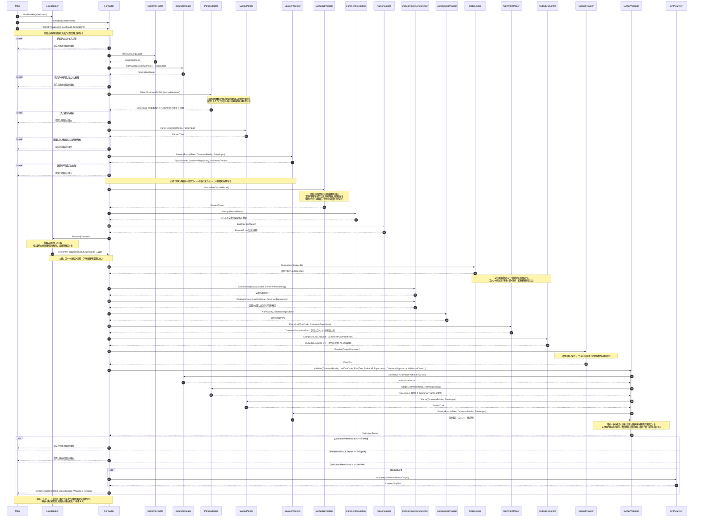

# Shave Format 整形仕様

本書は Shave Format の整形結果，責務境界，処理順序及び外部契約を規定する．構文の状態を `SyntaxModel`，コメントの状態を `CommentRepository` に分離し，宣言的な整形中間表現を経て出力する設計を採る．本書は実装の到達状況を示す物ではない．同じ構文上の役割には同じ適用条件を用い，未実装である事を言語全体の書式免除へ置き換えない．

表記及び整形規則は [コーディング規約](../CODING_STANDARDS.md) に従う．本書の節参照は「本書」，コーディング規約の節参照は「規約」と表記する．実装の補助関数名，内部ファイル構成，移行の進捗は本書の規定対象としない．

---

# 目次

- **[第１章 基本契約](#第１章-基本契約)**
	- [1.1 意味の保存と正規形](#11-意味の保存と正規形)
	- [1.2 コメントからの独立](#12-コメントからの独立)
	- [1.3 冪等性](#13-冪等性)
	- [1.4 簡潔性と構造規則](#14-簡潔性と構造規則)
	- [1.5 失敗時の契約](#15-失敗時の契約)
- **[第２章 対象言語](#第２章-対象言語)**
	- [2.1 言語と方言](#21-言語と方言)
	- [2.2 言語の確定](#22-言語の確定)
- **[第３章 構成と情報境界](#第３章-構成と情報境界)**
	- [3.1 責務の分担](#31-責務の分担)
	- [3.2 中核の型](#32-中核の型)
	- [3.3 クラス図](#33-クラス図)
	- [3.4 シーケンス図](#34-シーケンス図)
	- [3.5 公開してはならない情報](#35-公開してはならない情報)
- **[第４章 入力受理と構文投影](#第４章-入力受理と構文投影)**
	- [4.1 入力表現と受理](#41-入力表現と受理)
	- [4.2 解析器への適応](#42-解析器への適応)
	- [4.3 投影の完全性](#43-投影の完全性)
	- [4.4 逐語区画と埋込内容](#44-逐語区画と埋込内容)
	- [4.5 指示子と意味上の制約](#45-指示子と意味上の制約)
	- [4.6 入力誤りと部分整形](#46-入力誤りと部分整形)
- **[第５章 構文正規化](#第５章-構文正規化)**
	- [5.1 変換の共通条件](#51-変換の共通条件)
	- [5.2 字句・区切り・式の正規化](#52-字句区切り式の正規化)
	- [5.3 不変指定と束縛](#53-不変指定と束縛)
	- [5.4 括弧の正規化](#54-括弧の正規化)
	- [5.5 本体と波括弧](#55-本体と波括弧)
	- [5.6 宣言の分離・統合と並替](#56-宣言の分離統合と並替)
	- [5.7 Ruby の構文](#57-ruby-の構文)
- **[第６章 整形中間表現とソース出力](#第６章-整形中間表現とソース出力)**
	- [6.1 `FormatIR` の契約](#61-formatir-の契約)
	- [6.2 字句間の空白](#62-字句間の空白)
	- [6.3 構造に依る展開](#63-構造に依る展開)
	- [6.4 行幅に依る選択](#64-行幅に依る選択)
	- [6.5 インデントと空行](#65-インデントと空行)
	- [6.6 PHP / JSX / HTML / CSS の境界](#66-php--jsx--html--css-の境界)
	- [6.7 出力の終端](#67-出力の終端)
- **[第７章 コメント処理](#第７章-コメント処理)**
	- [7.1 分離と所属の確定](#71-分離と所属の確定)
	- [7.2 錨の移譲と順序](#72-錨の移譲と順序)
	- [7.3 本文の正規化](#73-本文の正規化)
	- [7.4 文書化コメントの同期](#74-文書化コメントの同期)
	- [7.5 指示子の保持](#75-指示子の保持)
	- [7.6 記法・配置・深さ](#76-記法配置深さ)
	- [7.7 差込禁止区画と通常コメントの脱落](#77-差込禁止区画と通常コメントの脱落)
- **[第８章 出力検証と静的検査](#第８章-出力検証と静的検査)**
	- [8.1 独立した出力検証](#81-独立した出力検証)
	- [8.2 部分整形の検証](#82-部分整形の検証)
	- [8.3 結果の分類](#83-結果の分類)
	- [8.4 静的検査](#84-静的検査)
- **[第９章 資源管理と並列実行](#第９章-資源管理と並列実行)**
	- [9.1 入出力と解析の上限](#91-入出力と解析の上限)
	- [9.2 中核の処理予算](#92-中核の処理予算)
	- [9.3 解析器固有の制限](#93-解析器固有の制限)
	- [9.4 並列化と決定性](#94-並列化と決定性)
- **[第１０章 外部契約](#第１０章-外部契約)**
	- [10.1 呼出とコマンドライン](#101-呼出とコマンドライン)
	- [10.2 経路の収集と安全な書戻](#102-経路の収集と安全な書戻)
	- [10.3 符号化と改行様式](#103-符号化と改行様式)
	- [10.4 終了コードと通知](#104-終了コードと通知)
	- [10.5 検査用の環境変数と拡張機能](#105-検査用の環境変数と拡張機能)
- **[第１１章 受入試験と関連仕様](#第１１章-受入試験と関連仕様)**
	- [11.1 不変条件の検査](#111-不変条件の検査)
	- [11.2 境界の検体](#112-境界の検体)
	- [11.3 未対応範囲の扱い](#113-未対応範囲の扱い)
	- [11.4 関連仕様](#114-関連仕様)

---

# 第１章 基本契約

## 1.1 意味の保存と正規形

値・型・評価順序と回数・副作用・例外・寿命・束縛・外部契約の保存を最優先とする．変換の前提を確認出来ない構文は，其の意味を表す構造を保ち，安全な空白・改行の整形だけを行う．簡潔性を理由に意味の保存を緩めない（規約 1.3）．

同じ言語・方言・対象バージョン・行幅に於いて，投影後の構文構造，字句の値，意味を持つ境界及び空行比較を含む構文事実が同じなら，コメント経路の出力を除くソース本体の出力は一意に定まる．此れは，任意の二つのプログラムの意味同値を証明して同じコードへ変換する要求ではない．

ソース本体の意味を持たない空白・改行・空行・インデントは，投影時に破棄する．コメントの配置用空白は本書 7.1 に従って分離する．Ruby の実引数の読み，Python の構文本体，文を終える改行，HTML の表示される空白等は構文事実へ変換する．リテラル・地の文・埋込データ等の内容は，必要な範囲を逐語保持する（本書 4.4）．

## 1.2 コメントからの独立

コメント経路の通常コメント・文書化コメント・指示コメントの有無・内容・記法・位置は，ソース本体の構文正規化，折返，インデント及び空行を変更しない．コメントの為に波括弧を残す，行を折る，宣言統合を止める等の判断を禁止する．

空行はソースの構造だけから決め，コメントの復元後も有無・数・構文境界との対応を変えない．ファイル先頭，コメント同士の間及びコメントとコードの間にも例外を設けない．コメント専用の区画，記法又は保護断片へ空行を含めて此の制約を回避してはならない．

ソースの構文と確定済の配置は，コメントの所属・深さ・文書化の対象を決める為に参照して良い．依存はソースからコメントへの一方向とし，コメントの配置結果をソース工程へ戻さない．

指示子の対応範囲と根拠は本書 4.5 に定める．指示コメントはコメント経路で本文・記法・適用対象・有効性を保持し，其の為にソース本体の整形を変更しない．保持契約を満たさない候補は返さない（本書 7.5, 8.3）．

コメント記法でない標準の指令・属性・指示文は構文として扱う．実行時に読まれる文書，文書構造の一部である HTML コメント等は，本書 4.4 のソース側に保持する．コメント内の改行が文を終える場合も，其の文境界はコメント本文ではなく構文事実である．

## 1.3 冪等性

受理した入力を整形した結果は，同じ設定で再整形しても変化しない．部分整形も対象とする．

```text
Format(Format(Source)) == Format(Source)
```

構文正規化は本書 5.1 の依存関係と規則順に従って収束させる．錨の移譲，コメントの統合，句読点の正規化及び条件付の記号も，１回の整形で固定点に達する．外部の `Format` の繰返で非冪等な出力を取り繕わない．

## 1.4 簡潔性と構造規則

規約の構造規則を満たす範囲で冗長な括弧・波括弧・空行を除き，行幅内なら不要な折返を行わない．本体の展開，閉じ括弧，ラベル，Python のインデント等が要求する改行を，行幅内という理由で除かない．

行幅は既定で１２８文字とし，インデント及びコメント経路で出力する通常コメント・指示コメントを数えない．幅の計数と選択を行うのは `LineBreaker` だけである．意味を保って分割出来ない字句・区画は分割せず，行幅を超える事だけを理由に整形全体を見送らない（規約 2.3）．

## 1.5 失敗時の契約

正常な入力に対して「整形が難しい」事を通常の見送理由にしない．入力の構文誤り，対応外の言語・符号化・明示した機能，解析器・資源の限界と，整形器の不具合を区別する．

失敗した候補を出力・書戻しない．原文を返す場合は，BOM，改行様式及び末尾改行を含む入力のバイト列を保つ．構文を壊した出力，意味の保存を確認出来ない候補及び収束しない処理を成功や通常の無変更に分類しない．解析不能区画に限る部分整形の候補拒否は本書 8.3 の見送条件に従い，新たな構文破壊・循環・内部の不変条件違反は失敗として報告する（本書 10.4）．

---

# 第２章 対象言語

## 2.1 言語と方言

全対象言語を同じ中核アルゴリズムへ通す．文法・字句・意味上の差は入力側で構文の役割と制約へ投影し，正規化・字句間空白・群の構築・行分割・配置の手順を言語毎に複製しない．未実装の構文は本書 11.3 に従う．

| 言語 | 主な拡張子 | 個別の契約 |
|---|---|---|
| C | `.c`, `.h` | 共有ヘッダは本書 2.2 に従う．前処理指令は１論理行を保つ． |
| C++ | `.cpp`, `.cc`, `.cxx`, `.hpp`, `.hxx` 等 | マクロ，型の解釈，対象バージョンを保つ． |
| C# | `.cs` | 型変換・式・ラムダの読みを区別する． |
| Java | `.java` | 字句化前の Unicode 逃避と定数変数化の影響を扱う． |
| Go | `.go` | 自動セミコロン挿入，末尾カンマ及びコメントに由来する字句境界を保持する． |
| Rust | `.rs` | マクロの字句列，文書属性，可変性を保持する． |
| Kotlin | `.kt`, `.kts` | 文境界，型位置の注釈，ラムダの結合を保持する． |
| Swift | `.swift` | 演算子の前置・中置・後置と末尾クロージャを区別する． |
| PHP | `.php`, `.php3`, `.php4`, `.php5`, `.phtml`, `.phps` | 地の文，ヒアドキュメント，ナウドキュメントは逐語保持する． |
| JavaScript | `.js`, `.jsx`, `.mjs`, `.cjs` 等 | JSX を含む．古典スクリプトとモジュールを区別する． |
| TypeScript | `.ts`, `.tsx`, `.cts`, `.mts` | `.tsx` と `typescriptreact` / `tsx` の指定だけを TSX として読む． |
| Ruby | `.rb` 等 | 修飾子，文境界及びヒアドキュメントの開始行を保持する． |
| Python | `.py`, `.pyi` 等 | 本体を構文から再構成し，必要な継続括弧を補う． |
| JSON | `.json`, `.jsonc` 等 | JSONC の通常コメントと許容する末尾カンマを区別する． |
| HTML | `.html`, `.htm` 等 | 属性間等の意味を保つ境界で折る．属性値・本文・子境界の意味を保持する． |
| CSS / SCSS | `.css`, `.scss` | 要素区切・演算等の合法な境界で折る．値・選択子と両方言の字句規則を保持する． |

全言語で，構文の役割と意味保存を確認出来る境界を同じ選択機構へ載せる．分割不能な字句だけを保持し，言語全体を行幅判断から除外しない．Python の本体は規約 2.3 に従う必須展開とし，１行化の選択肢を作らない．

## 2.2 言語の確定

言語を明示した場合は其の指定を使う．既知の拡張子との不一致はコマンドラインの使用法の誤りとし，ディレクトリ配下のファイルは個別の拡張子で判定する．

言語未確定の `.h` と `--lang h` は C として解析し，C++ で破損が減る場合だけ C++ の文法を選ぶ．C からも利用し得る共有ヘッダでは，C と C++ で同じ意味を持つ変換に限る．`(void)` の除去，`while(true)` 化，整数から真偽値リテラルへの変換を一律に掛けず，C++ 専用の `constexpr` / `static_cast` / `nullptr` の勧めも出さない．`--lang c` を自動で C++ へ変更しない．

Objective-C のヘッダ，Qt Linguist の XML 文書である `.ts` 等は，同じ拡張子の対応言語として整形しない．対象バージョンを指定又はプロジェクトで固定し，整形だけで新しい構文を要求しない．C++ のラムダ，Python の組等の省略形にも此の制約を適用する．

---

# 第３章 構成と情報境界

## 3.1 責務の分担

各工程には責務に必要な型だけを渡す．`Formatter` は行幅設定済の `LineBreaker` を受け取り，言語指定から `GrammarProfile` を選ぶ．全言語を同じ工程順へ通し，情報・権限は本書 3.5 に従って分離する．

| クラス | 責務 | 変更出来る対象 |
|---|---|---|
| `Main` | 引数の解釈，入出力，設定済の工程の構築 | 外部入出力の状態 |
| `Formatter` | 工程の順序，成功・見送・失敗の統括 | 呼出内の結果と所有物 |
| `GrammarProfile` | 文法・版・字句規則・投影対応・文書記法・検証条件の定義 | 無 |
| `InputNormalizer` | 符号化・入力表現の受理と正規化 | 解析前の入力表現 |
| `ParseAdapter` | 解析器の読違に対する意味保存の補修と可逆な保護 | 解析用の入力 |
| `SyntaxParser` | 指定文法に依る構文解析 | 新しい解析結果 |
| `SourceProjector` | 文法上の表現から共通の構文・コメント・検証資料への投影 | 新しい投影結果 |
| `SyntaxModel` | 独自の節点表と構文事実の整合管理 | 節点表のみ |
| `CommentRepository` | コメントと文書化候補の記法・所属・錨の管理 | コメント記録と文書化候補 |
| `SyntaxNormalizer` | 構文の役割別の共通規則と依存関係に依る正規化 | `SyntaxModel` |
| `Canonicalizer` | 正規化した構文から幅非依存の中間表現を生成 | 新しい `FormatIR` |
| `LineBreaker` | 行幅に依る選択を全て確定 | 新しい `BrokenIR` |
| `TextMetrics` | 字句の文字数の計数 | 無 |
| `SignatureExtractor` | 関数の名前・仮引数・戻値の構文情報の抽出 | 新しい `Signature` |
| `DocCommentSynchronizer` | 構文上の署名と既存文書の対応付，確定した配置に従う文書の位置と群の所属 | `CommentRepository` |
| `CommentNormalizer` | 通常コメント本文の表記の正規化 | `CommentRepository` の本文 |
| `CodeLayout` | 確定済の中間表現へのインデント・空行の具体化 | 新しい `LaidOutCode` |
| `CommentPlacer` | 安全な配置位置へのコメントの割当 | 新しい `CommentPlacementPlan` のみ |
| `OutputDocument` | 変更不能なコードとコメント配置計画の合成 | 新しい合成結果のみ |
| `OutputFinalizer` | 確定済の合成結果と終端契約の直列化 | 最終字面のみ |
| `SyntaxValidator` | 独立した再解析に依る出力・保護区画の検証 | 新しい `ValidationResult` |
| `LintAnalyzer` | 自動変更しない規約違反と要確認の候補の列挙 | 警告列のみ |

言語差は `GrammarProfile` の構文・意味・記法の定義で表し，同じ役割・制約・生成形式は共有する．文法固有の読取結果を共通の型へ投影し，共通工程は構文の役割・適用条件・選択状態で分岐する．共通操作の追加には，其の意味と前提を定義する．

## 3.2 中核の型

### 構文と安定した識別子

`SyntaxModel` は独自の `NodeId`，共通の節点種別，子の順序及び `SyntaxFacts` を持つ節点表である．`Lexeme` は字句の葉と逐語区画に限り，通常の親節点の原文全体を保存しない．

`SyntaxKind` は構文の役割と子の構造で分ける．同じ構造の意味・条件の差は `SyntaxFacts`，出力表現の差は `CanonicalFormList` で表す．種別は既存の役割・子の構造で表せない場合だけ追加し，言語名・解析器の節点名・綴り・子の個数だけで分けない．

`NodeId` は同じ整形呼出の中で移動・並替に依って変えない．原文のバイト位置，コメントの数，作業スレッドの実行順を識別の根拠にしない．別の整形呼出で同じ数値を割り当てる事は要求しない．

`RewriteTrace` は節点の統合・除去・分割に伴う先行・末尾・内部の錨の移譲を記録する．`CommentRepository` が本書 7.2 に従って適用する．

節点表は親・子・兄弟・構文順・役割別の索引を持ち，束縛・参照・書込・型・制御移動の事実を必要時に求める．再利用と更新は本書 5.1 に従い，索引の維持に全文文字列や解析木を再構築しない．

`SyntaxFacts` は次の情報を，該当する構文に限って持つ．固定の定義は変更不能な値として共有し，可変な事実と其の依存関係を分ける．

| 情報 | 内容 |
|---|---|
| 字句 | 値・型・基数・精度・符号・符号化・補間と，等価な綴りの成立条件 |
| 演算と束縛 | 演算の役割，結合，評価順，値の使用，名前の導入・参照・変更，捕捉と受け手の束縛，構築呼出の可否及び型に関する確認済の事実 |
| 宣言 | 全体で共有する指定，宣言子毎の指定，束縛の開始，初期化の単位，分離・併記の成立条件及び空行比較の値 |
| 本体 | 文の所有者，文数，値・脱出先・寿命への影響，包装と同行形の可否 |
| 境界 | 文終端，字句の融合，必須空白，密着，改行禁止及び逐語内容の保持条件 |
| 記述条件 | 規約が構文の役割へ定める名前の形，指定子の順序及び必須項目 |
| 生成形式 | 使用出来る共通変換，部品の対応，固定字句，必須・省略可能・条件付の包装と区切り |

`CanonicalFormList` の各要素は，共通操作の識別子，適用条件，子の役割の対応及び固定字句又は字句生成の定義値を持つ．基数・区切り・接頭辞・接尾辞・逃避の定義値は投影時に共通操作へ対応付ける．任意の処理は保持せず，字句の生成は本書 5.2 に従う．

規約 2.4 の構造種別は，対象言語・方言・版に対応する tree-sitter 文法で，宣言・指令全体を表す公開節点型に対応付ける．空行比較の値は其の同異だけを表し，入力側で解析器の識別子とは独立した等値比較専用の値へ投影する．宣言子・型注釈・初期化子等の子の型では区別せず，同じ `SyntaxKind` へ投影する異なる節点型を同値にしない．生成・分離・統合した宣言には，採用する生成形式に対応する値を用い，元の節点型を機械的に引き継がない．共通工程へ型名・文法の識別子・逆引手段を渡さず，特定値との照合に依る言語別・節点型別の処理分岐を設けない．

### 意味を持つ境界

`LexicalBoundary` は前後の字句を別の字句として保つ条件，`StatementBoundary` は意味上の文境界を表す．

例えば Ruby の `f (x)` と `f(x)` は，単に空白の有無を保存するのでなく，解析した呼出形式と必要な境界を保持する．Go / Kotlin / Swift の文を終える改行は `StatementBoundary` へ変換する．

### コメント

`NotationRules` は使用可能な記法，入力の文書形式，役割・種別毎の採用記法と出力文書形式を持つ変更不能な定義であり，共通の説明項目・タグの語彙を参照する．行コメントの登録定義から，記法・本文・位置の判定に必要な条件だけを投影し，`OutputForms` の成立条件として共有する（本書 3.5, 4.5）．文書形式は囲み記号だけで識別しない．

`SourceProjector` は，既存コメントの `Format` に記法定義と入力の文書形式，入力時の群の所属，行末コメントの前置区切りのタブ数 `LeadingTabCount`，先頭論理行の密着及び囲み内の改行条件を記録する．文書化対象の定義にはコメントの有無に依らず `DocumentationSite` を作り，定義の錨と記法定義を `CommentRepository` に保持する．既存記録と文書化候補は同じ定義値を共有し，記録毎の書式を別表へ重複保持しない．錨は本書 7.2 に従って移譲する．

`CommentRecord` は `NodeId` の錨，原文の順，`Notation`，`Format`，役割，種別，所属及び本文 `Text` を持つ．`Text` は開始・終端記号と区切空白を含めず，値を構成する空白を保持する．定型指示記法の開始記号は名前迄を含む一つの値とし，名前を本文へ分けない．

登録済の指示記法には `DirectiveInfo` を付ける．`Definition` は登録定義，`Conditions` は成立・保持条件と値を表す．適用対象は記録の錨・所属と記法が表し（外側の文書は後の項目，内側の文書は囲む項目），同じ事実を別の欄へ重ねて持たない．適用対象の検証は本書 8.1 の構文・境界対応に従う．`DirectiveState` は `Active`（成立）又は `Inactive`（不成立）であり，ビルド条件式の真偽とは異なる．無効な位置の記法も記録し，原文の所有者・任意の処理への参照を持たせず，中核へ渡さない．

| 区分 | 値 | 意味 |
|---|---|---|
| `CommentKind` | `OwnLine`, `Trailing`, `Inline` | 独立・行末・文中の３種別． |
| `CommentPlacement` | `Before`, `After`, `Inside` | 錨との関係． |
| `CommentRole` | `Presentation`, `Directive` | 通常の説明か，本書 4.5 の対応記法として有効性を含めて保持する指示コメントか． |
| `CommentNotation` | 次表の２６値 | コメントの開始・終端を表す記法．種別・所属・役割とは独立して記録する． |

文書生成だけに用いる説明は，文書の構造を保持して正規化する `Presentation` とする．Rust の文書属性等，本書 7.5 の保護対象は `Directive` とする．文書形式を道具が読む事だけで全説明を指示子に分類しない．

`CommentNotation` は次表の開始・終端記号を表す列挙型で，１記録に１値を持つ．識別した開始記号は分割しない．文書化の対象・指示子の役割・有効性は別に判定する．

| 値 | 対応する記法 | 記録上の区別 |
|---|---|---|
| `SlashLine` | `//` | 一般の行コメント |
| `TripleSlashLine` | `///` | C / C++ の Doxygen，C# / Java / Rust / Swift の文書，TypeScript の指示子（其の他の言語では `SlashLine` とする） |
| `SlashBangLine` | `//!` | C / C++ の Doxygen 及び Rust の内部文書 |
| `GoBuildLine` | `//go:build` | Go のビルド制約 |
| `GoDebugLine` | `//go:debug` | Go の `GODEBUG` の設定 |
| `GoEmbedLine` | `//go:embed` | Go のファイルの埋込 |
| `GoGenerateLine` | `//go:generate` | Go のコード生成 |
| `GoLinknameLine` | `//go:linkname` | Go の記号名の対応付 |
| `GoNoescapeLine` | `//go:noescape` | Go の関数への指示 |
| `GoNoinlineLine` | `//go:noinline` | Go の関数への指示 |
| `GoNoraceLine` | `//go:norace` | Go の関数への指示 |
| `GoNosplitLine` | `//go:nosplit` | Go の関数への指示 |
| `GoUintptrescapesLine` | `//go:uintptrescapes` | Go の関数への指示 |
| `GoWasmexportLine` | `//go:wasmexport` | Go の関数への指示 |
| `GoWasmimportLine` | `//go:wasmimport` | Go の関数への指示 |
| `GoLineLine` | `//line` | Go の行形式の位置指示 |
| `GoLineBlock` | `/*line` … `*/` | Go の囲み形式の位置指示 |
| `CgoExportLine` | `//export` | `cgo` の公開名 |
| `GccgoExternLine` | `//extern` | `gccgo` の外部名 |
| `HashLine` | `#` | 一般の行コメント．符号化・マジックコメント等の役割は別に記録する． |
| `HashBangLine` | `#!` | 対象言語・版の標準記法として識別した `#!`．開始位置を保ち，`#` と `!` の間を分断しない． |
| `HashColonLine` | `#:` | 入力に在る `#:` の記法．此の値だけで指示子の役割又は特別な出力記法を与えない． |
| `Block` | `/* ... */` | 一般の囲みコメント．独立・行末・文中の種別を，此の値だけで決めない． |
| `DoubleStarBlock` | `/** ... */` | 文書の囲みを持つ言語の専用記法．Go / CSS は含めず，文書化と区切の用途を区別する． |
| `StarBangBlock` | `/*! ... */` | C / C++ の Doxygen，Rust の内部文書及び SCSS の配信物へ残すコメント． |
| `RubyEmbeddedDocument` | 行頭の `=begin` から行頭の `=end` 迄 | Ruby の埋込文書．本書 4.2 の復号後の記法と，開始・終端の行条件を保持する． |

`Notation` は入力で識別した記法を記録し，本文正規化では変更しない．識別は本書 4.3，指示子の登録範囲は本書 4.5，出力記法の選択と合成は本書 7.6 に従う．

Python の文書文字列，HTML コメント及び逐語保護した誤り区画は本書 4.4, 4.6 のソース側に残す．JSX の `{/* ... */}` は外側の `{}` を構文，内部の通常コメントを `Block` として扱う（本書 6.6, 7.1）．

復元先と順序は本書 7.2，指示子の適用条件は本書 4.5 に従う．

### 中間表現と出力

`FormatIR` は字句・必須境界・選択可能な折返・インデントの範囲・錨・逐語区画を持つ宣言的な表現である．`Group` と `IfBroken` が平坦形と展開形の選択を表し，`LineBreaker` が全ての選択を解決した結果を `BrokenIR` とする．

`LaidOutCode` は `CodeLayout` だけが構築する変更不能なコード出力であり，断片，終端契約及び `AnchorPositionMap` を持つ．位置表は節点の前後，区切字句の前，行毎の深さ，安全な行末及び差込禁止区画を示す．コメントを置ける零幅の位置には `CommentSlotId` を与える．空行其の物は配置枠にせず，前後の構文境界に結び付いた断片として固定する．元のバイト位置を持たない．

`CommentPlacementPlan` は `CommentInsertion` の列であり，各要素は `CommentSlotId` と `CommentBlock` だけを持つ．配置枠の所属する `LaidOutCode` も識別する．コードの置換範囲，削除命令，空行の要求，任意の出力断片又はコードの所有者への変更可能な参照を持たない．`CommentPlacer` は此の計画だけを返し，完成字面又は書換済のコードを返さない．

`CommentBlock` は確定した記法に従うコメント行の列とし，本書 7.6 の前置区切りも含む．各物理行はコメントの本文又は記号を含み，空行を要素として持たない．文書の空の論理行は記法が許すコメント記号・継続記号で表す．指示コメントを含め同じ型を用い，区切空行を含む任意の文字列を代用しない．種別・所属・順序・合法な記法の条件も構築時に満たす．保持契約を満たす値を構築出来ない場合の扱いは本書 7.7, 8.3 に従う．

`OutputDocument::Compose` は，変更不能な `LaidOutCode` と `CommentPlacementPlan` だけを受け取る．コードの全断片を元の順に１回ずつ出力し，指定した配置枠へコメントだけを挿入する．独立したコメント行を終える改行は出すが，空の物理行を生む余分な改行は出さない．空行の断片を追加・削除・移動又は上書する操作，完成字面を直接受け取る構築子及び指示子別の合成経路を設けない．

`OutputDocument` は変更不能な合成結果であり，生成部分・逐語部分の区別と終端契約を引き継ぐ．直列化は本書 6.7 に従う．

### 検証結果

`ValidationContext::SemanticChecks` は，入力の解析木で確認した意味上の区別，構文対応及び検証条件の列である．検証に必要な区別だけを保持し，入力木や構文事実全体を複写しない．照合は本書 8.1 に従う．

`ValidationResult` は次表の `ValidationStatus` を持ち，`Verified` の場合だけ `Output` に `ValidatedOutput` を保持する．其の他は出力を持たず `FailureReason` を必須とし，原文の返戻は `Formatter` が行う．理由名だけで状態を判定しない．

| 状態 | 条件 | 後続 |
|---|---|---|
| `Verified` | 完成候補の全検証に成功した． | 必要な静的検査を行い，検証済の候補を返す． |
| `Skipped` | 本書 8.3 の見送条件又は本書第９章の検証時の資源上限に該当する． | 原文と理由を返し，静的検査・書戻へ進まない． |
| `Failed` | 新たな構文破壊，内部の不変条件違反，又は見送に該当しない検証失敗である． | 原文と失敗理由を返す． |

## 3.3 クラス図

図のメソッドは責務境界を示す契約である．読取専用の引数は実装でも変更不能な参照又は値として渡す．`ProjectionResult` は呼出側が所有物を受け取る為の結果であり，中核工程へ結果全体を渡さない．

```mermaid
classDiagram
	direction LR
	class Main {
		+Run(Arguments) int
	}
	class Formatter {
		-Breaker : LineBreaker
		+Format(RawSource, Language, ShouldLint) FormatResult
	}
	class GrammarProfile {
		+Resolve(Language) GrammarProfile
	}
	class InputNormalizer {
		+Normalize(GrammarProfile, RawSource) NormalizedInput
	}
	class ParseAdapter {
		+Adapt(GrammarProfile, NormalizedInput) ParseInput
		+DecodeLexeme(ParsedTree, Text, Start) string
	}
	class SyntaxParser {
		+Parse(GrammarProfile, ParseInput) ParsedTree
	}
	class SourceProjector {
		+Project(ParsedTree, GrammarProfile, ParseInput) ProjectionResult
	}
	class ProjectionResult {
		+Syntax : SyntaxModel
		+Comments : CommentRepository
		+Validation : ValidationContext
	}
	class SyntaxModel {
		-Nodes : SyntaxNodeTable
		-Root : NodeId
		+GetRoot() NodeId
		+GetNode(NodeId) SyntaxNode
		+Apply(RewritePlan) RewriteTrace
	}
	class SyntaxNode {
		+Id : NodeId
		+Kind : SyntaxKind
		+Lexeme : string
		+Facts : SyntaxFacts
		+Children : NodeIdList
	}
	class SyntaxFacts {
		+Boundaries : SemanticBoundaryList
		+Constraints : SemanticConstraintList
		+Forms : CanonicalFormList
	}
	class CommentRepository {
		-Records : CommentRecordList
		-DocumentationSites : DocumentationSiteList
		+Get(NodeId) CommentRecordList
		+GetDocumentationSites() ReadOnlyDocumentationSiteView
		+Update(CommentRecordList) void
		+Remap(RewriteTrace) void
	}
	class DocumentationSite {
		+Anchor : NodeId
		+Rules : NotationRules
	}
	class CommentFormat {
		+Rules : NotationRules
		+InputDocument : optional~DocumentFormId~
		+Group : CommentGroupId
		+LeadingTabCount : size_t
		+AttachFirstLine : bool
		+SeparateLogicalLines : bool
	}
	class NotationRules {
		<<immutable>>
		+AvailableNotations : CommentNotationList
		+DocumentForms : DocumentFormList
		+OutputForms : CommentOutputFormList
	}
	class CommentRecord {
		+Anchor : NodeId
		+Text : string
		+Kind : CommentKind
		+Placement : CommentPlacement
		+Role : CommentRole
		+OriginalOrder : size_t
		+Notation : CommentNotation
		+Format : CommentFormat
		+Directive : optional~DirectiveInfo~
	}
	class DirectiveInfo {
		+Definition : DirectiveDefinitionId
		+State : DirectiveState
		+Conditions : DirectiveConditionList
	}
	class DirectiveState {
		<<enumeration>>
		Active
		Inactive
	}
	class SyntaxNormalizer {
		+Normalize(SyntaxModel) RewriteTrace
	}
	class RewriteTrace {
		+Transfers : AnchorTransferList
	}
	class Canonicalizer {
		+Build(SyntaxModel) FormatIR
	}
	class FormatIR {
		+Root : FormatItem
		+NormalizedSyntax : SyntaxModel
	}
	class FormatItem {
		+Kind : FormatItemKind
		+Children : FormatItemList
	}
	class LineBreaker {
		-MaxChars : const size_t
		+Resolve(FormatIR) BrokenIR
		+LineBreaker(MaxChars)
	}
	class TextMetrics {
		+CountCharacters(Text) size_t
	}
	class BrokenIR {
		+Items : ResolvedFormatItemList
		+Expectation : OutputExpectation
	}
	class OutputExpectation {
		+NormalizedSyntax : SyntaxModel
		+SelectedForms : SelectedFormList
		+DeclarationPartitions : DeclarationPartitionList
	}
	class SignatureExtractor {
		+Extract(SyntaxModel, NodeId) Signature
	}
	class DocCommentSynchronizer {
		+Synchronize(SyntaxModel, CommentRepository) void
		+ConfirmGroups(LaidOutCode, CommentRepository) void
	}
	class CommentNormalizer {
		+Inspect(ReadOnlyCommentView) CommentStructure
		+Normalize(CommentRepository) void
	}
	class CodeLayout {
		+Materialize(BrokenIR) LaidOutCode
	}
	class LaidOutCode {
		-Fragments : OutputFragmentList
		-Anchors : AnchorPositionMap
		-Ending : EndingContract
		+GetFragments() ReadOnlyFragmentView
		+GetSlots() ReadOnlyCommentSlotView
	}
	class CommentPlacer {
		+Place(LaidOutCode, CommentRepository) CommentPlacementPlan
	}
	class CommentPlacementPlan {
		-Insertions : CommentInsertionList
	}
	class CommentInsertion {
		-Slot : CommentSlotId
		-Comment : CommentBlock
	}
	class CommentBlock {
		-Lines : CommentLineList
	}
	class OutputDocument {
		-Code : LaidOutCode
		-Comments : CommentPlacementPlan
		+Compose(LaidOutCode, CommentPlacementPlan) OutputDocument
	}
	class OutputFinalizer {
		+Finalize(OutputDocument) string
	}
	class ValidationContext {
		+ErrorZones : ErrorZoneSet
		+ProtectedRegions : ProtectedRegionSet
		+SemanticChecks : SemanticCheckList
		+InputDiagnostics : DiagnosticList
	}
	class SyntaxValidator {
		+Validate(GrammarProfile, LaidOutCode, Text, OutputExpectation, CommentRepository, ValidationContext) ValidationResult
	}
	class ValidationStatus {
		<<enumeration>>
		Verified
		Skipped
		Failed
	}
	class ValidatedOutput {
		+FinalSyntax : SyntaxModel
		+FinalComments : CommentRepository
		+Locations : DiagnosticLocationMap
	}
	class ValidationResult {
		+Status : ValidationStatus
		+Output : optional~ValidatedOutput~
		+Reason : FailureReason
	}
	class LintAnalyzer {
		+Analyze(ValidatedOutput) LintWarningList
	}
	class FormatResult {
		+Text : string
		+Classification : FormatClassification
		+Warnings : LintWarningList
		+Reason : FailureReason
	}
	Main --> LineBreaker : 行幅で構築
	Main --> Formatter : 設定済の工程を注入
	Formatter --> GrammarProfile : 定義の選択のみ
	InputNormalizer ..> GrammarProfile
	ParseAdapter ..> GrammarProfile
	SyntaxParser ..> GrammarProfile
	SourceProjector ..> GrammarProfile
	SyntaxValidator ..> GrammarProfile
	Formatter --> InputNormalizer
	Formatter --> ParseAdapter
	Formatter --> SyntaxParser
	Formatter --> SourceProjector
	Formatter --> SyntaxNormalizer
	Formatter --> Canonicalizer
	Formatter --> LineBreaker
	Formatter --> DocCommentSynchronizer
	Formatter --> CommentNormalizer
	Formatter --> CodeLayout
	Formatter --> CommentPlacer
	Formatter --> OutputDocument
	Formatter --> OutputFinalizer
	Formatter --> SyntaxValidator
	Formatter --> LintAnalyzer
	Formatter --> FormatResult
	ParseAdapter ..> SyntaxParser : 補修に必要な試験解析のみ
	SourceProjector --> ProjectionResult
	ProjectionResult *-- SyntaxModel
	ProjectionResult *-- CommentRepository
	ProjectionResult *-- ValidationContext
	SyntaxModel *-- SyntaxNode
	SyntaxNode *-- SyntaxFacts
	CommentRepository *-- CommentRecord
	CommentRepository *-- DocumentationSite
	CommentRecord *-- CommentFormat
	CommentFormat --> NotationRules : 変更不能な定義を共有
	DocumentationSite --> NotationRules : 変更不能な定義を共有
	CommentRecord "1" *-- "0..1" DirectiveInfo
	DirectiveInfo --> DirectiveState
	SyntaxNormalizer ..> SyntaxModel
	SyntaxNormalizer --> RewriteTrace
	CommentRepository ..> RewriteTrace
	Canonicalizer ..> SyntaxModel
	Canonicalizer ..> SignatureExtractor : 読取専用の文書化対象の判定
	Canonicalizer --> FormatIR
	FormatIR *-- FormatItem
	FormatIR ..> SyntaxModel : 読取専用の期待構文
	LineBreaker ..> FormatIR
	LineBreaker ..> TextMetrics
	LineBreaker --> BrokenIR
	BrokenIR *-- OutputExpectation
	SyntaxValidator ..> OutputExpectation
	SyntaxValidator ..> LaidOutCode : 変更不能な照合基準
	DocCommentSynchronizer ..> SignatureExtractor
	SignatureExtractor ..> SyntaxModel
	DocCommentSynchronizer ..> SyntaxModel
	DocCommentSynchronizer ..> CommentRepository
	DocCommentSynchronizer ..> LaidOutCode : 文書の位置の読取
	CommentNormalizer ..> CommentRepository
	SourceProjector ..> CommentNormalizer : 読取専用の本文構造判定
	DocCommentSynchronizer ..> CommentNormalizer : 読取専用の本文構造判定
	CommentPlacer ..> CommentNormalizer : 読取専用の本文構造判定
	LintAnalyzer ..> CommentNormalizer : 読取専用の本文構造判定
	LintAnalyzer ..> SignatureExtractor : 読取専用の署名
	CodeLayout ..> BrokenIR
	CodeLayout --> LaidOutCode
	CommentPlacer ..> LaidOutCode
	CommentPlacer ..> CommentRepository
	CommentPlacer --> CommentPlacementPlan
	CommentPlacementPlan *-- CommentInsertion
	CommentInsertion *-- CommentBlock
	OutputDocument ..> LaidOutCode : 変更不能な出力を共有
	OutputDocument ..> CommentPlacementPlan : コメントだけを挿入
	OutputFinalizer ..> OutputDocument
	SyntaxValidator ..> ValidationContext
	SyntaxValidator ..> InputNormalizer
	SyntaxValidator ..> ParseAdapter
	SyntaxValidator ..> SyntaxParser
	SyntaxValidator ..> SourceProjector
	SyntaxValidator ..> CommentNormalizer : 変換した文書の本文の照合
	SyntaxValidator ..> CommentRepository : 読取専用の期待コメント
	SyntaxValidator --> ValidationResult
	ValidationResult --> ValidationStatus
	ValidationResult "1" *-- "0..1" ValidatedOutput
	LintAnalyzer ..> ValidatedOutput
```



`CommentNormalizer::Inspect` は，コメント群，コード例及び段落を区切る空の論理行を判定する．
`ReadOnlyCommentView` は記法と文書形式及び其の定義，本文，記録の順序と所属だけを公開し，`CommentStructure` は変更不能な判定結果とする．
投影・同期・配置・検証・静的検査は此の読取専用の判定を共有し，本文の書換は `Normalize` に分離する．
文書の認識・配置，字句境界及び構文変換の条件も，各工程に許された値だけを読む共通判定として共有し，入力適応・同期・構文正規化・中間表現生成とは分離する．

`MaxChars` は構築後不変とし，取得用・変更用の公開メソッドを設けない．型図で省略した `NodeId`，`Signature`，各列及び列挙型は値型であり，原文やコメントの所有者へ遡る参照を持たない．

## 3.4 シーケンス図

解析前の失敗は後続工程へ渡さない．図中の構文正規化以降では再解析せず，最終検証で初めて完成字面を新しく解析する．解析器対策の為の試験解析は `ParseAdapter` の内部に限る．



## 3.5 公開してはならない情報

次表の全工程に，言語識別，`GrammarProfile` 及び解析器固有の情報（節点名・識別子・`TSNode` 等）を公開しない．引数・保有状態・共有定義・キャッシュを介する間接取得も禁止する．言語名を真偽値・別名・処理関数表へ置き換えず，本書 3.2 の投影済の事実と記法の定義を用いる．

| 受取側 | 公開しない物 |
|---|---|
| `SyntaxNormalizer`, `Canonicalizer`, `SignatureExtractor` | 原文，原文の位置，コメント本文・元配置，行幅 |
| `LineBreaker` | 原文，コメントの状態，元のインデント，最終コメント配置 |
| `CodeLayout` | 原文，コメントの状態，行幅，未解決の折返候補 |
| `DocCommentSynchronizer`, `CommentNormalizer` | 構文を変更する権限，行幅 |
| `CommentPlacer` | 構文・コード断片・空行を変更する権限，行幅，元の字面から配置を推測する API，任意の出力断片を作る API |
| `OutputDocument` | コード・空行の変更権限，行幅，未確定の配置，任意の断片を追加する API |
| `OutputFinalizer` | 構文変換，折返選択，行幅，空行の増減・移動，コメントの内容に依る分岐，解析用の印の復元という後付の処理 |
| `LintAnalyzer` | 出力又は構文を変更する権限 |

入力の診断位置と保護原文を持つ `ValidationContext` は中核へ渡さない．情報境界は型と権限で保証し，事後検証で代用しない．

---

# 第４章 入力受理と構文投影

## 4.1 入力表現と受理

`InputNormalizer` は入力を受理出来るかを判定し，言語・符号化・BOM・改行様式の情報を分ける．UTF-16 / UTF-32 を UTF-8 と見誤って構文誤りとして扱わない．外部入力のサイズ上限は呼出側が受理境界で検査する．解析器の資源上限は本書第９章に従う．

解析用に生成するコード部分の改行は LF とする．但し，リテラル・地の文・埋込データの内部を，字句の境界を確かめずに一括置換してはならない．保護範囲の確定に言語の走査が必要な場合は `ParseAdapter` が行う．BOM と元の改行様式は入力受理・診断用とし，正常出力へ戻す設定にしない．出力は本書 10.3 の共通契約に従う．

単独の CR，及び C# の U+0085 / U+2028 / U+2029 等は，其の言語が行境界として読む位置だけを正規化する．文字列・生文字列・囲みコメントの内容と，Go / Rust / PHP / Ruby の単独の CR を一律に行境界へ読み替えない．NUL は全言語一律の禁止とせず，使用文法が受理するかで判定する．

## 4.2 解析器への適応

`ParseAdapter` の補修は，言語処理系の読みを解析器へ伝える為の物に限る．書式の好みで括弧・空白・コメントを整える工程ではない．可逆な保護の印は原文と衝突しない様に管理し，投影時に本来の字句へ復号する．`DecodeLexeme` は，分離したコメントを除いた `Text` と原文上の開始位置 `Start` を受け，解析結果の印と復号資料から本来の字句を返す．除去・結合で不連続に為った断片も印又は復号資料で対応付け，`Start` からの加算だけで元位置を推定しない．中核の字句，幅の計数，最終出力へ解析用の印を残さない．

試験解析が必要な補修は入力側で完結させる．補修前の診断と保護対象を控え，補修自身に因る字句の喪失・構文変更を検出する．補修後に構文誤りが無い事だけを意味保存の根拠にしない．

`ParseInput` は入力側で確定した `GrammarProfile` を保持する．共有ヘッダ等で文法を選び直した場合は，其の定義を以後の解析・投影・最終検証へ引き継ぎ，最初の指定と混用しない．

確定した入力の世代と文法・版が一致する試験解析の結果は再利用する．`SyntaxParser` は有効な結果が在る場合に同じ入力を解析し直さず，入力又は文法が変わった場合だけ再解析する．最終検証の解析結果は，完成出力から別に得る（本書 8.1）．

| 対象 | 入力側で確定する内容 | 保持条件 |
|---|---|---|
| C / C++ | 字句化前の逆斜線と改行の連結 | 行コメントへ取り込まれる後続行も同じ意味で連結する．生文字列内の取消規則とコメント本文の保持を区別する． |
| C / C++ | 前処理指令，関数形式マクロ，指令本文内の引用符・コメント | `#` は行の所定位置に在る物だけを指令とする．マクロ名と `(` の密着の有無を構文事実へ変換する． |
| C / C++ | リテラル内の `/*`，指令の途中の囲みコメント | 解析器の誤ったコメント認識を防ぎ，指令の残りの字句を失わない． |
| C / C++ | 条件コンパイルに分かれた `extern "C" {` と `}` | 対を成す定型の保護に限る．リンケージと条件の対応を保持する． |
| C++ | 型引数を持つ型の宣言を比較の式文と読む誤り | 型名・テンプレート名の束縛と対象版の曖昧性解消規則から，文全体が宣言と確定する場合だけ補修する．比較結果の未使用だけを根拠にせず，呼出・多重定義演算を含む式と未確定の名前を宣言へ読み替えない． |
| C# | 名前の括弧をキャストと読む誤り，実引数の積を宣言と読む誤り | `(d) - a` と型変換を区別し，総称型・別名修飾等の判別不能な形を推測で変えない． |
| C# | 修飾子付の暗黙型ラムダで構文木に現れない括弧 | 省かれた字句を復元してから中核へ投影する． |
| Java | 字句化前の `\uXXXX` の展開と，繰り返した `u` を含む逃避の解釈 | コード・引用符・コメントの境界を変える逃避は展開後の構造で読む．境界を変えないリテラル内の逃避は値を保つ．桁不足と，コード内の対を成さないサロゲートは受理しない． |
| Kotlin | コメントを呑み込む自動セミコロンの読み，型本体末尾，改行後の呼出・添字・参照 | 文境界と継続を確定し，コメント・`else` 等の字句が解析木から消えた結果を其の儘投影しない． |
| Swift | 演算子と密着したコメント，`?` / `!` の前置・中置・後置，見出の末尾クロージャ | 空白の意味を演算子の役割へ変換する．`x!=y` 等を通常の比較と決め付けない．既知の誤読だけを補修する． |
| JavaScript / TypeScript | `let`，`await`，クラスの修飾語の前後の文境界 | 非同期関数・モジュール内の `await` と識別子を区別する．`static` / `get` / `set` と，改行で別の欄に為る形を区別する． |
| JSX / HTML | コメント・文字参照・本文・空の式の境界 | 本文を先に意味付し，コメントの分離に依って隣の本文を結合しない． |
| Ruby | 行頭の `=begin` から行頭の `=end` 迄の埋込文書 | 本文途中の `=end` で早く閉じない．保護の印は文書本文から復号する． |
| Ruby | 括弧無の実引数，符号，正規表現，修飾子と文境界 | 呼出・演算子・局所変数の認識を保持する．原文の改行を畳んで別の呼出を作らない． |
| CSS / SCSS | 文字列内の逃避した逆斜線，引用符の無い `url()` | 文字列の終端を誤らず，URL の `//` や `/*` をコメントと見誤らない．HTML 内の CSS も同じ． |

C / C++ の前処理指令は，連結後の１論理行として扱う．マクロの仮引数は名前・カンマ・`...` の構造として扱い，本文の文字列化・字句連結の制約を別に保持する．行末に改行の無い入力の扱いも，言語の翻訳段階の規則に従う．

## 4.3 投影の完全性

`GrammarProfile` の対応は文法・版毎に検証し，節点名・子の役割を解析器の識別子へ一度対応付ける．`SourceProjector` は此の定義から，共通の節点種別・構文事実・コメント・検証資料を同じ走査で構築する．

意味の異なる構文を，種別・子の構造・意味の事実が全て同じ表現へ投影してはならない．必要な差を表せない場合は投影失敗とする（本書 8.3）．

`SourceProjector` は，解析器の名前付節点だけでなく，意味を持つ無名の字句も対象にする．全ての入力範囲を，構文の字句，意味を持つ境界，通常コメント，指示子，逐語区画又は捨てて良い空白へ分類する．未分類の字句を黙って捨てない．

コメントは開始記号・区切り・本文・終端記号を識別し，本書 3.2 の `Notation` と `Text` へ投影する．指示記法は本書 4.5 の登録定義，文書記法は対象言語・版と文書形式の定義に照合し，定型名の綴りと直後の字句境界を確認する．規約の採用形式と異なる行形式も，文書として認識する．未登録名や一般の説明は通常の記号と本文へ分けるが，境界を確定出来ない場合は本書 8.3 の投影失敗とする．

構文木の子の間に残る字句，幅０のコメント，誤り回復で消えた `else`，文字列として誤読された後続コード等は入力側で検出する．既知の適応で正しい構造を取得出来なければ，誤った `SyntaxModel` を作らず投影失敗として報告する．

原文の空白を参照出来るのは此処迄である．文字列への参照を残す場合も，其の参照先は独立して所有した字句又は逐語区画に限り，前後の原文を読める範囲や所有者への参照を公開しない．

## 4.4 逐語区画と埋込内容

逐語区画は「解析又は整形が面倒な範囲」ではなく，字面が値・出力・字句照合の対象と為る範囲，又は許容した誤り区画に限る．通常のコード全体を逐語区画へ包んで元レイアウト非依存を回避しない．

| 区画 | 保持する物 | 周囲の処理 |
|---|---|---|
| 文字列・生文字列・正規表現・区切文字付リテラル | 内容，逃避，意味を持つ空白と改行 | 安全な引用符の変更は本書 5.2 に限る．補間の式と文字列本体は区別する． |
| 許容した誤り区画 | 誤り本体と保持に必要な前後の境界 | 本書 4.6 に従う． |
| C / C++ の文字列化するマクロの実引数 | 空白を含む実引数の字面 | 同じファイルで確認した文字列化と `assert` の対象を保護する．外部のマクロ定義は推測しない． |
| Rust の未展開マクロの字句列 | 照合に使う字句・区切り | 末尾カンマや括弧を通常の式と同じ規則で除かない． |
| PHP / Ruby のヒアドキュメント，PHP のナウドキュメント | 本文，終端，開始行との対応 | 開始行の折返禁止と本文の出現順を中間表現へ渡す． |
| PHP の `__halt_compiler()` の後 | データの全体と終端 | 手前のコードだけを整形し，データを除去・改変しない． |
| PHP の地の文 | 先頭の空白を含む出力本文，改行，行末空白 | PHP の開始・終了タグとの境界を保持する．末尾が地の文なら末尾改行数も保持する． |
| Ruby の `__END__` 以降 | データの全体と終端 | コードとして解析・インデントしない． |
| Python の文書文字列，f 文字列のデバッグ表示 | 実行時に読まれる値と表示対象の字面 | 通常コメントの生成・句読点変換を適用しない． |
| HTML の `<pre>`，`<textarea>`，空白保持要素等 | 値又は表示に使われる本文・空白・改行 | 内容へインデントを追加・削除しない．内容を文字として読む要素の内部をタグとして編集しない． |
| HTML コメント，文書型宣言 | 文書内の位置と内容 | 通常コメントとして分離・移動しない．表記統一だけを理由に既存の値を変更しない． |
| CSS の引用符の無い `url()` | 引数全体 | コメントの形や括弧を通常のコメント・インデント境界と見誤らない． |

補間の式は，本文を変えずに独立して構文化出来る範囲だけを整形する．ヒアドキュメントやテンプレート文字列の親節点全体を無条件に不透明とせず，逆に内部の生の本文へ通常の空白規則を適用しない．

言語と境界を確定出来る埋込コードは，同じ言語・構文の単独コードと同じ規則で投影・正規化する．HTML の `<script>` / `<style>`，文字列の補間等も此の条件で扱う．文法の識別は入力・検証資料へ，親子の所有関係と錨は構文モデルへ保持する．所有区画毎に同じ中核工程へ通し，整形した子の字面を親の原文へ差し戻す為の全文再構築・親の再解析を挟まない．親へ内部のコメントを渡さず，埋込である事だけを理由にコメント本文だけの処理へ限定しない．言語・境界・契約を確定出来ない内容は未対応範囲として明示し，整形済と扱わない（本書 11.3）．

### 行位置・元の字面を観測する構文

行番号，呼出元情報又は元の字面を実行時の値として観測する処理は，通常の診断座標と区別して保護対象にする（規約 1.3）．入力側で観測対象と保持条件を記録し，検証側で確認する．元の位置や原文全体を通常の中核工程へ公開する理由にはしない．

書式変更後も観測される値を保つ事を確認出来ない場合は，`source observation cannot be preserved` の見送として原文を返す．単に行番号らしい文字列が在る事ではなく，構文・束縛・対象処理系から観測の使用を確認する．未知の動的内省を全て検出出来るとは保証しない．対応範囲は本書 11.3 に従い，通常コード全体の逐語保持で処理済を装わない．

## 4.5 指示子と意味上の制約

### 対応範囲

対応する指示子は本節の登録定義に限る．対象言語・版の言語仕様書，公式の言語参照又は公式ツールチェーンの仕様を根拠とし，記法・意味・適用条件・保持条件・検体を対応付ける．言語仕様本体と公式ツールチェーンの規定は区別して記録する．

| 区分 | 代表例 | 経路と契約 |
|---|---|---|
| コメントで表す言語仕様上の指示子 | Rust の文書属性，Ruby の符号化宣言・マジックコメント，Python の符号化宣言 | `CommentRepository` に記法・本文・適用対象・成立条件を保持する． |
| コメントで表す公式ツールチェーンの指示子 | 下表の登録記法 | 同じコメント経路で保持し，登録定義に従って適用を検証する． |
| 標準が定める先頭記法 | Rust / JavaScript の `#!` | 開始位置と字句上の区別をコメント経路で保持する． |
| コメントでない標準の指令・指示文・属性 | 前処理指令，PHP の `declare`，JavaScript の `"use strict"`，構文としての属性 | `SyntaxModel` に構文と意味上の境界を保持する． |
| 値又は文書構造である内容 | Python の文書文字列，HTML コメント，埋込内容 | 本書 4.4 のソース側で保持する． |

#### 言語仕様の登録定義

次表の符号化宣言と実行時設定は `#` の行コメントから識別し，埋込文書等の他の記法を登録形としない．候補検出で複数の認識条件を併用しても，有効性・値・適用範囲は対象言語・版・処理系毎の登録定義で判定する．字形・区切り・前後の字句・位置条件を，異なる定義間で混用しない．

| 規定元 | 記法・対象 | 適用・保持条件 |
|---|---|---|
| Ruby | 符号化宣言（`coding` の後に空白を挟み得る `:` 又は `=`） | １行目，又は `#!` の次の行のコメントだけの行． |
| Ruby | `frozen_string_literal` の組 | 最初の字句より前の注記．行頭の組と `-*-` の囲み内の組を読む． |
| Ruby | `shareable_constant_value` の組 | コメントだけの行．後の定数へ有効範囲毎に作用する． |
| Ruby | `warn_indent` の組 | 行末を含む全てのコメント． |
| Python | 符号化宣言（`coding` の直後の `:` 又は `=`） | 先頭の２行．２行目の物は１行目がコメント又は空行の時だけ読み，１行目のコメントも成立条件とする． |

#### 公式ツールチェーンの登録定義

定型の開始記号は本書 3.2 の値へ対応付ける．名前直後の区切りと位置条件は別に検査し，記法の識別だけで有効と判定しない．

| 規定元 | 記法・対象 | 適用・保持条件 |
|---|---|---|
| `go` コマンド | `//go:build` | `package` より前の頭部で，１ファイルに１行迄．条件式と対象環境毎のファイル選択を保持する．Go 以外のソースでも定義上の位置条件に従う． |
| `go` コマンド | `//go:debug` | `main` パッケージ又は試験の対象ファイルの `package` より前．対象版の設定名・値と重複の可否を確認し，対象プログラムへの適用を保持する． |
| `go` コマンド | `//go:embed` | 直後の変数宣言と，パターン・型・初期化・取込の成立条件を対応付ける． |
| `go` コマンド | `//go:generate` | 行頭（桁０）．命令と引数の内容を保持する． |
| コンパイラ | `//go:linkname` | 独立行．名前の対応を保持する． |
| コンパイラ | `//go:noescape`, `//go:noinline`, `//go:norace`, `//go:nosplit`, `//go:uintptrescapes`, `//go:wasmexport`, `//go:wasmimport` | 直後の関数宣言．個々の定義が要求する本体・署名・引数の条件を保持する． |
| コンパイラ | `//line` | 行頭（桁０）．次行先頭の位置を表す． |
| コンパイラ | `/*line` … `*/` | 閉じ記号の直後の字句の位置を表す． |
| `cgo` | `//export` | 直後の関数宣言と公開名の対応を保持する． |
| `gccgo` | `//extern` | 直後の関数宣言と外部名の対応を保持する． |
| `cgo` | `import "C"` の前文 | 取込の直前のコメント群として，本文・所属・適用を保持する． |
| `go test` | `Example` 関数の出力注記 | 標準出力との照合対象である最後のコメント群の本文・空白・行と所属を保持する． |
| TypeScript コンパイラ | 三重スラッシュ指示子（`/// <reference … />` 等） | コメントだけが先行するファイル頭部．指示内容・適用対象・有効性を保持する． |

定型名の直後は，登録定義が認める行末・スペース・タブで区切る．`go` コマンドの行形式はスペース・タブの区切りを識別し，コンパイラ等の定義がスペースだけを認める境界へ広げない．位置指示では，記号後の必須スペース１つを区切り，其れ以降をファイル名・行・列を含む本文とする．本文先頭・末尾の空白も値として保持し，位置を示す `:` と数値の成立条件を検査する．

前文・出力注記は通常の `SlashLine` / `Block` 等の記法と `DirectiveInfo` の役割で表し，独自の開始記号を捏造しない．此等を含む全登録形の配置は，本書 1.2 の空行不変性と本書 7.5 の保持条件を満たす範囲に限る．

登録済の記法は無効な位置・区切りも有効性の検証対象とする．未登録名には通常コメントの規則を適用し，似た接頭部や未確認の仕様から指示子を推定しない．標準が内容の意味を定めない区画は不透明な内容として保持し，内容固有の変換・生成を行わない．

### 情報境界と保持

指示コメントの保持契約は，コメント側の記録と検証側の保護資料に保持する．対象言語・版・規定の識別，本文・記法，適用対象，有効性及び必要な位置条件を対応付け，中核工程へは渡さない．指示子の成立に必要な前行又は境界も，コメント側と検証側で保持条件として記録する．

指示コメントの為にコードの構文正規化，折返，インデント又は空行を変更しない．`CommentPlacer` は確定済の配置枠へ `CommentBlock` を割り当てるだけとし，空行を要求する値・操作を持たない．先頭区画にも別経路を設けず，区切空行を `Verbatim` に封入して此の制約を回避してはならない．`LineBreaker` / `CodeLayout` へ指示子の状態を渡さない．コメントでない標準構文の必須境界は，前段で構文事実として扱う．

本節で作る配置計画と其の合成結果は検証前の候補である．本文・記法だけが残っていても，適用対象又は有効性を保持出来なければ成功にしない．コード側へ戻って補修せず，候補を拒否して原文を返す．指示コメントの保持契約に違反した候補は，本書 8.3 の意味保存の検証失敗として扱う．

## 4.6 入力誤りと部分整形

入力誤りの扱いは言語名や解析器の誤り件数だけで分けず，構文境界と保護対象を信頼出来るかで決める．正当な構文を解析器が読めない場合は，本書 4.2 の適応で確認し，言語上の誤りと診断を区別する．

| 確認結果 | 処理 |
|---|---|
| 正しい構造と全字句を投影出来る． | 通常の工程へ進む．方言が許す区切り等を誤り扱いしない． |
| 誤りを局所化し，外側の完全な構文単位と保護境界を確定出来る． | 誤り区画を保持し，外側へ同じ整形規則を適用する． |
| 閉じないリテラル，欠落した本体，境界又は字句の喪失に依って外側も確定出来ない． | 部分整形を開始せず原文を返す．本書 8.3 で分類する． |

保護するのは最外の誤り区画と，保持に必要な前後の境界である．同じ字面の区画は識別と順序を別に記録する．内部のコメントは不透明な入力の一部とし，通常の錨へ移動しない．此の区画を既知の正常構文へ装って渡さない．

誤りを越える束縛・型・評価関係を証明に使わない．独立した正常区画で確認出来る変換には共通条件を適用し，一箇所の誤りだけを理由に全ファイルの規則を変更しない．中核に誤り周辺の原文を読む経路を設けない．

---

# 第５章 構文正規化

## 5.1 変換の共通条件

`SyntaxNormalizer` は投影済の構文を共通規則で変更する．本章の言語別記述は適用条件の対応資料であり，言語別の走査・処理順を定めない．

各規則は，対象の役割，必要な事実，意味保存の前提，生成する構造，変更が影響する事実，錨の移譲及び優先順位を持つ．型・束縛・演算子の多重定義・値域・寿命等を確認出来ない場合は，自動変換せず必要に応じて静的検査の候補とする．未対応の判定を末尾の構文検査だけに委ねない．

初回は役割別の索引から該当規則と対象を登録する．以後は変更した節点と，其の事実へ依存する対象だけを作業列へ登録し，規則順位と構文順の全順序で処理し，ハッシュ表の列挙順又は並列実行の先着順に依存させない．同じ規則・節点・依存事実の世代を重複登録せず，適用不能・無変更の結果も依存事実が変わる迄再利用する．節点の追加・除去では役割別の対象も更新し，名前・宣言等の検索が不成立だった結果には，検索した範囲の構成を依存先として記録する．無関係な全節点を規則毎に走査しない．

規則の依存関係で循環しない部分は順に確定し，相互依存する部分だけを再評価する．包装の除去・生成等を互いの逆操作として往復させず，規約が定める一つの正規形へ向ける．全ての依存先を処理して作業列が空に為った時に正規化を完了し，一度だけ `FormatIR` を構築する．

編集は `SyntaxModel::Apply` に集約し，対象の世代，競合及び前提を確認して節点・索引・事実・`RewriteTrace` を一体で更新する．独立した編集は纏め，同じ範囲を読み書きする編集は規則順に適用する．循環・予算の判定は本書 9.2 に従い，再解析，全文比較又は整形済文字列への再編集を反復手段にしない．

## 5.2 字句・区切り・式の正規化

字句の変更は本書 3.2 の値・型・成立条件と生成形式に従い，規約に必要な候補だけを生成する．等価な綴りを全列挙せず，数値の近似値だけを同値の根拠にしない．型・精度・符号，文字列の値・補間及び観測する字面を保持し，変更時は隣接境界と生成形式の依存事実を更新する．

| 対象 | 正規化 | 保持条件 |
|---|---|---|
| 数値リテラル | 有効な接頭辞・接尾辞・指数記号・１６進桁を規約の字形へ揃える．対象言語で小数点前後の `0` を補う． | 型・値を保持し，対象版で有効な綴りだけを用いる．誤り区画の字面を数値と決め付けない． |
| 通常の文字列 | 値を保って二重引用符へ揃える． | 全言語で引用符・逃避・補間の再表現を確認する．専用リテラルの区切りと，字面自体の観測を保持する（規約 2.13）． |
| 引数無の宣言 | C++ と対象が C23 以降の C では `()` へ揃える． | C17 以前及び共有ヘッダでは `(void)` の契約を保持する． |
| 真偽値の初期化 | 規約 4.7 に従い，言語が持つ真偽値リテラルで表す． | 契約上も真偽値である対象に限り，型・値を保持する．整数のフラグ，名前の束縛又は外部契約の型を変えない． |
| 文脈上値を使わない後置増減 | 前置形を持つ言語・構文で，規約 4.9 に従って揃える． | 組込演算又は同値と確認した演算に限る．多重定義・アクセサ等を含む未確認の候補は，言語に依らず静的検査へ回す． |
| 通常関数の末尾 | 規約 5.7 の返戻を，言語に依らず同じ適用条件で明示する． | 値・評価回数・寿命・脱出先を保持する．式本体・内部の値ブロック・生成器の終了を通常関数へ読み替えない． |
| 無条件の反復 | 条件反復の構文と真偽値リテラルを持つ場合は，規約 3.6, 4.7 に従う形へ揃える． | C の版と宣言済の真偽値名を確認し，不明な名前を生成しない．Go の `for {}` 等，専用の無条件反復も同じ意味として扱う． |
| C / C++ の `sizeof` | `sizeof(X)` の形へ揃える． | 型又は式の意味を保持する． |
| C / C++ の `const` | 基底の型への修飾は型の前，ポインタ自体への修飾は対応する `*` の後へ置く． | 修飾する対象を取り違えない（規約 2.10, 5.8）． |
| Go / Kotlin / Swift / Ruby の文末 | 不要な行末セミコロンを除く． | 同行の文区切り，継続との衝突回避，ヒアドキュメント開始行等で必要な物は残す． |
| PHP の閉じタグが終える文 | `<?= $x; ?>` 等の終端を明示する． | 宣言本体の `}`，見出の `:`，地の文との境界を保持する． |
| JavaScript / TypeScript の `typeof` 比較 | 文字列リテラル又は双方の `typeof` との比較を厳密比較へ揃える． | 一般の数値・型不明の比較へ機械的に広げない． |
| JavaScript / TypeScript の文末 | 文の終端を明示する． | 式で終わる宣言・代入・export と，関数・クラスの宣言本体を区別し，二重に補わない． |
| TypeScript の型本体 | セミコロンとカンマの何方も使える境界はカンマへ揃え，冗長な末尾区切りを除く． | 文法上必要な区切りを保持し，クラスの成員のセミコロンとは区別する（規約 2.16）． |
| Python の単純文 | 文毎の行へ展開し，区切と末尾の `;` を除く． | 投影済の本体への所属と実行順を保つ．リテラル内の記号は変更しない． |
| HTML の空要素 | 通常の HTML の空要素の不要な `/` を除く． | SVG / MathML 等の外来内容，XML としての契約，文字として読む本文は対象外． |
| CSS / SCSS の色 | １６進色の桁を大文字へ揃える． | `url(#fade)`，選択子の ID，誤り区画は色として変更しない． |
| CSS / SCSS の宣言末尾 | 各宣言の末尾に `;` を付ける． | 空のカスタムプロパティの空白の値を消さない． |

末尾カンマは，単なる区切りである場合だけ除く．Rust / Python の単一要素タプル，Rust のマクロ字句列，JavaScript / TypeScript の配列の空要素，TSX の `<T,>`，Ruby の `|a,|` の分解，Python の括弧の無い単一要素タプルと添字，CSS の `var(--x,)` を表すカンマは保持する（規約 2.14）．Go の折返に必要なカンマは本書 6.4 で確定する．

Ruby / Python の行継続や文区切りの違いは，投影済の文・式の構造として正規化する．括弧の内側に原文の改行が残ったかを調べて冗長括弧の要否を決めない．

通常関数は，名前を持つ関数・メソッドの定義，コンストラクタ，デストラクタ及びアクセサで，本体が文の並びである物とする．ラムダ・無名関数・クロージャ，初期化の塊，式本体，生成器・コルーチン，戻らない型を宣言した関数，値を返さない関数の空の本体及び Python の中身の無い本体（説明文字列・`pass`・`...` だけの本体）は対象としない．値を返さない通常関数の末尾へ到達する場合は規約 5.7 の返戻文を補い，C / C++ の起動点には空の本体を含め `return 0;` を補う．Ruby は本書 5.7 に従う．

戻値の区分と到達可能性は `ControlFlow` が確認済の構文・束縛・制御移動の事実から判定し，本節の補完，本書 7.4 の戻値の説明の同期及び本書 8.4 の静的検査で共有する．終端は返戻・送出・脱出経路の無い繰返と，戻らない事を確認した呼出から求める．分岐・切替・例外処理は，全ての実行経路が終端する場合だけ終端とする．切替では不一致時の経路を含め，既定節の省略だけを網羅性の根拠にしない（規約 5.7）．対象は C / C++ の `abort` / `exit` 等，C# の `Environment.Exit` / `Environment.FailFast`，Java の `System.exit`，Go の `panic`，Rust の `panic!` 等，Kotlin の `TODO` / `error`，Swift の `fatalError` / `preconditionFailure`，PHP の `exit` / `die` 及び Python の `sys.exit` 等とする．実行上の到達可能性と，対象言語のコンパイル時の到達可能性を区別する．定数条件・脱出先・例外処理の経路を確認し，意味と構文の成立を保てる場合だけ返戻文を補う．確認出来ない候補は自動変更せず，本書 8.4 の要確認として扱う．

Rust の値を与える末尾式は，対象版の場所・値の区分，一時値と局所変数の破棄順及び借用を保持出来る場合だけ返戻文にする．未展開のマクロ・属性の影響を確認出来ない場合は補わない．Swift の暗黙の返戻も，結果構築子の明示・推論適用を含む構文・型・束縛を確認し，同じ値と動作を保てる場合に返戻文を明示する．前提が未確定の候補は本書 5.1, 8.4 に従う．

## 5.3 不変指定と束縛

| 言語 | 対象 | 必要な確認 |
|---|---|---|
| Java | 局所変数への `final` | 再代入だけでなく，定数変数化に因る型・評価・到達可能性等への影響が無い事． |
| Rust | `let mut` から `mut` を除去 | 可変借用・呼出・捕捉等に可変性を必要としない事．未展開マクロや名前の正規化を追えない範囲を除く． |
| Kotlin | 関数内の `var` から `val` | 再代入が無い事．`object` や無名 `object` のメンバを局所変数と見誤らない． |
| JavaScript / TypeScript | `let` から `const` | 全ての束縛名に再代入が無く，初期化子が存在する事．直接の `eval`，解釈を追えない逃避識別子，古典スクリプトの最上位を除く． |

分割代入・残余・反復変数は其の全ての束縛名を解析する．同じ宣言内で不変指定の可否が異なる場合は，意味を保って分離出来る宣言を宣言子毎に正規化する．初期化順序，スコープ，export，属性及び宣言子毎の型の違いを保持する．

C / C++ の局所 `const`，`constexpr`，浮動小数の接尾辞，型推論の置換等，本書で自動変換の前提を規定していない物は本書 8.4 の静的検査へ回す．構文解析だけで型・値域・外部契約を証明出来ると仮定しない．

## 5.4 括弧の正規化

括弧を「構文の区切り」「意味を持つグループ」「省略可能な包装」に分類する．通常の包装は最内の中身と外側の文脈で必要性を判断し，冗長な重なりを除く．型の別名の誤読，逐語区画，誤り区画又は字面を表示する構文を，同じ規則で剥がさない．

必要性は次の観点で判断する．何れかに該当する括弧を保持する．

| 観点 | 保持する代表例・条件 |
|---|---|
| 文法上の必須記法 | 制御構文・型変換の区切り，Java の `synchronized`，Rust のタプル，PHP の必要な三項のネスト，JavaScript の `??` と論理演算の混在，Python の単独の代入式． |
| 演算子の結合 | 内側と外側の優先順位・結合性が変わる場合．`a - (b - c)`，非結合の比較・範囲・Swift のシフト等． |
| 文頭の解釈 | JavaScript / TypeScript の関数式・クラス式・オブジェクト式，アロー関数が返すオブジェクト，指示文へ変わる文字列だけの式． |
| 呼出と参照の区別 | `(a.f)()` が欄の関数からメソッド呼出へ変わる言語，C / C++ の関数形式マクロの展開を抑える `(f)(x)`，PHP の属性の閉包． |
| 後置連鎖と短絡 | `(a?.b).c`，引数無の `new` の受け手，生成式と後続の呼出・タグ付テンプレートの結合． |
| 型と式の曖昧さ | C / C++ の名前と型を判別出来ないキャスト，型引数に読まれる比較，C++ のテンプレート内の `<` / `>`． |
| グループ内の値の構造 | コンマ式，組，展開要素，複数の名前付要素を持つ型表明等．括弧の除去で要素を外の並びへ分けない． |
| 語又は式の後続取込 | Swift の `try` / `await`，Ruby の括弧無呼出・終端の無い範囲・`not` / `defined?`，末尾へ伸びるラムダ等． |
| 字句の融合 | `--` / `++` / `&&` / `!~` / `!!` 等へ変わる前置記号の隣接，数値の後の `.`，Swift の密着した記号． |
| スコープ・型・値の差 | C++ の `decltype((x))` と `decltype(auto)` の返却，PHP の参照返却，Python の注釈対象 `(x): T`，マクロの実引数の端． |
| バージョンの制約 | 省略形が対象バージョンで受理されない場合．C++ の修飾付ラムダ，Python の星付タプル等． |

### 演算子の比較

優先順位は言語毎に定める．Go のシフト・ビット演算を C 形式の表で扱わず，Kotlin の中置関数を記号のビット演算と同じ結合にしない．累乗の左右と単項演算，Swift の非結合のシフト，PHP の比較・三項，Ruby / Python の比較・範囲を個別に扱う．

`yield` / `throw` / `return` / `break` / `include` / `require` / `print`，Python の `:=`，ラムダ等の後続を取る式を，演算子の記号が無いという理由で最も強い式としない．前置の `await` / `co_await` / `delete` 等と，識別子としての同じ語も区別する．

型の後で閉じる `as` / `satisfies` と，後続の `<` / `<<` / `&` / `|` / `?` 等を型へ取り込む文脈を区別する．反復見出の `in` / `of` / C# の問合せ式の `in` / PHP の `as` は，通常の二項演算子として比較しない．Python の内包の反復対象は，通常の `for` と同じ式を全て受理する物として扱わない．

### 文頭・値位置・後置位置

後置の受け手は，最上位の節点種別だけでなく，名前又は後置連鎖として成立する左側の構造を確認する．投影側の読違を中核へ残した儘，呼出に見えるという理由だけで `(a + g()).h` を `a + g().h` にしない．

JavaScript / TypeScript では，文頭の `let [`，for-of の `let` / `async`，for-in の左辺，`export default` の後，アロー関数の本体を区別する．括弧を外して宣言・指示文・別のループ構文へ変えない．`for` の初期化子内の `in` は，字句の区切りや関数本体が其の解釈を解除する位置かも確認する．

ラムダ，矢印関数，`if` / `match` / `when` 式等は，値全体を占め，後に区切りしか続かない位置なら不要な包装を外す．後続の演算子を本体又は型へ取り込む位置では保持する．C++ の反映式・置換構文も，対象バージョンと後続字句の読取範囲を保持する．

### C / C++ とマクロ

同じファイルで確認した関数形式マクロ，別名のマクロ，全て大文字でマクロの可能性を否定出来ない呼出先では，実引数の左端・右端の括弧を不用意に外さない．文字列化する実引数は本書 4.4 の逐語区画とする．

名前が変数・仮引数・関数・列挙子として宣言されていても，条件コンパイル内だけの宣言，使う位置迄の `#include`，マクロの定義・取消・条件判定の有無を確認する．外部の定義が不明な名前を，非マクロと断定しない．

`return` / `co_return` の値全体と，コンマへの展開が投げる値を変える `throw` を区別する．C / C++ の `(T)++*p` 等のキャストとも読める形を，通常の後置増減として一律に外さない．

### Python の組と注釈

組の括弧は，戻値・代入・反復対象・`del`・添字等，括弧無の組を置ける文脈だけで外す．単一要素を示すカンマは残す．`d[(a, b), c]` 等で内側の組を複数の添字へ分解しない．

`yield from`，代入式又は `yield` を要素に持つ組，ラムダや条件式の内部，星付要素のバージョン制約，添字対象側の組を個別に扱う．注釈を記録するかを変える `(x): T` は保持する．`as` パターンの結合，型別名の誤読，f 文字列のデバッグ表示も保持する．

１要素でカンマの無いパターンの包装は組と区別して外す．折返に必要な継続括弧は此処で元の改行から判断せず，`LineBreaker` に委ねる．

### 型の括弧

原子の型，又は型全体を置く位置の冗長な包装は外す．合併・交差・関数・条件・`keyof`・参照・チャネル等の被演算子は，型としての結合と後続取込を確認する．

Go のポインタ・関数型への変換，Rust の `dyn` と参照，Swift の省略可能型と関数の仮引数，TypeScript の関数型の戻値，条件型の `infer ... extends`，関数の型の後の `=>` を区別する．Go の `chan (<-chan int)` は `<-` の掛かる先を保持する．

### 省略可能な仮引数・実引数

名前だけの単一仮引数を持つ C# / Java / JavaScript / TypeScript のラムダ，Kotlin の空の主構築子，Swift / Ruby の許容される仮引数，空の Ruby の定義・ラムダ，Python の空の基底等は，構文とバージョンが許す範囲で省略する．型・既定値・修飾・残余・分割代入・副構築子への委譲等を失う場合は省略しない．

末尾ラムダ・クロージャだけを渡す空の実引数，注釈・属性・列挙子の空の引数，安全な位置の生成式等も同じ条件で省略する．`f()() {}`，Kotlin の型位置の `@Composable () -> Unit`，後置式の受け手の生成等は外すと結合が変わる為に保持する．

Ruby の受け手の無い通常の名前は局所変数と読まれ得る為，空の実引数を一律に外さない．`::` の後の定数名，後続の添字・符号，`yield` の値を区別する．SCSS の mixin / include と，括弧を必要とする `@function` も区別する．

## 5.5 本体と波括弧

本体の文数は構文から数え，コメントと見出の部品を数えない．単一文の包装は，波括弧を省略出来る言語・構文でのみ除く．空の本体，宣言，言語仕様で必須の本体，スコープ・資源の寿命を持つ本体は保持する．

`else` の結合を最優先で保持する．ループ・ラベルを辿った末尾の開いた `if`，外側の枝へ結び付く `else` を確認する．内側と外側の何方を包装するかが除去順で揺れる形は，外側の所属を保持する一意の構造へ正規化する．`else` 内の安全な `if` は `else if` の連鎖へ揃える．

Kotlin の値位置の代入・繰返，Kotlin のネストの繰返を本体に持つ do-while，PHP の地の文を持つ本体，TypeScript の `using` / `await using` 宣言は，通常の単一式と区別する．解析器と処理系で枝の所属が異なる形は，入力側で正しい所属を確定してから扱う．

本体自身の必須展開や do-while 等に必要な包装は，構造規則として保持する．幅超過だけで必要に為る波括弧は此処で付けず，本書 6.4 の条件付表現として確定する．除去と幅依存の付与を同じ固定点反復へ混在させない．

## 5.6 宣言の分離・統合と並替

対象は規約 5.3 の関数内の宣言とする．宣言子単位で本書 5.3 の不変指定を確定し，同じ所属範囲でカンマに依る一括宣言として表せる最長の連続範囲を必ず一つの群へ統合する．

各宣言を，共有する指定と順序を持つ宣言子列へ分解する．共有する宣言種別・型指定・修飾・属性等と所属範囲を比較キーとし，文の列を左から一度走査して，併記の成立条件を満たす間だけ同じ群へ追加する．異なるキー又は越えれない境界で群を確定する．宣言全体で型を共有しない形式では宣言子の型をキーへ含めず，全言語で同じ群構築を用いる．

型注釈の削除，共通型への変換又は推測した型の付与で統合条件を作らない．識別子の綴り，用途，使用箇所及び元の一括・個別記法も判定に用いない．キーと成立条件に必要な構文事実は索引から得て，候補毎に宣言本文を連結・再解析しない．

宣言以外の文・本体・前処理指令の境界を跨がず，初期化の評価順序と回数，束縛開始，各宣言子の型・修飾，属性及びリンケージを保持する．Go の多値初期化，定数仕様の省略及び `iota` の値も保持する．変換の前提は本書 5.1 に従い，初期化子同士の依存の有無だけで統合を禁じない．

C / C++ のポインタ・参照等は宣言子側に保持する．Swift の `let` / `var`，PHP の局所 `static`，JavaScript / TypeScript の各宣言種別にも同じ基準を用い，異なる型を併記出来る範囲を分離しない．クラス・列挙の成員と最上位の宣言は統合せず，分離出来る複数宣言子は１宣言毎にする．仮引数列は対象に含めない．

群の境界は行幅・コメント・原文の空白から決めない．幅超過時の宣言分割は `FormatIR` の選択肢として表し，共有する指定と各宣言子の型注釈を保持した儘 `LineBreaker` が選ぶ．コメントの移譲は `RewriteTrace` と本書 7.2 に従う．

JavaScript / TypeScript の名前付インポート指定子は，大文字・小文字を区別しない規約の順に並べる．同順位では決定的な順序を用い，別名・型指定を保つ．指定子の `NodeId` を維持する為，添付の移動は本文を見ずに行える．モジュールの評価順や読込の副作用を変える import 文全体の並替を，此の規則から導出しない．

## 5.7 Ruby の構文

明示的な `return` はメソッド本体及び rescue 節の末尾の値を対象とし，ensure，通常のブロック，ネストの別関数へ越境しない．`end` を用いない式本体の定義は，幅に依る合法な折返の有無に関わらず其の形式を保つ（規約 6.12）．現在の呼出元が戻値を使うかで定義の書式を変えず，値・脱出先・寿命を保持出来るかで判断する．

`not` で始まる式，改行又は空白で始まる正規表現，符号で始まる式，括弧内の曖昧な受け手では，`return` の追加に伴う読みを確認する．数値と符号を密着させて `- 1.abs` を符号付数値のメソッド呼出へ変えない．必要な包装は構文として表す．

単一文で `else` を持たない `if` / `unless` / `while` / `until` は，意味を保持出来る場合に修飾子へ正規化する．本体と条件の解析順に因る局所変数の認識，代入，正規表現の捕捉，値文脈，後判定の `begin ... end while/until` を確認する．正規化してから一度だけ中間表現を生成する．

通常形式の分岐は，単一文本体と複数文本体を区別する．`case ... in` の対象式と最初の `in`，終端の無い範囲，ヒアドキュメントを開始する見出は，其の構文上必要な区切りを保持する．文区切りの `;` を除く場合も，ブロック仮引数内，括弧で包む複文，補間及びヒアドキュメント開始行の `;` を同一視しない．

---

# 第６章 整形中間表現とソース出力

## 6.1 `FormatIR` の契約

`Canonicalizer` は構文の役割と生成形式へ共通の組立規則を適用し，次の要素を一つの構築走査で生成する．子は識別子又は変更不能な範囲として共有し，平坦形・展開形の為に部分木や本文を複写しない．完成字面を作らず，任意の文字列に埋めた印を後から探して処理しない．

| 要素 | 意味 |
|---|---|
| `Token` | 復号済の字句又は規則から生成する固定字句 |
| `Space` | 字句の区切り又は規約が要求する空白 |
| `LexicalSeparator` | 字句列を再現する固定の区切記法．境界規則の識別だけを持ち，原文・コメント本文又は任意の文字列を持たない． |
| `SoftBreak` | 平坦時と折返時の表現が定義された選択可能な境界 |
| `HardBreak` | 構文・意味又は構造規則に依る必須の改行 |
| `Group` | 共通の選択単位を持つ平坦形・展開形の組 |
| `IfBroken` | 指定した群の展開時だけ出す記号又は断片 |
| `IndentScope` | 構文上の本体又は継続範囲の深さ |
| `BlankLine` | 本書 3.2 の空行比較の値と構文単位の範囲を持つ規則．確定した行数と合わせて `CodeLayout` が具体化する． |
| `AnchorMark` | 節点・字句・所属文へ戻れる出力上の錨 |
| `Verbatim` | 本書 4.4, 4.6 に限定する変更不能な値・照合対象・誤り本文と，其の出力制約．通常コメントを包まない． |
| `Sequence` | 選択・深さ・錨を持たない子の並び．子を順に出す． |
| `LineEdgeSpace` | 行内では空白，行端では子の字句列（JSX の空白の式等）で表す表示上の空白．`LineBreaker` が隣接するコード境界から表現を確定し，字句列も幅へ数える． |
| `OwnedRegion` | 本書 4.4 の所有区画の出力を置く位置．親へ本文を複写せず，区画の幅と錨を保持する．`CodeLayout` は生成コードの行だけを所属深さへ置き，逐語内容を変更しない． |
| `DeclarationSplit` | 行幅に依り複数の宣言へ分ける統合宣言．本書 5.6 の共有指定と宣言子列，区切り及び宣言間の改行を持ち，行分割仕様 4.1 の区分を `LineBreaker` が選ぶ． |

`LexicalSeparator` の綴りは前後の字句種別・値と意味上の境界から固定規則で生成する．CSS の空の区切記法 `/**/` 等が該当する．コード側の必須表現として幅に数え，説明コメントの置換先又は任意の字面の退避先にしない．再投影時も同じ境界へ戻す．

`IfBroken` は何処かに改行が在るかで判定せず，対応する群の決定を参照する．`Group` の各選択肢は同じ意味を持ち，必須の構文と逐語内容を保持しなければならない．

波括弧の省略を許す単一文の制御本体は，平坦時の `if(Condition) Statement;` と，必要時の波括弧付本体を持つ群として表す．Go の末尾カンマ，Python の継続括弧も同じ選択機構へ載せる．分割可能な宣言は平坦と展開の二択でなく宣言子の連続範囲の区分を選ぶ為，`DeclarationSplit` として表す．各要素は `NodeId` に対応し，幅に依る選択後も宣言子・式・文の錨を失わない．

正規化後の `SyntaxModel` は，中間表現を構築した時点から変更しない．`Canonicalizer` は此の読取専用の期待構文を `FormatIR` に対応付け，`LineBreaker` は選択した表現の記録と共に `BrokenIR::Expectation` へ引き継ぐ．原文・解析木を復元する情報は含めず，期待構文を共有し，全文の複写を繰り返さない．

`BrokenIR` には未解決の `SoftBreak` / `IfBroken` / 選択肢を残さない．`OutputExpectation` の `SelectedForms` は末尾カンマを含む包装・区切り等の採用形式を，`DeclarationPartitions` は宣言子群の出力区分を保持し，同じ選択を重複保持しない．`LineBreaker` は中間表現に宣言された対応を選ぶだけとし，新しい意味上の変換を考案しない．`Formatter` は此の期待結果を検証へ渡すだけとし，字面を読み直して期待する構文を作らない．

## 6.2 字句間の空白

`Canonicalizer` は正規化後の構文種別・字句・`SyntaxFacts` に，[字句間空白仕様](token_spacing_spec.md) の役割別規則を適用する．境界毎に意味保存条件を先に満たし，共通の優先順位で一度決定する．解析木との対応資料も同仕様に集約する．

平坦時の境界は `Space` 又は `SoftBreak` の平坦表現とし，合法な改行位置だけを群に所属させる．折返時は区切空白を残さず，逐語内容の空白は保持する．

## 6.3 構造に依る展開

本体の役割・文数と子の必須展開から，幅非依存の改行を決める．規約 2.5 の非空の宣言本体は，開始記号の後，文・宣言間及び閉じ記号の前を `HardBreak` とする．単一文本体は規約が同行形を認める場合だけ平坦形を持たせ，２文以上の本体は文毎に展開する．空の本体は合法な空の形へ揃え，コメントだけの本体もソース側では空として扱う．

Ruby の空の `if` / `while` 等は必要な `then` / `do` を使う．`def m end`，継承付の `class`，空の rescue 等，禁止した同行のセミコロン無では書けない形を無理に畳まない．例外の種別を限定する `begin` / `rescue` を，単一式の修飾子 rescue と同一視しない．

配列・オブジェクト・実引数の並びは，要素の数だけで不要に展開しない．子に本体等の必須展開が在る容器は，開き，内容及び閉じの境界を構造化する．規約 7.8 が直前の文書を要求する名前付定義は，コメントの有無に依らず前置属性を含む定義の開始を独立したコード行へ置き，必要な容器を展開する．空の本体の `{}` は展開しない．Java の列挙本体の宣言部は成員として展開し，列挙子を終える `;` は最後の列挙子へ付ける．

複数行の行頭へ置いた閉じ括弧の後に更に閉じ括弧が続く場合は次行へ置き，其れ以外の接尾字句は同じ行へ続ける（規約 2.5）．`,`, `;`, `else`, `catch`, do-while の `while`，宣言名，`from`，代入，型表明，メンバ参照，呼出等が該当する．Go 等で此の改行が文を終える場合は，構文を保つ分割だけを表す．

`else` / `catch` / do-while の `while` の結合は構文の所属から決め，字面が同じ別の `while` を結合しない．初期化文を持つ見出の区切りは見出の群へ所属させ，内側の単独文の区切りとして扱わない．

Ruby の分岐は複数文本体の節だけを展開し，単一文本体は次の節境界迄を平坦形とする．全節が単一文なら１行の候補を作る．`case ... in` は対象式の後を必須改行とし，終端の無い範囲には必要な区切りを残す．

Python は投影した文の並びから本体を再構成する．`if x: a = 1` と同行の `;` で並ぶ単純文も，構文上の本体と文毎の行へ揃える．文として意味を持つ無名の字句を，名前付節点でないという理由で省かない．

## 6.4 行幅に依る選択

`LineBreaker` は `FormatIR` の字句を `TextMetrics` で計数し，宣言区分・折返・条件付記号を確定して `BrokenIR` を返す．群の構成，測定区間，評価順及び構文別の選択条件は [行分割仕様](line_breaking_spec.md) の第２章〜第４章に従う．

完了後はコード字句と折返を変更せず，後段は配置・出力契約の具体化だけを行う．

## 6.5 インデントと空行

`CodeLayout` は `BrokenIR` の範囲と確定済の改行を順に辿り，インデント・空行・出力断片・錨と配置枠の表を同時に構築する．深さと文の所有者は範囲の開始・終了で更新し，行毎の構文木走査又は原文の先頭空白の換算を行わない．

本体と行を跨ぐ括弧対は内容を１段深くし，閉じの行は開始側の深さへ戻す．同じ起点の行で開く複数の括弧を，見掛の個数だけ重ねて深くしない．`} else {` 等の境界では，閉じる側と開く側の所属を正しく引き継ぐ．行の途中の引数だけを任意に二段深くする配置は禁止する．

アクセス修飾子，`case` / `default`，goto・ループのラベル及び対応する Ruby の節見出は，規約の対象に従って内容より１段浅くする．Rust / Kotlin の同じ行に付くラベル，Python の `case` 等の構文本体は独立した行のラベルと区別する．

生成するインデントはタブとする．本文・リテラル・データの内部へインデントを挿入しない．独立コメントは後続の行の深さに置く為（本書 7.6），行毎の深さを位置表へ記録する．

空行は本書 3.2 の空行比較の値，確定したコードの行数及びアクセス区画から規約 2.4 に従って決め，変更不能な断片として出力する．前処理指令にも同じ比較を用い，`SyntaxKind`，指令名又は用途に依る独自の分類へ置き換えない．

## 6.6 PHP / JSX / HTML / CSS の境界

### PHP

地の文から始まる行と PHP だけの行を区別し，開始・終了タグの移動で出力本文を増減させない．先頭の `<?php` の後，同行に収まる単一文の区画，複数文の区画を構文に従って配置する．`<?=` と閉じタグの終端も保持する．

代替構文の `:` から `endif` / `endforeach` 等迄は本体の範囲として扱う．空の本体は合法な同行形を使い，地の文の直後へ不要な改行を追加しない．見出直後の `?>` が空の本体を意味する場合は，後続の地の文を条件付の本体に取り込まない．

### JSX

隣接する本文と文字参照を内容の並びとして読み，式・要素の境界毎に空白の意味を確定する．空白だけの本文と空の式を，展開する内容子の個数へ機械的に加えない．コメントだけの式は，本文の境界を保つ式として残す．

`{" "}` 等と通常の本文の空白を同じ表示へ正規化する場合も，子の値を保持する．改行に接する空白を式で表す必要が有れば，其の字句列を中間表現の選択肢へ含める．文字参照へ変えるだけでは行端で失われる空白と，本文・式で扱いの異なるタブを区別する．

JSX の行端に在る全角空白，NBSP，制御文字，文字参照，U+2028 / U+2029 等は，対象方言・版で同じ内容を保てる事を確認出来ない限り境界を変更しない．此の区画を後処理で改行し直してはならない．

属性の分割は属性の前と閉じの前を候補にする．属性の無いタグの内部は折らない．単一の行内本文を持つ属性付要素では，属性だけを折って `>本文</Tag>` を保つ形と，子を展開する形を区別する．

### HTML

子の境界は，行を区切る要素，行内の要素，描画されない要素，文字参照及び本文を区別して決める．空白が表示へ現れる境界は有無を保持し，元の空白の量を整形判断へ持ち込まない．本文内部及び空白保持要素は本書 4.4 に従う．外部の表示規則を確認出来ない場合に，既定の表示だけを根拠として内容の空白を捨てない．

描画されない子やコメントを越えて隣接関係を調べる場合も，文書の節点や文字参照の境界自体は消さない．`&cop<!-- c -->y` を `&copy` へ繋げない．暗黙に閉じる要素，空要素，SVG の文字と図形，MathML の字句と式の並びを区別する．

`<textarea>` / `<title>` / `<xmp>` / `<plaintext>` / `<iframe>` / `<noembed>` / `<noframes>` 等，内容を文字として読む範囲の `<!--` を通常コメントと扱わない．通常の HTML と外来内容・XML の閉じ方も区別する．

### CSS / SCSS

コメントの除去に伴う字句の意味は投影時に確定する．CSS の `.a/**/.b` と SCSS の同じ字面を，同じ子孫結合子として扱わない．数値と単位，百分率の `%`，符号付数，減算，関数名の一部である記号を区別する．

`10/* c */%` や `1px/* c */-2px` 等，コメントの境界が字句の分離・演算の解釈に関わる物は，其の必要な境界を構文事実として保持する．単に説明本文を取り除いて数値や演算を繋ぎ直さない．空白では同じ字句列を表せない場合は，前後の字句と `LexicalBoundary` から本書 6.1 の `LexicalSeparator` を生成する．説明本文は必ずコメント経路へ分離し，コメントを含む原文を逐語区画へ封入しない．同じ字句列と境界の下で本文だけを変えた入力は，コメント非依存の検査対象とする．

値の中の `//` を解析器がコメントと読まない形は，通常コメントの処理へ渡さず内容を保持する．数値に密着した単位・関数，`calc()`，空のカスタムプロパティの値，引用符の無い URL は固有の境界規則に従う．

## 6.7 出力の終端

`OutputFinalizer` は `OutputDocument` の断片を，確定済の終端契約に従って直列化する．

生成コードの行末空白は `CodeLayout`，コメントの行末空白はコメント経路で予め処理する．通常の非空のコード出力は末尾改行を正確に１つとし，コードが空でもコメントの行が在る場合は其の行を終える改行を出す．コードもコメントも無い結果は空の儘返す．コメントの後へ別の空行を追加しない．

末尾の地の文・データは終端を保持し，逐語区画の CR・LF・タブ・行末空白を変更しない．

---

# 第７章 コメント処理

## 7.1 分離と所属の確定

`SourceProjector` は原文中の通常コメントを独立・行末・文中の３種別に分類し，構文の錨と所属を確定する．後に同じ行のコードが続く物は文中，コードの後で行を終える物は行末，コメントだけの行は独立とする．PHP の同じ行の `?>` はコードの行の終端として扱う．

分類の際に読み飛ばすのは解析・字句確認済のコメントだけである．文字列の `#` / `//`，PHP の属性，JavaScript の私有名，CSS の色等をコメントの開始と見誤らない．

| 原文での関係 | 錨と所属 |
|---|---|
| 後続の構文を説明する独立コメント | 後続の構文又は字句の直前の境界へ結び付ける． |
| 本体の最後の独立コメント | 本体の末尾の境界へ結び付け，閉じ記号・後続節又は字下げで表す閉じとの対応を記録する． |
| 閉じと次の節の間のコメント | 原文の字下げに依らず次の節へ所属させる． |
| 字句の間の文中コメント | 前後の字句，区切り・閉じの内外及び所属する構文を記録する． |
| 見出直後の行末コメント | 本体の最初の文だけでなく，見出の境界へ置ける所属を記録する． |
| 構文の閉じの後の行末コメント | 本体の中の最後の文へ降ろさず，其の構文の末尾へ結び付ける． |
| コメントだけの本体・空の括弧 | 其の本体・括弧の終端境界へ結び付ける． |
| 所有区画の末尾の独立コメント | 所属区画の終端へ結び付ける． |
| コメントだけのファイル | 根に結び付け，独立した出力位置を用いる． |
| JSX のコメントだけの式 | 空の式の内部へ結び付け，本文の境界を維持する． |

行末コメントでは，開始記号直前の区切空白に含まれる水平タブ (U+0009) の個数を，半角・全角スペースの混在に依らず `CommentFormat::LeadingTabCount` に記録する．其れ以外及び新規記録は０とする．対象は同じ行の先行コード又はコメントとの区切りとし，行頭の字下げと，記号と本文の区切りを含めない．元の空白列・表示桁は保持せず，錨の移譲と本文正規化でも此の値を変えない．

原文の行頭インデントは，コメントの所属にも出力深さにも用いない．コメント本文中の `end` / `{` / `}` 等も所属判定に用いない．

## 7.2 錨の移譲と順序

構文の並替では錨の `NodeId` を維持する．包装の除去・追加，宣言の統合・分割，返戻又は後置条件への変換では，`RewriteTrace` と中間表現の錨対応に従う．移譲の連鎖は構文正規化中に合成し，コメント側は確定した対応を一度適用する．独立コメントの境界字句が除かれる場合も，対応する後続境界又は所有区画の終端を記録する．解析器の節点の寿命，原文のバイト位置又は再解析時の経路の推測へ依存しない．

先行・末尾・内部の錨を同じ移譲先へ一律に寄せない．括弧の内側に在るコメント，括弧の前に在るコメント及び括弧を閉じた後のコメントの関係を保持する．型の頭のコメントを複製して全宣言へ増殖させず，分割された宣言子自身のコメントは当該宣言子へ運ぶ．

同じ種別のコメントは原文の順を保つ．構文の並替又は修飾子化で錨の順が変わる場合は，錨に従って移動して良い．異なる種別の前後関係は，種別を保つ為に変わって良い．同じ配置先では，行の前・行内・行末・後の独立行を区別した上で，元の順を安定して適用する．

## 7.3 本文の正規化

`CommentNormalizer` は本文の論理行と表記を正規化し，配置は決めない．説明文には，使用言語・記法・種別に依らず規約 7.1 の１文１論理行と句点禁止を適用する．説明内容を生成・翻訳し直したり，複数文を１文へ書き換えたりしない．

文境界を識別して論理行を確定した後，句点を除去し，規約第８章に従って読点・空白を整える．先に全てのピリオドを削除して文境界や字句の区切りを失わない．

| 対象 | 処理 |
|---|---|
| 日本語・英文の説明文 | １文を１論理行とし，１文を行幅だけで折り返さない．行末・文中でも複数文を１論理行へ結合せず，配置は本書 7.6, 7.7 に従う． |
| 文境界の句点 | `.`／`．`／`。` の何れも出力へ残さない．句点を読点へ置換するだけで複数文を同行へ詰め込まない． |
| 数値・字句の内部又は記法としての点 | `0.25`，`config.json`，URL，版番号，略語，列挙番号等の一部を，文終端の句点と区別して保持する．同じ行に在る説明文の句点迄保持しない． |
| 疑問・感嘆の文末記号 | 記号自体を保持して文境界を識別する．連続する文末記号を１つの境界として扱い，記号だけの論理行を生成しない．語・コード片・値の一部である記号は，説明文の文末記号と区別して保持する． |
| 括弧・引用内の説明文 | 文境界と対応する括弧・引用記号を保って論理行を分け，説明文の句点を除く．引用である事を句点保持の理由にしない． |
| 囲みコメントの終端 | 本文と閉じ記号を区別する．句点の除去で閉じ記号又は後続コードを本文へ取り込まない． |
| 文書記法・コード例・数式・外部の値 | 見出・箇条書・表・引用・文書化タグ等の構造と，字句・値の内容を保持する．記法内の説明文には同じ文区切規則を適用する． |
| コメントの記号と標準の指示構文 | 本書 3.2 の `CommentNotation` で記号と本文を識別し，本書 4.5 の指示構文と引数は其の保持契約で扱う．本文の正規化で `Notation` / `Kind` / `Placement` / `Role` を変更しない． |

漢字化・翻訳・説明の補完を空白正規化の副作用として行わない．数字と数量を表す英字の全角・半角は，日付・範囲を含めて変換しない．

文書内の空の論理行は，採用記法のコメント記号又は継続記号を伴う行で表す．記号の無い空行は追加せず，指示構文の本文へ飾りの `*` や空行を補わない．全ての出力を本書 3.2 の `CommentBlock` の条件へ揃える．

## 7.4 文書化コメントの同期

`SignatureExtractor` は名前付関数の索引と確認済の構文事実から，名前，仮引数，明示された型，戻値の有無を抽出する．署名毎に全ファイルを走査せず，言語固有の節点名を調べない．引数の意味，自然言語の概要，数学的制約，計算量を構文だけから捏造しない．宣言と定義が分かれる場合は定義側を対象とする（規約 7.8）．

`DocCommentSynchronizer` は，規約 7.8 の文書形式と実際の署名を対応付けれる `Presentation` の記録を統合・同期する．対象は錨・所属と `NotationRules` の採用記法・文書形式から下表に従って決め，記法変換後に対象と為る説明も出力・再解析を挟まず同じ同期で取り込む．タグを持たない形式は構造化した説明項目として扱う．`Directive` 又はソース側に保持した文書は内容を改変せず，不足を読取専用の静的検査へ渡す．

文書は錨に対応する文書形式で構造化し，同期・本文正規化・合成で同じ本文世代の解析結果を共有する．タグ名だけを言語別に処理せず，概要・仮引数・戻値・失敗条件等の共通の説明項目へ対応付ける．

既存の説明とタグの対応を保ち，構文上確認出来る仮引数・戻値の項目を同期する．不存在の項目や推測した説明を追加せず，説明の無いタグ骨格だけを文書化済と判定しない．不足の判定は本書 8.4 に従う．

新しい文書記録は，定義の `DocumentationSite::Rules` を共有し，採用する文書形式に対応する `Notation` と `Format` を設定する．既存記録の入力記法は変えず，出力記法は本書 7.6 で選ぶ．

| 判定 | 契約 |
|---|---|
| 既存文書の認識 | `Presentation` の文書は，投影済の記法・文書形式と，型・成員（値として作る物の成員を含む）・最上位の宣言（取込と前処理指令を含む）又は文書化対象の定義への所属で認識する．宣言子・仮引数等の宣言の部分は其の宣言を説明対象とし，同期する定義の見出内では本表の統合条件を適用する．局所の型と値として作る物の成員も文書の認識対象とし，囲む関数の説明とは区別する．入力文書の認識には本書 7.2 の移譲済の錨と構文上の所属を用い，出力時の記法と配置は本書 7.6 に従う．其れ以外の通常の文（最上位の文を含む）に付いた文書記法は通常コメントとして扱う．本文にタグらしい語が在る事だけで文書とせず，規約 7.9 の区切コメントは含めない． |
| 定義直前の通常コメント | 文書を同期する定義へ，区切コメント又は指示コメントを挟まずに続く独立した通常コメントは，文書の説明へ統合する．文書より前の物は説明の先頭へ，其れ以外は説明の末尾へ原文の順で置き，概要を要素で表す形式では概要の要素の内容とする．統合した説明が在れば空の概要行を補わない． |
| 見出の中の独立コメント | 本体より前の独立した文書と通常コメントは，見出内の型・値の成員に付く物も含め，行幅に依らず原文の順で説明の後へ統合する．指示コメントは元の錨に残す． |
| 文書の構造 | 説明・タグ・参照・コード例を文書形式に従って読み，同じ対象へ別の文書骨格を重ねない． |
| 仮引数のタグ | 対象名・型との対応を取る．ネストの `@overload` 等の内部タグを外側の仮引数と比較して消さない． |
| 戻値のタグ | 明示された `void` / `Unit` / PHP の `never` 等を区別する．型が無い場合は対応言語で値付の `return` を確認する． |
| 失敗条件 | 送出例外・エラー値等と発生条件の既存記述を保持する．署名又は本体の送出構文だけで全ての失敗を推定せず，構文に現れない事だけを理由に説明を削除しない． |
| ネストの関数 | 別の関数・ラムダ・ジェネレータの `return` を外側の戻値へ数えない． |
| 誤りを持つ定義 | 署名を信用出来ない為，自動同期を行わない． |
| 仮引数等の独立した文書 | 定義へ所属を統合する場合は，コードの元の行番号や行幅でなく構文上の対応で決める． |
| Kotlin の推論された式本体 | `Unit` かを確認出来ない字面だけで戻値の説明を追加しない． |
| Ruby の１行定義 | 明示的な `return` が無くても本体の値を返す形式として扱う． |

文書へ統合しない先行コメントと文書の順序を保持する．新しい文書を置く場合も，標準の指示コメントの適用位置を妨げない．行末・文中の通常コメントを独立した文書へ取り込まない．文書内の型・仮引数・戻値の説明は，対象となる宣言子又は関数との対応を保持する．此れは説明対象の対応であり，本文を構文上の型・束縛として解釈する処理ではない．

文書を作るかは，最終字面で錨が行頭に在るか，行幅で折れたかでは判断しない．文法上文書を付けれる定義かを構文から決める．空行は本書 6.5 に従い，文書が増えた事を理由にコメントの前後を含む空行を変えない．

## 7.5 指示子の保持

`Directive` は本書 4.5 の登録定義に従い，記法・本文・適用対象・有効性を保持する．説明文の正規化，文書への取込，コメント同士の結合又は通常コメントの脱落を適用しない．記号と区切空白は本書 7.6 の共通規則で出力する．

| 保持対象 | 配置・検証 |
|---|---|
| 位置・所属 | 登録定義の先頭位置，前行又は対象宣言との関係を，確定済の配置枠と錨から再現する． |
| 適用内容 | ビルド条件，設定，埋込先，公開名，位置情報等を保持し，別の構文へ移したり複製したりしない．ビルド条件を現在の環境だけで削除・簡約しない． |
| 有効性 | `DirectiveInfo` の入力時の状態を保持する．無効な位置・区切りの有効化も拒否し，他のコメントの追加・削除・移動に因る影響を含める． |
| 配置可能性 | 記法・本文・有効性を保持する計画だけを構成する．コード・折返・インデント・空行を変更して配置を確保せず，構成不能な候補は本書 8.3 に従って拒否する． |

## 7.6 記法・配置・深さ

`CommentPlacer` は `LaidOutCode` の配置枠と錨の所属から，本書 3.2 の `CommentPlacementPlan` を構築する．

### 記法と本文の合成

出力記法は用途と `NotationRules` から選び，入力の `Notation` と区別する．

| 用途 | 出力記法と条件 |
|---|---|
| 通常の独立・行末・文中コメント | 規約 7.2 の種別毎の記法を用いる． |
| `Presentation` の文書 | 規約 7.8 の採用形式へ揃える．同じ文書の論理行を一つの文書へ纏め，説明・タグ・参照・コード例の意味と対象を保つ． |
| 区切コメント | 規約 7.9 の記法を用いる． |
| `Directive` | 入力の `Notation` と本書 7.5 の保持契約に従う． |

通常コメントの行形式は，本書 7.3 で正規化した各論理行へ開始記号を付けて本文と後続コードの境界を保つ．字句化前の行連結・逃避展開，又は別の記法・登録形への読替等で保持出来ない場合は，同じ種別で合法な囲み形式を選ぶ．本文の改行の有無だけで入力の囲みを保持せず，全形式に本書 3.2 の `CommentBlock` の条件を適用する．成立する形式が無い場合は本書 7.7, 8.3 に従う．

記法の変更では，記号だけでなく本文の文書形式も照合する．Java の Markdown 形式と従来の Javadoc 等，本文の解釈が異なる形式を，開始・終端記号の置換だけで変換しない．`@returns` 等の同義タグは，対象の文書形式で同義と確認した上で規約の綴りへ揃える．文書構造の同値を確認出来ない場合は本書 1.1, 8.4 に従う．

選択した記法の開始記号を一つの固定綴りとして出力し，非空の本文との区切りは，入力の半角スペース・全角スペース・タブの有無・個数・混在に依らず半角スペース１つへ正規化する．引数を伴わない指示記法及び文書の記号だけの行には，区切空白を出さない．開始・終端記号と本文は別に合成し，値に属する空白を含む指示子の `Text` は変更しない．入力時の区切条件の識別は本書 4.5，有効性の保持は本書 7.5 に従う．

文書の囲みは，規約 7.8 の開始・継続・終端の行形式で合成する．一般の囲みの複数論理行は継続行を `*` で始め，文毎に分けた物と行末の一般の囲みは論理行毎に閉じる．文中の囲みでは，投影済の意味上の改行条件を保つ．指示記法と値の保持は本書 7.5 に従う．

| 記号 | 本文 | 合成結果 |
|---|---|---|
| `//` | `説明` | `// 説明` |
| `//go:build` | `linux` | `//go:build linux` |
| `//go:debug` | `panicnil=1` | `//go:debug panicnil=1` |
| `//go:noinline` | 無 | `//go:noinline` |

### 配置

記法と配置の選択はコメント経路で完結させる．本書 7.4 と本節で定める対応の下で種別・所属・順序及びコードの意味を保ち，本書 7.7 の通常コメントの脱落と，保持契約の不成立に依る候補拒否を区別する．

| 種別 | 配置 |
|---|---|
| 独立 | 所属する構文の前又は末尾の独立行へ置く．錨が行内へ移った場合も行内コメントにしない． |
| 行末 | 錨に対応するコードが在る行の行末へ置く．リテラル・JSX 本文の内部へ入る場合は，其の区画の終わる安全な行末を使う． |
| 文中 | 同じ構文内の字句の境界へ置く．後続コードが次行へ移った場合は，錨を終える区切り・閉じ字句の前，又は錨の直前の安全な行内を使う． |

同じ行のコード又はコメントに続ける行末コメントの前置区切りは，`CommentFormat::LeadingTabCount` が正なら同数の水平タブだけを出し，混在していた半角・全角スペースを除く．０なら半角スペース１つとする．表示桁を再現する為のタブ数の増減やスペースの追加は行わず，独立コメントの字下げと開始記号後の空白には用いない．前置区切りはコメントの配置計画だけに含め，コードの断片は変更しない．

### 深さと所属

独立コメントは，本書 7.1, 7.2 で確定した後続境界の字句が在るコード行の直前へ，其の行の深さで置く．閉じ記号・節見出・字下げで閉じる本体も同じとする．境界字句が他の字句と同行に為った場合は其の行の前，境界字句が消えた場合は対応する後続のコード行の前へ置く．後続のコード行が無い場合は所属区画の末尾へ，其の最上位の深さで置く．原文の位置又は字面を配置工程で読み直さない．

配置先が複数行リテラル・地の文の内部に為る場合は本書 7.7 に従う．出力する記法が行頭（桁０）を必須とする行だけ字下げせず，指示子には本書 7.5 の有効性保持を適用する．

独立した `Presentation` の文書は，説明対象（前置の属性を含む）が確定済のコード行の途中から始まる場合，直前の独立行へ置けない．本書 7.4 の統合後も此の条件に該当する物は，説明対象の在る行の前へ，規約 7.2 の通常の独立コメントとして置き，脱落させない．`ConfirmGroups` は此の出力配置に従う群の所属を本文正規化前に確定する（本書 3.4）．処理系が読む文書属性は本書 7.5 に従う．

Go の最上位の通常コメントが移動先の別の宣言の文書へ取り込まれる場合は，確定済の空行の手前へ後続コード行の深さで置く．区切コメントも次の宣言の文書へ取り込まれない位置だけを使う．空行は追加せず，安全な位置が無ければ本書 7.7 に従う．

### 複数の論理行

行末コメントの複数の論理行（文毎に分けた物を含む）と，宣言の統合等で同じ行へ集まる行末コメントは，其々の記号と記録毎の前置区切りを付けて原文の順に行末へ積む（`/* a. b. */` → `// a // b`）．一つの記録から分けた追加の論理行の前置区切りは半角スペース１つとする．記号を持たない文を一つの本文へ連結せず，積んだ記号は次の整形でも論理行の区切りとして読み，其々の前置区切りを本書 7.1 に従って記録する．行形式を持たない言語は閉じた囲みを並べる．処理系が読むコメントの後へは積まず，積めない複数行の本文と共に本書 7.7 に従い，コードの折返や空行を変更して配置を確保しない．

## 7.7 差込禁止区画と通常コメントの脱落

通常コメントは，種別を保ち，コードの意味と他の基本契約を守って置ける位置に限って残す．条件を満たす位置が無ければ除く．本書 7.4 で認識した文書を含む文書構造，指示子及び実行時データには此の脱落許可を適用しない．保持契約の不成立は本書 8.3 に従う．

内容の無い通常のコメント行は，規約 7.2 に従って置かない．文書構造の空の論理行は本書 7.3 に従って保持する．

| 状況 | 処理 |
|---|---|
| 行コメントの後の複数行コメント | 続く行がコードに化ける場合は除く．PHP の `?>` に依る終端も確認する． |
| 文中コメント内の改行 | 自動セミコロン挿入・演算・前処理指令を変える位置には置かない． |
| 文の終わりの無い行末コメント | 同じ行にコードが無ければ行末種別を作れない為，除く． |
| 消滅した内部の錨 | 構文上対応する行内位置が無い文中コメントは除く．根へ寄せて別の文の説明にしない． |
| 解析器が特定の挿入形を読めない場合 | 言語の意味と最終検証を壊す挿入はしない．通常コメントだけに安全な代替位置又は脱落を適用する． |
| C / C++ の連結した前処理指令 | 独立行の種別を保てないコメントや，指令を途中で終える複数行の文中コメントは除く． |
| PHP の地の文 | 本文へ差し込まない．同じ行に閉じタグが在る行末コメントだけを `?>` の前へ置ける．独立・文中等で安全な場所が無ければ除く． |
| JSX の本文・複数行リテラル | 内容に混入させない．独立コメントは外側の構文の前，行末コメントは外側の終端等の安全な位置へ移す． |

同じ種別の順序を維持出来ない場合も，別種別へ変更して解決しない．脱落の通常警告は必須とせず，診断用設定で確認出来る様にする（本書 10.5）．構文変換で新しく作った錨の不整合は，通常の「置けないコメント」として隠さず実装上の不具合として検査する．

---

# 第８章 出力検証と静的検査

## 8.1 独立した出力検証

`SyntaxValidator` は `OutputFinalizer` の完成候補を，入力時に確定した `GrammarProfile` と埋込境界で新しく解析・投影する．入力の解析木・中間位置は再利用せず，文法を選び直さない．コメントの比較元には同期・本文正規化済の `CommentRepository` を読取専用で渡し，空行の照合には変更不能な `LaidOutCode` を用いる．

次の項目を全て確認し，結果を本書 3.2 の `ValidationStatus` へ分類する．成功以外の候補を静的検査又は書戻へ渡さない．

| 項目 | 検証内容 |
|---|---|
| 構文 | 入力に無かった許容対象外の `ERROR` / `MISSING` が無い． |
| 構造と意味の対応 | 期待構文と再投影した構文の種別，子の役割・順序及び意味を左右する事実が，選択済の表現対応の下で一致する． |
| 字句と値 | 再表現した字句の値・型・補間等の意味と，逐語保持すべき字句・データ・文書の内容が一致する． |
| 文書の構造と説明対象 | 本書 7.4 の統合・同期と本書 7.6 の記法・配置の変換に従う対応を照合する．直接付く文書は，説明・タグ・参照・コード例の構造と対象を保持する．通常の独立コメントへ変換した物も検証から除かず，完成候補と `LaidOutCode` から変換条件・移動先を確認し，正規化後の本文・論理行・順序に欠落・複製・改変が無い事を照合する．此の変換では元の対象への文書としての直付を要求せず，同名だけで対象又は所有構文を同一視しない． |
| 行末コメントの前置区切り | 残した行末コメントの前置区切りを本書 7.6 と照合し，記録したタブ数が正なら同数のタブだけ，０なら半角スペース１つである事を確認する．開始記号後の空白と混同しない． |
| 誤り区画 | 部分整形で保護した本文，順序及び隣接する境界を維持している． |
| 本体と式の結合 | Go の自動セミコロン挿入，Ruby の呼出・演算の接続変更，Python の空の本体の発生等を起こしていない． |
| 標準の指示子 | 同じ登録定義で本文・記法・適用対象・入力時の有効性を比較する．適用対象は構文・所有範囲・境界の対応で照合し，同名又は節点番号の一致だけで同一視しない．定義上同値な区切空白だけを許し，無効だった形の有効化と，記法・本文・配置の変更で新たに現れた登録形（無効な位置の物を含む）も拒否する．Go のファイル選択条件・対象宣言も保持する．検証側だけで未登録記法を追加しない． |
| 空行の不変性 | `LaidOutCode` の空行の有無・数・構文境界との対応を，コメント復元と終端処理の後も保持している．指示コメントを含め，追加・削除・移動又は上書していない． |
| 位置・字面の観測 | 入力側で確認した観測対象の値と保持条件が変わっていない． |
| 出力の完結 | 解析用の印，未解決の選択肢，無効な錨又は未出力の必須断片が残っていない． |

照合する事実は完成候補から求め直し，期待構文から補完しない．未確定値同士の一致を同値の根拠にせず，節点番号・記憶域・キャッシュ世代・未選択の生成候補の一致は要求しない．包装・区切り・宣言分割等の表現差は，選択済の対応に限って許容する．

投影の欠落を検出する為，`ValidationContext::SemanticChecks` を完成候補の解析木とも照合する．本書 5.1 の変換条件は読取専用で照合し，完成候補を再正規化して差を消さない．構文誤りの不在だけで同値とせず，変換前提と保護契約を併用する．

## 8.2 部分整形の検証

部分整形は保護区画の外だけを変更する．入力の誤り件数が増えていない事に加え，最外の各誤り区画と必要な前後の字句が同じ対応で残る事を確認する．

同じ字面が別の位置に繰り返される場合に，後の一致を壊れた区画の保存と取り違えない．入力側で区画の識別と順序を控え，出力の対応表と再解析結果で照合する．周囲の境界を確認出来ない場合は候補を返さない．

解析器の適応の前後で診断が変わる場合も，補修自身が落とした字句や変更した意味を検証対象から外さない．不透明な誤り本体を原文の儘保持する事と，其の外を自由に書き換えれる事を混同しない．

## 8.3 結果の分類

| 分類 | 意味 | 返す字面 |
|---|---|---|
| 完全整形・無変更 | 対象を全て処理して検証に成功し，入力と同じ結果． | 検証済の字面 |
| 完全整形・変更有 | 対象を全て処理して検証に成功した． | 検証済の字面 |
| 部分整形 | 許容した誤り区画を保持し，外側の整形と検証に成功した． | 検証済の字面と部分整形の警告 |
| 見送 | 対応外の対象，入力の誤り，文書化した解析器・資源の上限，又は下記の部分整形の候補拒否に該当する． | 原文と見送理由 |
| 失敗 | 解析器の初期化失敗，資源不足，内部の誤り，構文・意味・錨の不具合，又は見送に該当しない検証失敗． | 原文と失敗理由 |

対応外の入力に因る見送は原文で確認した条件に基付け，完成候補の検証時に判明した事だけを根拠にしない．観測値の保持不能は本書 4.4 に従う．入力側で安全な保護境界を確定出来ない場合は，部分整形を開始せず入力理由の見送とする．既に記録した解析不能区画に就いて，候補の本文・順序・隣接境界の保持を検証出来ず，出力前に原文へ戻す場合も，`partial formatting would change code the parser could not read` の見送とする．此れは安全の為の候補拒否であり，検証済の部分整形とは分類しない．

此の見送を，正常区画に生じた新しい構文破壊，無効な錨，必須断片の喪失，循環又は内部の不変条件違反へ広げない．見送理由と独立した失敗理由を同時に検出した場合は失敗を優先する．保護違反を見逃して出力した事が後から判明した場合は検証器の不具合として記録し，当該出力を成功の検体にしない．検出出来なかった違反を，同じ呼出で既に失敗分類に出来ていたかの様には扱わない．

正常な入力の構文破壊は `Error: formatting would break syntax` 等で失敗を通知する．標準の指示コメント又は文書が本書 8.1 の保持条件を満たさない候補も，意味保存の検証失敗として `Failed` にし，原文を返す．許可した記法・配置の変換を失敗とせず，本文の欠落・複製，順序違反又は許可しない説明対象の変更を通常コメントの脱落や部分整形の見送へ読み替えない．同じ状態への循環，内部の不変条件の破壊及び上記の見送に該当しない検証失敗も，資源上限に依る見送へ読み替えない．循環を検出せず，規定した探索量だけを使い切った場合の見送とは区別する（本書 9.2）．

`FormatResult` は分類，字面，警告及び理由を返す．呼出側は文字列の一致だけで成功と判定せず，分類を確認する．個別の規約の自動修正を行わなかった事は，ファイル全体の整形の見送とは区別する．

## 8.4 静的検査

`LintAnalyzer` は `ValidatedOutput` の最終構文，コメント及び位置情報を読むだけで，字面を変更しない．`--no-lint` では省略する．入力形式，資源，書戻等の通知は静的検査と別に行う．

検証済の構文索引から対象を列挙し，同じ役割の検査を共有する．必要な型・束縛・署名等は同じ構文世代内で再利用し，検査毎の全文走査と不要な再解析を行わない．静的検査を無効にした呼出では，静的検査だけが必要とする解析を実行しない．対象言語の記述は規約との対応であり，本書 3.5 の言語識別の禁止を解除しない．

### 警告の判定と文面

次表を静的検査の警告一覧とする．識別子は警告の条件と文面の対応を表し，内部の検査関数名ではない．一覧に無い静的検査の警告を追加する場合は，適用条件・文面・位置・件数及び受入条件を同時に規定する．規約全体の機械的な証明を意味せず，未実装の検査を検査済として数えない．

| 区分 | 成立条件 | `<内容>` の文面 |
|---|---|---|
| 違反 | 対象・前提・除外条件を確認し，規約違反が確定した． | `Violation: {message}` |
| 要確認 | 表の候補形を検出したが，適用又は変更の前提の一部が未確定である． | `Review: {message}; verify {checks}` |

警告一覧の「両方」は，確認結果から上の何方か一つを選ぶ事を表す．同じ指摘を両区分で重複報告しない．適用外又は規約の例外と確認した対象は報告しない．意味・外部契約を壊す事が確定した改善案は勧めないが，保持対象の文書等の未修正の書式差異は報告する．情報不足だけを根拠に全ての構文へ要確認を出さない．安全に自動修正して差異が残らない項目も報告しない．違反の判定と，自動変更して良いかの判定は区別する．警告だけで終了コードを変更せず，見送・失敗した候補には静的検査を行わない．

`{message}` は下表の警告本文を置換した文字列とする．固定部分の綴り・大小・記号は表の通りに出し，区分の表示を省略しない．`{checks}` は実際に未確定な確認事項を，`applicability`, `type`, `binding`, `value range`, `evaluation`, `lifetime`, `external contract`, `reachability`, `documentation`, `intent` の順に，重複無で `, ` に依って繋ぐ．空の確認事項で要確認を出さない．此の区分と文面は本節の静的検査に限り，部分整形・入力形式・書戻の通知へ付加しない．

### 警告一覧

表の規約番号は根拠の参照である．対象・例外は引用した規約と本書の共通条件を併用し，表に無い用途又は言語へ拡大しない．「位置」は最終字面の対象の先頭を表す．

| 識別子・検査 | 規約 | 対象・発報条件 | 区分・警告本文 | 位置・件数 |
|---|---|---|---|---|
| `NestingDepth`<br>ネストの深さ | 2.2 | 規約 2.2 の全対象．生成済の構文上の深さが対象の上限を超える連続範囲の最初のコード行を報告する． | 違反<br>`Nesting depth {depth} exceeds the limit of {limit}` | 超え始めた行の最初のコード字句．連続範囲毎に１件． |
| `AccessOrder`<br>アクセス修飾子の順序 | 2.7 | 規約 2.7 のクラス・列挙の成員又はアクセス区画の順位が後退する場合．暗黙の可視性と複合修飾子を含め，対象別の全順位を使う．公開範囲・初期化・配置・外部契約に必要な順は除く． | 両方<br>`Reorder access specifiers as {order}` | 順位が最初に後退する修飾子．暗黙なら成員の開始．本体毎に１件． |
| `ExplicitAccess`<br>アクセス修飾子の順序 | 2.7 | C++ の私有成員を持つ区画の `private:`，Swift の既定の `internal` が明記されていない場合．明示義務を他の言語へ広げない． | 違反<br>`Make {access} explicit` | 当該区画の最初の私有成員，又は当該成員の開始．明示箇所毎に１件． |
| `MemberOrder`<br>クラス成員の宣言順 | 5.11 | 規約 5.11 の成員の役割・分類内の順位又は使用・呼出の依存順に違反する場合．可視性を先に適用し，初期化・寿命・配置・外部契約，相互再帰と競合する呼出順の条件を守る． | 両方<br>`Reorder this member according to its role and dependencies` | 順序に違反する成員の開始．同じ成員の複数の順位違反は１件． |
| `JumpUsage`<br>goto・ラベル付脱出 | 3.7 | 規約 3.7 の `goto`・ラベル付脱出・段数付脱出．多重ループの脱出，資源漏洩・解放処理の重複を避ける使用及び合法な固有用途は除く．ラベルの存在だけで報告せず，実際の脱出先と関数境界を確認する． | 両方<br>`Replace this jump with structured control flow` | 脱出を行う語．脱出文毎に１件． |
| `ImmediateReturnVariable`<br>即時返戻の局所変数 | 5.1 | 初期化した局所束縛を直後の返戻だけで使用する候補．同名だけで束縛を同一視せず，型変換・丸め・寿命・コピー省略と，長い式・定数への命名の例外を確認する． | 両方<br>`Inline immediately returned variable {name}` | 局所変数の宣言名．束縛毎に１件． |
| `InferredType`<br>型推論の使用 | 5.4 | 規約 5.4 の型推論を指定する構文．匿名型・非公開型・不透明な型等，同じ型を書けない場合と，記録済の例外を除く．`auto` / `var` と同じ綴りの名前，Kotlin の可変指定等を含めない． | 両方<br>`Use an explicit type instead of {keyword}` | 推論を指定する字句．字句毎に１件． |
| `AnyType`<br>型推論の使用 | 5.4 | TypeScript の型としての `any`．同じ綴りの識別子・文字列を除く．置換先の具体型を推測せず，外部契約の変更を指示しない． | 違反<br>`` Replace `any` with `unknown` or a specific type `` | 型の `any`．出現毎に１件． |
| `MissingReturn`<br>関数の明示終端 | 5.7 | 本書 5.2 の通常関数で，到達可能性と返戻の必要性が確定し，自動補完後も必要な明示終端が無い場合．空本体・式本体・生成器等の適用除外を維持する． | 違反<br>`Function is missing an explicit trailing return` | 関数名．名前を持たない対象は定義の開始．定義毎に１件． |
| `ReturnReachability`<br>関数の明示終端 | 5.7 | 明示終端の候補が残り，到達可能性，値・型・借用・破棄順又は結果構築子の適用を確認出来ない場合．本書 5.2 の対象外の関数は報告しない． | 要確認<br>`Determine whether the function needs an explicit trailing return` | 関数名．名前を持たない対象は定義の開始．定義毎に１件． |
| `UnreachableReturn`<br>関数の明示終端 | 5.7 | 実行経路が終端した後の到達不能な末尾 `return`．対象言語の構文の成立と本書 5.2 の到達可能性を確認し，単に手前に脱出文が在る事を根拠にしない． | 違反<br>`` Remove the unreachable trailing `return` `` | 到達不能な `return`．返戻文毎に１件． |
| `FunctionNameStyle`<br>関数の命名 | 5.12 | 名前付定義が，公開範囲・役割から決まる名前の形に合わない場合．外部 API・多重定義・言語上固定された名前を区別し，Go の公開範囲，React のコンポーネント等の役割を確認する． | 両方<br>`Use {style} for function {name}` | 定義名．定義毎に１件． |
| `FunctionNameCharacters`<br>関数の命名 | 5.12 | 自ら定める名前付関数に ASCII の英数字と `_` 以外が在る場合．言語が必要とする接頭辞・接尾辞・演算子名，固有名詞・外部 API の例外を除く． | 両方<br>`Use an ASCII function name instead of {name}` | 定義名．定義毎に１件． |
| `FunctionNameRole`<br>関数の命名 | 5.12 | 真偽値の返戻・取得・設定・破壊的変更等の役割を確認した名前付関数が，規約の接頭辞・接尾辞に合わない場合．名前だけから処理の役割を推測しない． | 両方<br>`Use {form} for function {name}` | 定義名．役割毎に１件． |
| `DeclarationType`<br>宣言・仮引数・戻値の型 | 5.4 | 規約 5.4 の型を明示出来る宣言に型が無い場合．書けない型，注釈の評価・観測及び外部契約を確認する．型を記述する構文の無い JavaScript・Ruby 等へ要求を広げない． | 両方<br>`Add an explicit type to this declaration` | 宣言子名．独立して型を記述出来る宣言子毎に１件． |
| `ParameterType`<br>宣言・仮引数・戻値の型 | 5.4 | 規約 5.4 の型を明示出来る仮引数に型が無い場合．必須の推論・受け手等の固有構文を除き，注釈の評価・観測を確認する． | 両方<br>`Add an explicit type to {parameter}` | 仮引数名．分解等で名前が無ければ仮引数の開始．仮引数毎に１件． |
| `ReturnType`<br>宣言・仮引数・戻値の型 | 5.4 | 規約 5.4 の明示出来る戻値型が無い場合．Kotlin の `Unit` も含める．戻値型を記述出来ない構築子等を除き，必要な型を推測して生成しない． | 両方<br>`Add an explicit return type to this function` | 関数名．無名なら関数構文の開始．定義毎に１件． |
| `MissingDocumentation`<br>文書の不在 | 7.8 | 規約 7.8 の名前付定義に文書が無い場合．宣言と定義が分かれる時は定義側だけを検査する．同期の実行有無では免除せず，囲み・項目が存在して説明が空の場合は下記の不足として扱う． | 違反<br>`Function is missing a documentation comment` | 定義名．定義毎に１件． |
| `DocumentationSummary`<br>文書の不足 | 7.8 | 存在する対象文書に目的・概要の説明が無いか空の場合．タグや囲みだけでは充足としない． | 違反<br>`Documentation is missing a summary` | 文書の開始．対象文書毎に１件． |
| `DocumentationParameter`<br>文書の不足 | 7.8 | 存在する仮引数の説明が対象文書に無いか空の場合．残余・分解を含む実際の署名と項目の対応を確認し，構造上の名前を実引数と見誤らない． | 両方<br>`Documentation is missing a description for {parameter}` | 対象仮引数名．名前が無ければ仮引数の開始．仮引数毎に１件． |
| `DocumentationReturn`<br>文書の不足 | 7.8 | 存在する戻値の説明が対象文書に無いか空の場合．本書 5.2, 7.4 の共通判定に従い，値を返さない終端に項目を要求しない． | 両方<br>`Documentation is missing a return-value description` | 明示された戻値型．無ければ定義名．対象文書毎に１件． |
| `DocumentationConstraint`<br>文書の不足 | 7.8 | 確認した利用上の制約又は制約を必要とする根拠が在り，其の説明が無いか空の場合．数学的制約と単なる内部の実装条件を区別し，未知の制約を捏造しない． | 両方<br>`Document the required usage constraints` | 文書の開始．不足する制約を纏めて対象文書毎に１件． |
| `DocumentationFailure`<br>文書の不足 | 7.8 | 送出宣言・伝播・エラー値等の根拠に対し，呼出側へ伝わる失敗の種類又は発生条件の説明が不足する場合．全対象言語で確認し，捕捉済の失敗，内側の別関数，例外とエラー値を区別する．未確定の伝播・説明は要確認とする． | 両方<br>`Document the failure types and conditions visible to callers` | 文書の開始．失敗の種類と条件の不足を纏めて対象文書毎に１件． |
| `DocumentationComplexity`<br>文書の不足 | 7.8 | 主要な算法又は入力規模で費用が変わる関数に，O 記法の計算量又は基準の入力規模の説明が無い場合．適用の根拠を確認し，構文だけから計算量を断定しない． | 両方<br>`Document the complexity and its input-size measure` | 文書の開始．対象文書毎に１件． |
| `DocumentationNotation`<br>文書の形式 | 7.8 | 認識した文書の記法・配置又は本文形式が採用形式と異なり，未修正の場合．本書 7.6 の許可した変換は違反とせず，指示子・値として保持した文書も検査する．Python 等で形式の固定を確認出来ない場合は形式を捏造して警告しない． | 両方<br>`Use {form} for this documentation` | 文書の開始．対象文書毎に１件． |
| `DocumentationItemForm`<br>文書の形式 | 7.8 | 説明項目のタグ・見出・属性の形式が採用形式と異なり，未修正の場合．同義タグも採用形と比べ，囲みだけで文書形式を判定しない．意味上の対応が未確定なら要確認とする． | 両方<br>`Use {form} for this documentation item` | 対象タグ・見出・属性の開始．項目毎に１件． |
| `DocumentationName`<br>文書の形式 | 7.8 | Go の対象文書が説明する宣言名で始まっていない場合．錨と所属から宣言を対応付け，本文の同名語だけで対象を決めない． | 違反<br>`Start the documentation with {name}` | 文書の概要の開始．対象文書毎に１件． |
| `ConstexprCandidate`<br>`constexpr` | 5.9 | C++ の宣言がコンパイル時定数の候補で，必要な `constexpr` 又は `static constexpr` を持たない場合．対象版・定数式・型・外部契約を確認し，共有ヘッダは本書 2.2 に従う． | 両方<br>`` Use `constexpr` for this compile-time constant `` | 宣言名．宣言毎に１件． |
| `LocalConst`<br>局所 `const` | 5.8 | C / C++ の初期化済の局所束縛で，対象の型への `const` が無い候補．再代入・増減・アドレス取得・変更可能な参照渡を除き，ムーブ・型照会・多重定義・参照先の可変性を確認する． | 両方<br>`` Make this local binding `const` `` | 宣言名．束縛毎に１件． |
| `FloatSuffix`<br>浮動小数の接尾辞 | 2.8 | C / C++ の `float` として記述すべき浮動小数リテラルに `F` が無い候補．型・値・丸め・演算の精度を確認し，必要な `double` の値を変更しない． | 両方<br>`` Use the `F` suffix for this `float` literal `` | リテラルの開始．リテラル毎に１件． |
| `ConstantMacro`<br>定数マクロ | 6.5 | C / C++ の定数を表すオブジェクト形式マクロ．前処理での参照，対象版の定数式で代替出来ない用途，外部 ABI・処理系の契約を除く．外部からの使用が未確定の場合は断定しない． | 両方<br>`Replace this constant macro with a language constant` | マクロ名．定義毎に１件． |
| `Nullptr`<br>`NULL` | 6.7 | C++ の空ポインタとしての `NULL`．同名の別束縛と整数用途を区別し，型・多重定義への影響を確認する．共有ヘッダは本書 2.2 に従う． | 両方<br>`` Replace `NULL` with `nullptr` `` | `NULL` の開始．出現毎に１件． |
| `UsingNamespace`<br>`using namespace` | 6.6 | C++ の using 指令．競技プログラミング用の小規模な単一ファイルの `using namespace std;` は除く．其の用途を確認出来ない場合は要確認とし，名前空間が `std` 以外なら此の例外を適用しない． | 両方<br>`` Avoid `using namespace`; qualify names explicitly `` | `using` の開始．指令毎に１件． |
| `CommentSentences`<br>コメントの文区切 | 7.1 | 説明文の１論理行に複数文が在るか，１文が不要に複数論理行へ分かれる場合．日本語・英文・引用・タグ内も対象とし，コード例・値・文書構造を文と見誤らない．文境界の未確定は要確認とする． | 両方<br>`Use one sentence per logical comment line` | 違反する文の開始．繋がる同じ文区切の違反毎に１件． |
| `CommentPeriod`<br>コメントの文区切 | 7.1 | 説明文に文終端の `.`／`．`／`。` が残る場合．字句・数値・URL・略語等の内部の点を除く．保持文書では内容を変更せず未修正の差異を報告する． | 両方<br>`Remove sentence-final periods from this comment sentence` | 当該文の最初の句点．文毎に１件． |
| `StandardsReference`<br>規約番号への言及 | 7.4 | 本規約の節番号又は文書名を直接参照する説明コメント．他の文書の版・節番号を本規約の参照と決め付けず，指示子・コード例・値を除く． | 違反<br>`Describe the intent instead of referring to the coding standards` | 禁止された参照の開始．同じ論理行は１件． |
| `RedundantUnary`<br>冗長な二重符号 | 4.2 | 前置単項の符号を重ねた簡約候補．結合・型変換・多重定義・値・例外・字句融合を確認し，真偽値への変換等に必要な演算を除く． | 両方<br>`Simplify the redundant unary signs` | 最外の対象演算子．同じ連鎖は１件． |
| `MissingReturnComment`<br>返戻コメント | 7.10 | 規約 7.10 の `return` の直前に必要な説明が無い場合．case 内及びコメント・幅折返を除く本体の必須コード行が１〜２行の関数は除く．文字列・私有名の `//` / `#` をコメントと見誤らない． | 違反<br>`` Add the required comment before this `return` `` | `return` の開始．返戻文毎に１件． |
| `ReturnCommentForm`<br>返戻コメント | 7.10 | 既存の返戻コメントが，終了・値の返戻・早期返戻の役割に対応する説明形式を満たさない場合．同じ省略条件を適用し，前行に説明が在る事だけで充足とせず，説明の意味が未確定なら要確認とする． | 両方<br>`Describe the termination or returned value in the return comment` | 返戻コメントの説明の開始．返戻文毎に１件． |
| `ZeroComparison`<br>０比較 | 4.6 | 規約 4.6 の全対象で，型・値域及び比較結果の使用位置に対して指定された０判定と異なる候補．負値・番兵値・NaN・他の偽値・独自型の変換を確認し，数値を条件に出来ない構文又は真偽値の保持を要する位置へ値だけの条件を勧めない．JSX の非０判定は次行に従う． | 両方<br>`Use the zero-test form required for this numeric type` | 比較又は判定の演算子．判定毎に１件． |
| `JsxNonzeroCondition`<br>JSX の非０判定 | 4.6, 6.11 | JSX / TSX の `&&` の描画条件で，比較を除くと数値が描画へ流れる非０比較（`x != 0` / `x !== 0` と左右反転，非負性を確認出来る `x > 0` / `0 < x`）．型・値域・NaN・他の偽値・評価回数を確認し，`!!x` が同値でなければ勧めない． | 両方<br>`` Use `!!x` for nonzero in JSX condition `` | 比較演算子．比較毎に１件． |
| `BooleanNegation`<br>真偽値の反転 | 4.8 | 規約 4.8 の全対象で，同じ真偽値への反転再代入が対象の指定形と異なる候補．演算子の有無，組込型，プロキシ・アクセサ・多重定義と評価回数を確認し，型を整数へ変えない． | 両方<br>`Use the boolean-negation assignment required for this target` | 代入演算子．再代入毎に１件． |
| `NumericComparison`<br>数値の厳密比較 | 4.12 | JavaScript / TypeScript の同じ数値型同士の `===` / `!==`．`Number` と `BigInt` の混在，外部入力又は型未確定の値は厳密比較を保ち，此の警告を出さない． | 違反<br>`Use numeric equality instead of strict equality for matching numeric types` | 比較演算子．比較毎に１件． |
| `NullishComparison`<br>`null` / `undefined` の比較の縮約 | 4.12 | JavaScript / TypeScript の同じ対象について，`null` と `undefined` の両方を判定する論理式．個別判定の意図，評価順序・回数・副作用と独自の値の扱いを確認する．片方だけの厳密比較は除く． | 両方<br>`` Combine the `null` and `undefined` checks `` | 両判定を繋ぐ論理演算子．同じ判定群は１件． |
| `MergeIf`<br>同一本体の if の統合 | 3.3 | 規約 3.3 の連続又は連鎖する条件分岐で，本体が同じ統合候補．短絡評価・実行回数・副作用・スコープ・破棄時点を確認し，同時成立で本体が複数回動く形を機械的に統合しない． | 両方<br>`Merge the conditions of these identical branch bodies` | 対象群の最初の `if`．最長の統合候補群毎に１件． |
| `ComparisonBoundary`<br>比較境界の調整 | 4.11 | 規約 4.11 の `>=` / `<=` を境界調整で `>` / `<` に出来る候補．整数性・桁溢れ・精度・多重定義を確認し，計算が増える形又は意味の有る境界値の例外を除く． | 両方<br>`Use a strict inequality with an equivalent adjusted boundary` | 比較演算子．比較毎に１件． |
| `UnitAssignment`<br>`+= 1` / `-= 1` | 4.9 | 規約 4.9 の増減演算を持つ対象で，数値の１加算・１減算を複合代入で記述する候補．前置形の有無と式・文の使用位置を確認し，文字列・多重定義・副作用を区別する．Go には後置形を用いる． | 両方<br>`Use the increment or decrement form required for this target` | 複合代入演算子．演算毎に１件． |
| `UnusedPostfix`<br>後置増減の未使用結果 | 4.9 | 規約 4.9 の前置形を持つ構文で，後置増減の結果を使用しない候補．本書 5.2 で自動変更しなかった多重定義・アクセサ等も検査する．Go と，変更前の値を使う式を除く． | 両方<br>`Use prefix increment or decrement when the old value is unused` | 後置の `++` / `--`．演算毎に１件． |
| `CStyleCast`<br>C 形式のキャスト | 6.4 | C++ の C 形式のキャスト．型・値・多重定義と変換の目的を確認し，適切な C++ キャストを選ぶ候補とする．C の構文と未確定の型・式を混同せず，共有ヘッダは本書 2.2 に従う． | 両方<br>`Replace the C-style cast with the appropriate C++ cast` | 型を囲む開き括弧．キャスト毎に１件． |

### 置換値・位置・件数

`{depth}` と `{limit}` は実測の段数と対象の上限を十進整数で表す．`{name}` と `{keyword}` は対応する最終構文の名前又は字句とし，周囲の本文を取り込まない．`{access}` は明示すべき `private:` 又は `internal` とする．`{parameter}` は `parameter '名前'` とする．名前の無い仮引数は１始まりの署名順で `parameter #N` と表す．未確定の型・名前・説明を生成しない．

`JsxNonzeroCondition` の文面の `x` は比較対象の式を表す模式名であり，固定文面へ原文の式を展開しない．案内する置換でも，式の結合と評価回数を保持する．

`{order}` は規約 2.7 の対象別の全順位を ` → ` で繋ぐ．Java の修飾子無は `package-private`，C# の複合修飾子は `private protected` / `protected internal` と表し，Swift の `fileprivate` / `package` / `open` 等を落とさない．`{style}` は規約 5.12 で確定した `PascalCase` / `camelCase` / `snake_case` とする．`{form}` は次表の固定値から選ぶ．具体的な記法・名前の条件は引用した規約に従い，説明文を置換値として生成しない．採用形を確定出来ない場合は，此の値を必要とする警告を出さず，確認済の他の指摘だけを返す．

| 警告 | `{form}` の値と対応 |
|---|---|
| `FunctionNameRole` | 真偽問合せは `boolean-query naming`，取得は `getter naming`，設定は `setter naming`，Ruby の破壊的メソッドと非破壊版は `paired destructive-method naming`．大小と接頭辞・接尾辞は規約 5.12 に従う． |
| `DocumentationNotation` | 規約 7.8 の言語順で `Doxygen block-comment syntax`（C / C++），`XML block-comment syntax`（C#），`Javadoc block-comment syntax`（Java），`Go declaration documentation`，`outer Rust block documentation` / `inner Rust block documentation`，`KDoc block-comment syntax`，`Swift block documentation`，`PHPDoc block-comment syntax`，`JSDoc block-comment syntax`（JavaScript / TypeScript），`YARD line documentation`，`a triple-double-quoted docstring`． |
| `DocumentationItemForm` | 規約 7.8 の採用形式に対応する `@param`，`@return`，`@throws`，`@property`，`@raise`，`<summary>`，`<param>`，`<returns>`，`<exception>`，`# Arguments`，`# Returns`，`# Errors`，`# Panics`，`- Parameter 名前:`，`- Returns:`，`- Throws:`．`名前` は当該仮引数名とする．Go の本文は `prose`，Python はプロジェクトで固定した見出を使い，固定を確認出来なければ此の警告を出さない． |

置換値の制御文字等は本書 10.4 に従って安全に表示し，警告本文を１物理行にする．診断用の表示変換を，最終出力・検査位置又は文書本文へ反映しない．

警告座標は整形後の字面を基準とする．表示する行・列は１始まりとし，列は行頭からの UTF-8 のバイト数に１を加える．タブの表示幅や UTF-16 の符号単位数を列として混用しない．埋込コードの位置は親の最終字面へ対応付ける．書戻しない `--check` では原文の位置と食い違い得る．拡張機能は整形結果を適用し，其の本文から診断位置を編集器の座標へ換算する．

ネスト検査は行幅其の物を参照しない．行分割で生じた継続行の深さは最終配置として数え，１行に畳んだ本体には存在しない行の深さを加えない．複数行リテラルやコメントの本文を構文上のインデントとして数えない．

同じファイルの警告は，最終字面の行，列，警告一覧の行順，同じ位置・識別子内の対象の最終構文順と置換値の順に並べる．置換値は表記前の値を欄の記載順で比較し，文字列は Unicode の符号位置順，整数は数値順とする．ファイル間は本書 9.4 の収集順に従い，並列実行順を用いない．同じ識別子・区分・対象・置換値の重複だけを１件にし，同じ文面でも別の対象は残す．

文書自体が無い定義では `MissingDocumentation` だけを報告し，其の文書の概要・項目不足・形式の警告を重ねない．文書が在る場合は，存在する引数・戻値と根拠の在る制約・失敗条件・計算量だけを検査する．文書形式の差異が在っても，内容を読める項目の不足検査は行い，読めない形式を根拠に不足を断定しない．

同じ対象では，`InferredType` / `AnyType` と型の不在，`MissingReturn` と `ReturnReachability`，`MissingReturnComment` と `ReturnCommentForm` を夫々重ねない．同じ定義名には文字種，名前の形，役割の順に検査し，先に違反を確定した指摘に包含される後続の指摘を重ねない．同じ０比較では，`JsxNonzeroCondition`, `ZeroComparison`, `NumericComparison` の順に適用を確認し，最初に成立した警告だけを返す．JSX 用の文面を一般の０比較又は数値比較の文面で置き換えない．独立した不足又は別の演算の指摘は省かない．

---

# 第９章 資源管理と並列実行

## 9.1 入出力と解析の上限

上限は実行環境の制約として扱い，通常のスタイル選択の代用にしない．原文の空白を増減させただけで中核の処理予算が変わる様な計数を行わない．入力サイズ・解析用入力のサイズに対する上限は，受理前の資源制限として別に扱う．

| 項目 | 上限・契約 | 主な通知 |
|---|---|---|
| １件の入力 | 16 MiB 以下． | `input exceeds size limit` |
| 並列処理中に保持する入力 | 合計 16 MiB 以内．上限に近い１件は単独で処理する． | 入力の破棄でなく同時実行数を調整する． |
| １件の出力 | 16 MiB 以下．再入力も同じ上限で受理する． | `output exceeds size limit` |
| 解析１回の期限 | ５秒に入力１バイト毎の１マイクロ秒を加える． | `parsing exceeds the time limit` |
| 解析器の初期化 | 文法と実行時ライブラリの不整合等で木を取得出来ない場合は失敗． | `parser initialization failed` |
| 記憶域・実行資源・内部の誤り | 候補を返さず原文を保持する． | `Error: formatting could not be completed (out of memory or threads, or an internal error)` |

受理前の入力サイズと実時間の解析期限は資源上の外部契約であり，原文の空白量又は環境負荷で成否が変わり得る．出力上限は固定とし，入力の空白量から拡大率を計算しない．元レイアウト非依存は，此等の上限内で正常に完了する対象の中核表現と出力に就いて保証する．中核の予算自体は本書 9.2 に従って原文の空白量から独立させる．

生成候補は，独立検証へ渡す前に同じ 16 MiB の上限を確認する．成功した出力が，次の呼出でサイズだけを理由に受理されなく為る上限設定を用いない．検証時の解析期限は候補の実際のバイト数から求める．

出力上限は配置を実体化する前にも見積もり，コメント・インデントの追加後にも確認する．解析期限は１回の解析毎に適用し，整形全体の任意の時間制限と混同しない．実時間の期限は環境負荷の影響を受ける為，内容の恒久的な非対応判定ではない．

## 9.2 中核の処理予算

中核の予算は，節点・字句・中間表現の走査と探索に対して定める．原文の空白量，コメントの個数又は旧実装の再解析回数を計数の根拠にしない．

### 走査・記憶域・再利用

| 処理 | 共通の実装条件 |
|---|---|
| 構文の走査 | 役割・親子・宣言・参照の索引を共有し，変更が影響する範囲だけを再評価する．深い構文は明示した作業列で辿る． |
| 宣言の統合 | 文順の走査で最長群を作り，候補毎の本文連結・全宣言の再比較を行わない． |
| 字句と中間表現 | 字句・固定定義・子の範囲を共有し，親毎の全文複写を行わない．構文正規化中に完成字面を作らない． |
| 幅の測定と選択 | 不変の字句の計数，区間の幅要約及び選択の依存関係を再利用する．詳細は行分割仕様 3.2, 3.4 に従う． |
| コメント | 錨の移譲表，本文の構造及び配置枠を共有し，記録毎に構文木・全行・全配置枠を探し直さない． |
| 出力 | 断片を順に直列化し，挿入の度に残りの全文を移動しない．不要な中間文字列を作らない． |
| キャッシュ | 読んだ事実の世代をキーへ含め，依存先の変更時だけ無効にする．入力木と最終検証木の結果を無条件に混用しない． |

索引は用途に必要な物だけを作り，字句本文の複写より重い再識別を反復しない．新しい記憶域の予約と積算には桁溢れ検査を行う．独立した最終検証と意味保存の前提確認は削減対象にしない．

### 計数単位

投影直後の節点数を `N`，字句の葉及び逐語区画の UTF-8 バイト数の総和を `B` とし，基準量を `W = max(1, N + B)` とする．通常コメント・コメント経路の指示子本文，原文の非意味的空白，診断位置は含めない．逐語内容の空白は `B` に含む．`W` は呼出中に変更しない．

節点・中間表現要素・選択候補の１回の検査又は生成を１作業単位，字句本文の１バイトの検査又は複写を１作業単位とする．再利用した集計値の参照は１作業単位とし，再利用していない走査を省略して数えない．単位は実時間又は実際の記憶域の大きさではない．

| 対象 | 上限 | 理由の字面 |
|---|---|---|
| 構文正規化と中間表現の構築 | 合計 `max(524288, 32 * W)` 作業単位 | `structured text exceeds formatting limit` |
| `LineBreaker` の初回評価と再評価 | 合計 `max(524288, 32 * W)` 作業単位 | `line wrapping exceeds formatting limit` |
| 構文及び中間表現のネスト | ６５５３６段 | `nesting exceeds formatting limit` |

通知の字面は互換契約として保つが，完成字面の繰返組立，波括弧の挿入・除去の往復又は特定のスレッド数を処理手順にはしない．深さは使用する走査基盤の数ではなく，構造の段数で測る．

### 終了と分類

| 検出した状態 | 結果 |
|---|---|
| 必須条件を満たし，依存する再評価が残らず，規則順に全対象を確認した結果が変わらない． | 収束として次工程へ進む． |
| 変更後に以前と同じ完全な状態へ戻る，又は不変条件を破る． | 不具合として失敗． |
| 循環は検出していないが，処理予算又は深さの上限を超える． | 規定した資源上限として見送． |

循環の照合ではハッシュ値だけを等値の証明にせず，一致した候補の完全な構文状態又は選択状態を比較する．規則の進行位置と未処理の依存先も含め，同じ構文を異なる段階で訪れた事だけを循環と見做さない．識別に無関係な世代番号だけの差も循環を隠す根拠にしない．状態の控えは不変の構造と編集差分を共有し，巡毎に全文を複写しない．

失敗条件と予算超過を同時に確認した場合は失敗を優先する．予算超過だけを非収束の証明とせず，既に検出した循環を予算超過の通知で隠さない．選択の再評価順と終了状態は行分割仕様 3.4 に従う．

## 9.3 解析器固有の制限

解析器の制限は，使用する文法・実行時ライブラリの版，失われる情報又は超過する資源，検出条件及び再現検体を対応付けて記録する．言語名又は旧実装のしきい値だけを，入力を見送る根拠にしない．

| 文法・版 | 失われる情報又は超過する資源 | 検出条件 | 再現検体 | 通知 |
|---|---|---|---|---|
| tree-sitter-html 0.23.2 | 走査器が開いた要素の並びを書く１０２４バイトの直列化領域に収まらない要素の名前と，其の要素を閉じる閉じタグの対応． | 囲む要素の直列化の大きさが領域に達する要素と，誤った閉じタグ又は誤り区画の双方を解析結果が含む． | `test_data/golden/html/deep_nesting` | `nesting exceeds parser limit` |
| tree-sitter-swift 0.7.3 | 演算子に密着したコメントの補修に伴う再解析・走査の実読取量（累計 1 MiB）． | 上限内で密着したコメントの開きを補修し切れない． | `tools/verify_runtime.py` の密着したコメントの検体 | `comments glued to operators exceed parser limit` |

要素名を保持出来ない深さ，補修の探索量等は実際の保持・走査量で測る．補修の読取量は初回解析を除く UTF-8 バイト数の累計とし，同じ範囲の再読も数え，未走査の再利用区画は加算しない．コメント数から未確認の計算量を仮定せず，文字列・正規表現・本文をコメントへ誤分類しない．解析期限は本書 9.1 に従う．

本書 9.1 の外部資源上限と 9.2 の中核予算は別に適用する．依存版に対応する根拠又は検体が無い制限を，通常の見送条件へ追加しない．解析器の更新時は条件と検体を再確認する．

## 9.4 並列化と決定性

ファイル単位の並列処理を基本とし，大きな入力から割り当てる．同時に保持する入力の総量を制限する．ネストの並列実行で作業スレッドを無制限に増やさない．

同じファイルの内部を並列化する場合は，読取専用の部分木，又は互いに独立した変換計画を単位にする．共有する節点表・コメントの列を無同期に変更しない．宣言の統合，前後の文への依存，錨の移譲及び最終警告順は，決定的な順で合成する．

呼出毎の構文・コメント・位置情報・キャッシュは，他の呼出と混在させない．

文法定義と変更不能な規則表だけを呼出間で共有し，読取専用の結果を得る為の遅延初期化にも競合を作らない．並列化の有無は同じ入力・設定の出力，警告順及び資源上限の検査で照合する．

---

# 第１０章 外部契約

## 10.1 呼出とコマンドライン

埋込の呼出側は，行幅を `LineBreaker` の構築時に渡し，設定済の工程を `Formatter` へ注入する．`Format` の入力は原文，言語及び静的検査の要否とする．行幅やコメントの状態を引数へ追加して他工程へ転送しない．

```text
shavefmt [OPTIONS] <FILE|DIR>...
shavefmt --stdin --lang ID [OPTIONS]
```

| 指定 | 契約 |
|---|---|
| `-w`, `--write` | 検証済の変更をファイルへ書き戻す．既定では書戻しない． |
| `-c`, `--check` | 検査だけを行い，要修正のファイルが有る場合は終了コード `1` を返す． |
| `--diff` | 差分を表示する． |
| `-l`, `--lang ID` | 標準入力又は明示したファイルの言語を指定する．名前の大小を問わず，対応する拡張子の別名も受ける． |
| `-m`, `--chars N` | 非負整数の行幅を指定する．既定は `128`，`0` は幅無制限． |
| `--stdin` | 標準入力を読み，結果を標準出力へ書く．`--lang` を必須とする． |
| `--no-lint` | 規約違反と改善候補の静的検査を省略する． |
| `--fail-on-skip` | 見送と，リンクを経る為に辿らない明示経路を失敗として数える． |
| `-h`, `--help` | 使用法を表示する． |
| `-v`, `--version` | バージョンを表示する． |
| `--` | 以後を全て経路として扱う． |

`--chars` / `--lang` は引数を空白で区切る形式とする．`--chars=128` の形式，負値，非数値，欠落した引数は使用法の誤りとする．既知の拡張子との食違は拒否する．`.h`，明示した C，TSX 等の扱いは本書 2.2 に従う．

標準入力が入力上限を超えた場合は整形せず，既に読んだ分と残りを其の儘標準出力へ写す．編集器からの連携で本文を空にしない為である．此の見送の終了コードは，`--fail-on-skip` が指定された場合だけ `1` とする．

## 10.2 経路の収集と安全な書戻

ディレクトリは再帰走査する．走査中に出会った次の名前は除外する．利用者が直接指定した経路の名前には此の除外を適用しない．

| 区分 | 除外する名前 |
|---|---|
| ディレクトリ | 点で始まる全ての名前，`Carthage`，`Pods`，`bower_components`，`build`，`dist`，`node_modules`，`obj`，`out`，`target`，`vendor`，`venv` |
| ファイル | `*.lock`, `package-lock.json`, `*.min.js`, `*.min.css` |

ディレクトリ名は大小を問わず，全階層で照合する．指定したディレクトリ自体は照合しない．除外件数はディレクトリ又は対応言語のファイルを数え，`N path(s) excluded by name` と通知する．

シンボリックリンクは辿らない．明示した経路でも，何れかの成分がリンクである場合は同じとする．末尾の `/` やシェルの展開で得た経路も例外にしない．ファイルを開く時にも全成分でリンクを辿らず，収集から読込・書戻迄の差替を検出する．辿らなかった対応対象は `N symbolic link(s) not followed` と通知する．

書戻には対応する読込成功を必須とする．同じ親ディレクトリの一時ファイルを同期し，所有者・権限・拡張属性を保持する．POSIX では両名の原子的な交換と交換後の実体の照合を行い，Windows では付帯ストリームを保持して置換する．

外部の変更と競合した場合は，対象名の実体が確認出来る場合だけ元へ戻す．再競合した場合は別の編集を上書きせず，退避を残して警告する．所有者・権限・ACL・付帯情報を保持して置換出来ない対象は，環境名に依らず書き戻さない．ハードリンクの実体共有が切れる場合は，其の他の名前が古い内容を保持する事を通知する．

## 10.3 符号化と改行様式

成功した出力は，ファイル指定・標準入力・埋込 API の何れでも BOM 無の UTF-8 とする．生成するコード・コメントの改行は LF とし，元の BOM 又は CRLF を出力後に戻さない．同じ入力と設定へ入口別の変換を加えない．

本書 4.4 の逐語内容は，値を構成する CR・LF・行末空白・終端を保持する．入力の改行を解析用に正規化する場合も，値の復元に必要な対応を残す．正常出力の統一と，内容を保持する事を混同しない．

BOM の除去及び非意味的な改行様式の変更も整形差分に含める．見送又は失敗で原文を返す場合だけは，本書 1.5 に従い入力の全バイトを返す．

## 10.4 終了コードと通知

| 終了コード | 条件 |
|---|---|
| 0 | 整形成功，既定で許容する見送，書込又は通常実行で対応対象が無い場合 |
| 1 | `--check` の要修正又は対応対象無，経路不在，明示した対応外のファイル，読書き失敗，整形器の不具合・資源不足・内部の誤り，`--fail-on-skip` の対象 |
| 2 | 未知の指定，値の欠落・不正，排他指定の衝突，`--lang` と拡張子の食違等の使用法の誤り |

通常の見送の主な理由は次の字面を用いる．入力の誤りと解析器の未対応は，付加する診断で識別出来る様にする．

| 理由 | 主な対象 |
|---|---|
| `unsupported language` | 未対応の言語． |
| `unsupported encoding` | UTF-16 / UTF-32 等． |
| `source observation cannot be preserved` | 本書 4.4 の観測値の保持を確認出来ない入力． |
| `Objective-C header` | Objective-C のヘッダ． |
| `XML document` | TypeScript として扱えない XML 文書． |
| `--lang does not match the file content` | 拡張子で言語が確定しないファイルへの誤った言語指定． |
| `parser could not read the source` | 本書 4.6 の入力誤り又は回復出来ない解析の不一致． |
| `a stray backslash would end a line` | 整形すると行末に立ち原文に無い行継続に為る逆斜線を含む C / C++． |
| `a line comment absorbed a brace` | CSS / SCSS の入力で，値中の `//` の解釈に依って後続の波括弧との境界を確定出来ない場合（本書 4.6）． |
| `HTML-like comments are not supported` | 古典スクリプトの対象文法が認める HTML 風コメント（ECMAScript 付属書 B）．モジュール等で文法が認めない形は入力誤りとして扱う（本書 4.6）． |
| `non-associative Swift operators need parentheses` | 結合性の無い Swift の演算子を括弧無で連ね，本書 4.3 の構文の結合を確定出来ない入力． |
| `unknown Swift operator precedence in an unparenthesized chain` | 優先順位の定義が見えない Swift の演算子を括弧無で連ね，本書 4.3 の構文の結合を確定出来ない入力． |
| `partial formatting would change code the parser could not read` | 解析不能区画の保持を確認出来ず，出力前に原文へ戻した候補拒否（本書 8.3）． |

サイズ・時間・中核の処理予算・解析器の資源上限は本書第９章の理由を用いる．原文を保持した事だけを成功の根拠にしない．

構文正規化又は群の選択の循環，無効な錨，標準指示子・文書の保持契約違反及び見送条件に該当しない最終検証失敗は，`--fail-on-skip` の有無に関わらず終了コード `1` とする．解析不能区画に限る部分整形の候補拒否は本書 8.3 に従い見送とし，`--fail-on-skip` 指定時だけ終了コード `1` とする．独立した失敗理由も在る場合は失敗を優先する．

規約違反と要確認の候補は `[warn] file:line:col: <内容>`，見送は `[skip]` を伴う通知として標準エラーへ出す．静的検査の `<内容>` は本書 8.4 の区分・警告本文・置換値に従う．静的検査と部分整形の座標は最終字面を基準とする．見送を検査済と数えない．検査の要約は `Formatting check: N unchanged, N would change, N partial, N skipped (not checked), N failed, N warning(s)` とし，整形差分・部分整形・未検査・失敗・警告を区別する．静的検査で全規則を証明していない結果へ，規約全体への適合を意味する通知を出さない．

次の入力・出力上の通知も維持する．

```text
Input has a UTF-8 BOM; successful output omits it
Input uses CRLF line endings; generated output uses LF
File uses CR-only line endings; they become LF
File mixes CRLF and LF line endings; they become LF outside literals
hard link was broken; the other names keep the old content
Parser could not read part of the source; formatting is partial
Error writing: <path>: <reason>
the file changed on disk or could not be verified
```

BOM と改行様式の通知は標準入力でも行う．実体共有の切離は書戻時だけの事実として通知する．

表示用の経路・診断文では，制御文字，不可視の制御符号及び不正な UTF-8 を安全な表示へ置換し，字面の取違を防ぐ．日本語を含む通常の文字は保持する．差分本文では水平タブと異体字選択子を残し，双方向の制御文字・零幅空白・TAG 文字等は安全に表示する．此の表示用の変換を，保存する本文や標準入力の整形結果へ適用しない．

## 10.5 検査用の環境変数と拡張機能

検査用の指定は，診断の追加又は読取専用の観測だけを変更する．整形結果，規則，保持条件又は失敗分類を切り替える出力経路を設けない．

| 変数 | 有効条件 | 契約 |
|---|---|---|
| `SHAVEFMT_VERIFY_COMMENT_SEPARATION` | 値が空でない時 | 中核の読取専用な情報境界の診断を追加する．違反は指定の有無に依らず失敗とする． |
| `SHAVEFMT_WARNINGS` | 変数が存在する時 | 配置候補・脱落等の補助診断を追加する．無効な錨等の不具合を通常の脱落へ読み替えない． |
| `SHAVEFMT_STRUCT_DIAG` | 変数が存在する時 | 期待構文と再投影した構文の差を，入力の字面を含めずに報告する． |

コメント非依存は，本書 11.1 の中核モデル・出力計画の比較で検査する．コメントを変えた入力は試験側で用意し，製品の同じ入口・保持契約・検証を通す．指示条件の異なる入力の実行結果が同じであるとは要求しない．

VS Code 拡張機能は，子プロセスへ `HOME`, `LANG`, `LC_ALL`, `LC_CTYPE`, `SYSTEMROOT`, `TEMP`, `TMP`, `TMPDIR`, `USERPROFILE`, `WINDIR` だけを渡す．検査用変数は転送しない．`.h` には `--lang h` を渡し，検証済の整形結果を適用してから診断を配置する．

---

# 第１１章 受入試験と関連仕様

## 11.1 不変条件の検査

意味保存の比較では，言語・方言・版・意味上の境界・保護区画・指示子の適用を揃える．コメント非依存では投影後のソース構文と設定を揃え，指示コメントを含むコメントを変異させる．異なる指示条件での実行結果の一致は要求せず，意味を変える字句境界を非意味的空白の変異へ含めない．

| 性質 | 合格条件 | 検査資産の参照 |
|---|---|---|
| 期待結果 | 規定した出力と一致する． | `tools/golden_test.sh` |
| 冪等性 | 完全・部分整形の何方も再適用で変わらない． | `tools/golden_test.sh`, `tools/verify_generated_idempotence.py` |
| 行幅に依らない冪等性 | 何れの行幅でも再適用で変わらない． | `tools/verify_case_variants.py` |
| 元レイアウト非依存 | 意味を持たない空白・改行・空行の変異後もコードの出力が一致する． | `tools/verify_space_random_ast.py` |
| 宣言統合 | 本書 5.6 の条件を満たす最長の連続宣言が一群となる．併記可能な型の違い，変数の用途・使用箇所又は原文の区切方だけで分離されない． | `tools/golden_test.sh`, `tools/verify_generated_idempotence.py` |
| コメント非依存 | 指示コメントを含むコメントの有無・内容・記法・位置を変えても中核のモデルと出力計画が一致する． | `tools/verify_comment_separation.py` |
| 空行の不変性 | コメント復元後も空行の有無・数・構文境界との対応が一致する．先頭区画にも同じ条件を適用する． | `tools/verify_comment_separation.py` |
| コメントの深さ | 各行幅で本書 7.6 の後続コード行又は所有区画の終端に対応する深さを持ち，記法の行頭条件も満たす． | `tools/verify_case_variants.py` |
| 文書の形式 | 文書の認識・出力記法・未修正の差異の報告が本書 7.4~7.6, 8.4 と一致し，再適用でも変わらない． | `tools/golden_test.sh`, `tools/verify_generated_idempotence.py` |
| 静的検査の警告 | 本書 8.4 の全識別子で，発報・除外・区分・固定文面・置換値・位置・件数・順序が仕様と一致する．自動修正済・見送・失敗・無効化の対象を誤って報告しない． | 警告単位の試験，`tools/golden_test.sh` |
| コメントの文区切 | 日本語・英文・引用の説明文を同じ１文１論理行とし，説明文の句点を出力しない．字句・値内部の点を保持し，再適用しても文境界が変わらない． | `tools/golden_test.sh`, `tools/verify_generated_idempotence.py` |
| 期待結果と条文 | 期待結果自体が規約と本書に適う． | `tools/verify_golden_spec.py` |
| 依存境界 | 本書 3.5 の禁止情報を直接・間接に取得出来ず，コメント配置計画と合成経路が本書 3.2 の変更制限を満たす． | `tools/verify_design_invariants.py` |
| 共通アルゴリズム | 本書 3.2 の分類基準を満たし，同じ役割・制約・生成形式では規則と選択の結果が一致する． | 共通規則と投影の単体試験 |
| 再利用の正しさ | 両手順が予算内で完了する検体で，構文・出力・完全な選択状態が一致する．実作業量は別に記録する． | 下記の基準手順との比較試験 |
| 処理量 | 解析・規則評価・字句計数・複写・記憶域の量を計測し，言語数や無関係な規則数に比例する中核の重複作業が無い． | 計数付の負荷試験 |
| 意味の保存 | 本書 8.1 に従い，許可した変換と選択表現の対応を確認し，値・演算・副作用・保護対象を保存する． | `tools/verify_semantic_preservation.py` |

比較試験は規則関数・適用順・更新操作・終了条件を共有する．基準側は依存追跡に依る省略と，可変事実・幅要約・判定結果の再利用を無効にし，現在の構造から対象と測定区間を求めて全件再評価する．再利用用の索引・無効化結果に依存せず，不変の定義と基本操作は共有する．

基準側は試験内に限り，製品に切替入口を設けない．共有規則の誤りも検出する為，独立した期待結果・意味の異なる反例・投影及び検証器の欠落検体を併用する．試験の成功を全入力の証明としない．

コメント非依存は，出力文字列から `//` 等を単純に削る方法で検査しない．中核の `SyntaxModel` / `FormatIR` / `BrokenIR` / `LaidOutCode`，及び合成・終端処理後の出力断片を比較する．空行は元の行番号でなく前後の構文境界との対応で照合し，比較の為に空行を削除・再正規化しない．リテラル，文書の節点，コメントの改行に由来する文境界を消さない．

行幅を変えた比較では，`SyntaxNormalizer` の結果と `FormatIR` が一致し，変わるのが `LineBreaker` 以降だけである事を確かめる．`NodeId` の数値自体が異なる比較では，構文上の対応を取ってから比べる．

## 11.2 境界の検体

| 分類 | 必須の検体 |
|---|---|
| 行幅 | 上限の直前・一致・直後，`0` の無制限，非 ASCII の字句，分割不能な値 |
| 本体の配置 | 規約 2.5 の宣言本体の空・単一・複数の内容，CSS / SCSS の全宣言の `;`，幅内・幅超過・`0` での必須改行，制御本体・式本体・列挙子・値の並びとの区別，名前付定義と前置属性の行頭配置，空本体の保持，コメントの有無に依らない容器の展開 |
| 条件付の記号 | 単一文本体の波括弧，Go の末尾カンマ，JSX の空白の式，宣言の分割，Python の継続括弧 |
| 構文の結合 | 所属が曖昧な `else`，前置・後置の記号，`new` と呼出，型と比較，マクロ，Ruby の局所変数認識 |
| 通常コメント | 空の本体，先行・末尾・内部の錨，畳んだ枝，宣言統合，import 並替，複数コメントの順序，定義直前・見出内の独立コメントの概要への統合と幅非依存 |
| 空行の判定 | 同じ公開節点型と異なる公開節点型，同じ `SyntaxKind` に投影する異なる節点型，子の型だけが異なる宣言，前処理指令，属性付の構文単位，一方又は両方が複数行の隣接宣言，構文変換・宣言分割後の比較値，同じ設定での再整形の一致 |
| 独立コメントの後続境界 | 原文の字下げだけが異なる入力，閉じ記号・後続節・字下げに依る閉じ，境界の同行化・除去，空本体，末尾・コメントだけの区画，埋込区画の深さ，字句と節点の移譲，移動で成立する文書統合の同一回での完了，別の宣言の文書への誤取込防止，文書・指示子の非脱落，同じ設定での再整形の一致 |
| コメントの文区切 | 日本語・英文・混在文，引用・括弧・タグ内の説明，独立・行末・文中・文書化の各形式，同一行の複数文，句点だけの削除に依る文の結合防止，半角・全角の句点，疑問・感嘆の文末記号と語・コード片の接尾記号の区別，字句・値内部の点，論理行確定後の冪等性，コード・空行の不変性 |
| 行末コメントの前置区切り | タブ無の区切り（空白無を含む）の半角スペース１つへの統一，タブ１個・複数個の個数保持，タブの前・間・後に混在する半角・全角スペースの除去，文中コメント・独立コメント・開始記号後の区切りへの非適用，錨の移譲・宣言統合・折返後の保持，同行へ積む複数記録と１記録の文分割，再入力時の記録，脱落後の区切空白の不出力，コード・空行・幅計数の不変性，再整形の一致 |
| コメント記法 | 本書 3.2 の全値と対象言語・用途，採用記法に従う行頭条件と行形式への変換後の深さ，Ruby の埋込文書を含む空の論理行の記号付出力，定型名全体を持つ `Notation` と本文だけの `Text`，記号内部の密着，記号と本文の区切りに在る単一・連続・混在する半角スペース・全角スペース・タブの半角スペース１個への統一，記号と本文が密着する場合の半角スペース１個の補完，本文の記号・値の空白との区別，本文無の末尾空白禁止，未登録名・似た接頭部との区別，本文正規化時の入力分類の保持，通常の改行と字句化前の行連結・逃避展開の区別，正規化後の登録形・途中終端・次行連結の回避と安全な記法選択，再投影時の選択済記法との一致 |
| 文書の形式 | 規約 7.8 の全採用形式，局所型・値成員・宣言の部分への所属，見出内の型・値成員の説明の概要統合，平坦・展開と配置移動に依らない文書認識，コメントの無い定義からの記法取得，宣言・局所定義の文書と通常の文の説明の区別，指示子の役割の保持，同じ囲みで異なる文書形式，C# の XML の概要・引数・戻値，Java の Markdown と従来形式の区別，Rust の内側・外側の文書属性，Swift の引数・戻値，タグの同義関係，コード例中の囲み終端，文書の重複防止，出力記法・再投影・再整形の一致，指示子の入力記法保持と未修正の差異の報告 |
| 文書の配置変換 | 説明対象と前置属性が行頭・行途中に在る場合，畳んだ列挙・型・値の成員，説明対象の在る行の前への通常の独立コメントとしての配置，通常記法への変更後の本文・論理行・順序・移動先の照合，欠落・複製の検出，群の所属の同一回での確定，処理系が読む文書属性との区別，コード・空行の不変性，同じ設定での再整形の一致 |
| 本文構造の共通判定 | 同じ記法・文書形式・定義・本文・順序・所属に対する工程間の判定一致，判定時の入力不変性，本文・記法・群構成の変更後の再評価，完成候補からの独立した判定，同期・本文正規化済の比較元の不変性 |
| 記法変換と文書同期 | 同じ本文の行・囲み形式（Ruby の埋込文書を含む），空の論理行の有無，定義直前・見出内・既存文書の前後・定義以外の配置，区切・指示コメントとの境界，初回での統合・同期完了と幅非依存，同じ設定での再整形の一致 |
| 文書の失敗条件 | 規約 7.8 の全対象，送出・伝播・捕捉とエラー値の区別，失敗の種類と発生条件，既存説明の保持，空の項目・推測した説明の生成防止，確実な不足と要確認の区別 |
| 標準の指示子 | 言語仕様又は公式ツールチェーンの根拠と対象版，異なる所有範囲の同名宣言・名前を持たない適用境界の照合，符号化宣言，対象言語・版・処理系毎の字形・区切り・位置条件，記法・本文・配置の変更に依る有効化及び新規登録形（無効な位置を含む）の拒否，標準の先頭記法，文書属性，TypeScript の三重スラッシュ指示子の頭部と通常文後の区別，有効・無効の保持，前行・所属・適用位置，配置不能時の候補拒否，構文としての指令との分離 |
| コメントの配置権限 | 非空のコメント行だけの計画，通常の空のコメント行の除去，文書内の空の論理行の記号付保持，配置枠の所属，空行を上書出来ない事，コードの全断片が１回ずつ同順で出力される事，空行要求・置換・削除・任意断片の構築経路が無い事 |
| 宣言の統合 | 同型・異型の併記可能な連続宣言の必須統合，共有指定と宣言子毎の型注釈の区別，Swift の束縛列，PHP の局所 `static`，JavaScript / TypeScript の異型・型未確定の宣言列，不変指定後の群，初期化・束縛・定数値の保持，元の一括・個別記法・コメント・空白・行幅に依らない群の一致 |
| 逐語区画 | CR / LF / CRLF，行末空白，引用符，ヒアドキュメント，PHP の地の文，HTML の本文，末尾データ |
| 字句の分離 | 同じ字句列で異なる説明本文，CSS の固定区切記法，本文の中核漏洩が無い事，再投影後の同じ境界 |
| 言語・構文間の一貫性 | `f(name=value)`, `declare(strict_types=1);`, `declare(ticks=1);`, `A\|B`, `A&B` の密着，仮引数の既定値・代入・初期化・値のビット演算との区別，型注釈の有無に依らない同じ役割での空白の統一，Go の一括・個別宣言，TypeScript のカンマを許す型本体と許さない型構文，単独・埋込コード，Python の単一文本体の必須展開 |
| 到達可能性 | 不一致経路を持つ切替，網羅する切替，全選択節の終端，後続へ達する `break`，既定節の有無だけに依存しない終端判定，定数条件の反復と脱出先，捕捉後の継続，実行上とコンパイル時の到達可能性の区別，Rust の返戻前後の値・借用・破棄順，Swift の通常関数と明示・推論された結果構築子，確実な不足と未確定候補の報告 |
| 共通種別と意味 | 同じ役割で綴りの異なる構文，同じ種別で意味の事実が異なる構文，JavaScript の関数式とアロー関数の束縛・構築呼出，未確定値の誤った同一視，投影が意味差を落とす欠陥の検出 |
| 字句の再表現 | 数値の接頭辞・接尾辞・指数・精度，引用符・逃避・補間・符号化，字面を観測する内容，文脈・版に依る成立条件，変更後の隣接境界，候補の全列挙の防止，再投影した値・型の一致 |
| 共通処理と再利用 | 同じ規則関数に依る全件再評価と依存追跡，１節点の変更から親・参照先への伝播，長い宣言列，深い木，条件付断片の相互依存，左右の測定区間の変更，キャッシュ無効化，ハッシュ衝突，無関係な言語定義の追加 |
| 静的検査の警告 | 本書 8.4 の全識別子の発報・非発報・例外・未確定，必須規則を推奨と誤表示しない事，対象別の可視性順・命名・記法・増減構文，文書不在と項目不足の競合，０比較と数値比較の競合，同文の別対象，複数の仮引数，空の文書項目，Unicode・タブ・埋込後の座標，制御文字を含む置換値，自動修正後・再整形後・並列実行時の警告，`--no-lint` の非発報と入力・出力通知の維持 |
| JSX の非０判定 | JavaScript / TypeScript の JSX / TSX，`!= 0` / `!== 0` と左右反転，非負性を確認した `> 0` / `0 < x`，括弧・論理式の連鎖を介して偽値が描画へ渡る位置，`!!` を明記する警告本文，型・値域未確定の要確認，NaN・他の偽値・負値を含む非同値な置換案の非発報，既存の `!!`，０との等値比較，三項の条件・論理否定・別関数内の制御条件との区別，一般の０比較・数値比較との非重複，再整形・並列実行時の一致 |
| 診断設定 | 指定の有無でコード・コメント・空行・分類が変わらず，観測と補助診断だけが変わる事 |
| 解析器の適応 | 字句の呑込，幅０の節点，隠れ字句，C++ の型引数付宣言と比較の区別，型名の隠蔽・未確定の名前・結果を捨てる比較の呼出と副作用，Java の逃避，Kotlin / Swift の誤読，CSS の逆斜線，コメント除去・断片結合後の復号，補修時の実読取量と再利用区画の区別 |
| 入力誤り | `ERROR` / `MISSING`，閉じないリテラル，同じ字面の複数の誤り区画，Python の本体喪失 |
| 失敗 | 各工程の中断，正常区画の構文破壊，無効な錨，許可しない文書の説明対象の変更，通常コメントへ変換した文書の本文の欠落・複製・順序違反・移動先の不一致，見送理由との競合，循環と予算超過の分類，原文のバイト単位の保持 |
| 見送 | 入力側で保護境界を確定出来ない場合，解析不能区画に限る候補拒否，観測値の保持不能，入力に由来するコメントの呑込と出力時の新たな破損の区別，HTML 風コメントの古典スクリプトとモジュール，検証時の資源上限，静的検査と書戻へ進まない事 |
| 検証器の欠陥 | 保護違反を見逃す検体を成功扱いしない事，再正規化で候補の違反が消える反例，同期・正規化済の期待本文との不一致，独立した期待結果・反例で欠陥を検出する事 |
| 位置・字面の観測 | 行番号・呼出元情報・ソース参照の検出，保持可否，通常の診断座標との区別，見送の分類 |
| 並列実行 | 同じ結果・警告順，異なる行幅の同時呼出，安定した錨，資源上限 |
| 入出力 | BOM 無・LF の正常出力，入口間の同一結果，逐語内容の保持，原文返戻，リンク，競合保存，属性保持，再入力可能なサイズ上限，終了コード |
| Go の登録形 | `//go:build linux`，`//go:debug panicnil=1`，引数無の記号，定義毎のスペース・タブの認識，位置指示のファイル名内空白，埋込・関数指示の所属，前文・出力注記の保持，無効形の非有効化，記法・本文を変えても同じコードと空行 |

解析器の既知の誤読を，原理上許される仕様の例外へ移さない．例えば Ruby の範囲の継続が通常コメントの有無だけで別の構造へ投影される場合は，コメント非依存に合格していない入力側の課題である．正しい意味の投影を得る検体として残す．

## 11.3 未対応範囲の扱い

対応可否は，対象言語・方言・版，構文境界及び意味保存条件を確認出来るかで判断する．定義を確認出来ないマクロ，言語・境界を確定出来ない埋込内容，保持を確認出来ない位置依存値・動的なソース内省等は，必要な情報が未確定の対象として扱う．本書 4.4 の保護，本書 8.4 の静的検査及び入力側の見送を区別し，言語全体を一律の除外単位にしない．

実装の未対応を通常のコードの逐語保持へ一律に逃がしたり，壊れた出力を成功として返したりしない．対応を追加する場合は，同じ構文・異なる空白・通常コメント・行幅及び再整形の検体を併せて追加する．

## 11.4 関連仕様

| 文書 | 本書との分担 |
|---|---|
| [コーディング規約](../CODING_STANDARDS.md) | 書式・制御構文・式・宣言・コメント・表記の上位規則 |
| [行分割仕様](line_breaking_spec.md) | 中間表現の群，後行順，幅の測定区間，条件付表現の選択及び評価例 |
| [字句間空白仕様](token_spacing_spec.md) | 構文上の役割に依る密着・空白，言語固有の境界及び入力投影の対応資料 |

本書は処理結果と構造契約を保守する．実装上の名称変更・局所最適化・移行の進捗だけを理由に，言語上必要な保護条件や反例を削除しない．
